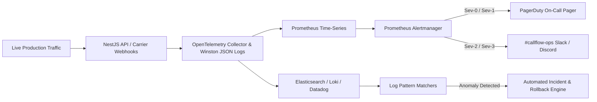

# CallFlow Production Regression Signals & Post-Deployment Monitoring Runbook

**Document ID:** `MON-REG-2026-P24`  
**Phase:** `CallFlow P2.4 Production Hardening`  
**Status:** `ACTIVE / PRODUCTION`  
**Target Systems:** CallFlow Telephony Engine, Commercial Settlement Pipeline, Wallet Ledger, NestJS API Gateway, PostgreSQL 16 Cluster

---

## 1. Executive Summary & Telemetry Architecture

In a real-time carrier telephony and high-frequency commercial routing system, subtle regressions (such as an off-by-one concurrency calculation, a dropped database lock, or an authorization check bypass) may not trigger outright application crashes. Instead, they manifest as degraded call completion rates, silent balance drift, delayed settlement generation, or localized cross-tenant leakage.

This specification establishes the **canonical telemetry signals, Prometheus metric definitions, structured log signatures, and alert thresholds** required to detect any post-deployment regression within **60 seconds** of emergence.



### 1.1 Mandatory Structured Log Format
All backend services in `apps/api` emit structured JSON to stdout containing standard context bindings:

```json
{
  "timestamp": "2026-11-23T12:04:15.123Z",
  "level": "warn",
  "message": "Waterfall routing exhausted without destination",
  "context": "RoutingEngineService",
  "trace_id": "c1f8a709-34b2-4d51-9e28-1b2c3d4e5f6a",
  "span_id": "7a8b9c0d1e2f3a4b",
  "workspace_id": "ws_live_99887766",
  "call_id": "call_1122334455",
  "carrier_call_control_id": "v3:abcdef1234567890",
  "buyer_id": "byr_44556677",
  "vendor_id": "vnd_88990011",
  "duration_ms": 42
}
```

---

## 2. Domain-Specific Regression Signals

### 2.1 Domain A: Telephony & Call Flow Routing Signals

The telephony subsystem processes live carrier calls via Telnyx and Twilio webhooks. Post-deployment regressions typically manifest as signaling drop-offs, bridge failures, or routing exhaustion.

| Signal Name | Metric / Metric Type | Source Component | Severity | Description & Failure Mode |
|---|---|---|---|---|
| **Call Completion Drop** | `callflow_call_completion_ratio` (Gauge, 0.0 - 1.0) | `CallsService` | **Sev-0** | Ratio of `COMPLETED` calls over total `INITIATED` calls over 5m rolling window. Normal: > 0.85. Regressed: < 0.70 indicates carrier signaling or routing breakdown. |
| **Carrier Webhook Ingestion Failures** | `callflow_carrier_webhook_errors_total` (Counter) | `WebhooksController` | **Sev-0** | Rate of HTTP 4xx/5xx responses returned to Telnyx/Twilio webhooks. Any value > 0.5% indicates invalid signatures, DTO rejections, or unhandled exceptions. |
| **Waterfall Routing Exhaustion Spike** | `callflow_waterfall_overflow_abort_total` (Counter) | `RoutingEngineService` | **Sev-1** | Calls that evaluated all campaign buyer routes and reached no viable destination due to buyer cap miscalculations or priority misconfigurations. |
| **Bridge Establishment Latency** | `callflow_bridge_latency_seconds` (Histogram) | `TelephonyProviderService` | **Sev-1** | P95/P99 latency from call answer to bridge establishment. P99 > 2.5s indicates socket congestion or provider throttling. |
| **SIP Error Code Distribution** | `callflow_sip_response_codes_total{code}` (Counter) | `CallsService` | **Sev-1** | Sudden surge in SIP 500 (Server Internal Error), SIP 503 (Service Unavailable), or SIP 486 (Busy Here) indicating premature buyer capacity exhaustion. |

#### Critical Telephony Log Signatures
- `[REGRESSION-TEL-01]` `"Failed to transition call state: invalid transition from COMPLETED"`
- `[REGRESSION-TEL-02]` `"Carrier webhook signature validation failed for provider telnyx"`
- `[REGRESSION-TEL-03]` `"Buyer concurrency cap exceeded after reservation: race condition detected"`
- `[REGRESSION-TEL-04]` `"Waterfall routing candidate list empty for campaign"`

---

### 2.2 Domain B: Financial, Billing & Settlement Integrity Signals

CallFlow maintains financial invariants across prepaid wallets, buyer charges, vendor payouts, and commercial settlements. Financial regressions are strictly zero-tolerance.

| Signal Name | Metric / Metric Type | Source Component | Severity | Description & Failure Mode |
|---|---|---|---|---|
| **Wallet Negative Balance Anomaly** | `callflow_wallet_negative_balance_count` (Gauge) | `BillingService` / `WalletLedger` | **Sev-0** | Count of wallets where `balance < 0.00`. MUST STRICTLY EQUAL 0 AT ALL TIMES. Any count > 0 indicates missing row locks or unchecked debit race conditions. |
| **Wallet Reservation Rollback Spike** | `callflow_wallet_reservation_rollback_total` (Counter) | `BillingService` | **Sev-1** | Rate of balance holds being rolled back due to abandoned, unbridged, or failed calls. Normal: < 5% of holds. Regressed: > 20% indicates routing bridge failures. |
| **168-Hour Maturity Backlog Drift** | `callflow_commercial_unbilled_anomaly_total` (Gauge) | `CommercialFinalizationService` | **Sev-1** | Count of commercial call records created > 168 hours ago that remain in `PENDING` state. Any backlog > 100 indicates cron/job execution failure. |
| **Settlement Item Unique Violation** | `callflow_settlement_unique_constraint_violation_total` (Counter) | `SettlementBatchService` | **Sev-0** | Database unique constraint violations (`23505`) on `SettlementItem @@unique([call_commercial_id, participant_type])` or `SettlementBatch @@unique([workspace_id, batch_number])`. Proves duplicate batch generation. |
| **Commercial Dispute Rate Surge** | `callflow_dispute_creation_rate` (Gauge) | `CommercialDisputesService` | **Sev-1** | Ratio of disputed calls vs total finalized calls. An increase of > 300% over baseline indicates improper billable duration calculation or inaccurate buyer rates. |

#### Critical Financial Log Signatures
- `[REGRESSION-FIN-01]` `"CRITICAL: Wallet balance invariant violated: balance is negative"`
- `[REGRESSION-FIN-02]` `"Unique constraint violation on SettlementItem [call_commercial_id, participant_type]"`
- `[REGRESSION-FIN-03]` `"Duplicate settlement batch generated for workspace"`
- `[REGRESSION-FIN-04]` `"Zero-cost commercial record encountered with non-zero duration"`

---

### 2.3 Domain C: Multi-Tenant Security, BOLA & Authorization Signals

CallFlow partitions all operations by workspace. Any breach or bypass of tenant isolation constitutes a catastrophic regression.

| Signal Name | Metric / Metric Type | Source Component | Severity | Description & Failure Mode |
|---|---|---|---|---|
| **Cross-Tenant Access Rejection Spike** | `callflow_cross_tenant_access_attempt_total` (Counter) | `TenantIsolationInterceptor` | **Sev-0** | Rate of requests attempting to query or mutate an entity with a mismatched `workspace_id`. A post-deploy spike indicates frontend URL generation or routing ID leakage. |
| **HTTP 403 Forbidden Rate Anomaly** | `callflow_auth_forbidden_403_rate` (Gauge) | `PermissionsGuard` | **Sev-1** | Sudden increase in 403 Forbidden responses (> 2% of total API requests). Indicates broken RBAC permission matrix or invalid JWT role claims. |
| **DTO Mass Assignment Stripping Rate** | `callflow_validation_pipe_rejection_total` (Counter) | `SafeValidationPipe` | **Sev-1** | Volume of requests containing forbidden or unwhitelisted fields (e.g. `workspace_id`, `balance`, `role`). High volume indicates frontend DTO regression. |
| **Owner Privilege Escalation Deflection** | `callflow_privilege_escalation_attempt_total` (Counter) | `WorkspaceMembersService` | **Sev-0** | Attempts by non-owners to assign `OWNER` role or self-promote permissions. |

#### Critical Security Log Signatures
- `[REGRESSION-SEC-01]` `"BOLA/IDOR Deflected: Entity workspace_id does not match authenticated token workspace_id"`
- `[REGRESSION-SEC-02]` `"Mass-assignment violation: stripped non-whitelisted payload property"`
- `[REGRESSION-SEC-03]` `"Forbidden role escalation attempt detected from user"`

---

### 2.4 Domain D: Database & Concurrency Signals

PostgreSQL performance directly determines telephony throughput and financial safety. Regressions in index usage, transaction locks, or connection pooling must be flagged immediately.

| Signal Name | Metric / Metric Type | Source Component | Severity | Description & Failure Mode |
|---|---|---|---|---|
| **PostgreSQL Deadlock Count** | `pg_stat_database_deadlocks` (Counter) | PostgreSQL Engine | **Sev-0** | Any deadlock occurrences in transaction workflows (wallet reservation vs call completion). Normal: 0 deadlocks/hour. Regressed: > 1 deadlock in 5m window. |
| **Prisma Connection Pool Wait Time** | `callflow_prisma_connection_pool_waiting` (Gauge) | `PrismaClient` | **Sev-1** | Number of concurrent queries stalled waiting for an available connection from the pool. Threshold: > 15 waiting connections for > 15 seconds. |
| **P99 Database Query Latency** | `callflow_db_query_duration_p99_ms` (Gauge) | `PrismaInstrumentation` | **Sev-1** | P99 latency of queries on `calls`, `call_commercial`, or `wallets`. P99 > 350ms indicates missing composite index or sequential table scan regression. |
| **Transaction Lock Timeout Rate** | `callflow_db_lock_timeout_total` (Counter) | PostgreSQL Engine | **Sev-0** | Queries aborted due to `statement_timeout` or `lock_timeout` during row-level locking (`FOR UPDATE`). |

---

## 3. Prometheus Alert Rule Definitions

The following alert rules are committed to Prometheus Alertmanager configuration (`deploy/prometheus/alerts.yml`):

```yaml
groups:
  - name: callflow_post_deploy_regression_alerts
    rules:
      - alert: CallFlowCallCompletionRegression
        expr: (sum(rate(callflow_calls_completed_total[5m])) / sum(rate(callflow_calls_initiated_total[5m]))) < 0.70
        for: 2m
        labels:
          severity: critical
          tier: telephony
        annotations:
          summary: "Inbound call completion dropped below 70%"
          description: "Call completion ratio is {{ $value | humanizePercentage }}, indicating severe telephony or routing regression."

      - alert: CallFlowWalletNegativeBalanceDetected
        expr: callflow_wallet_negative_balance_count > 0
        for: 0s
        labels:
          severity: page
          tier: financial
        annotations:
          summary: "CRITICAL: Negative wallet balance detected"
          description: "{{ $value }} wallets currently have a negative balance. Immediate rollback required."

      - alert: CallFlowSettlementUniqueConstraintViolation
        expr: rate(callflow_settlement_unique_constraint_violation_total[5m]) > 0
        for: 0s
        labels:
          severity: page
          tier: financial
        annotations:
          summary: "Settlement item or batch duplicate generation detected"
          description: "Database unique violation 23505 encountered during settlement processing."

      - alert: CallFlowPostgresDeadlockSpike
        expr: rate(pg_stat_database_deadlocks[5m]) > 0.05
        for: 1m
        labels:
          severity: critical
          tier: database
        annotations:
          summary: "PostgreSQL deadlocks detected in production"
          description: "Deadlock rate has reached {{ $value }} deadlocks/sec, indicating concurrent lock order inversion."

      - alert: CallFlowCrossTenantBOLAAttemptSpike
        expr: rate(callflow_cross_tenant_access_attempt_total[5m]) > 0.1
        for: 2m
        labels:
          severity: critical
          tier: security
        annotations:
          summary: "High volume of cross-tenant resource access rejections"
          description: "Cross-tenant BOLA defenses triggered {{ $value }} times/sec, possible frontend routing regression."
```

---

## 4. Post-Deployment Verification (Smoke Testing) Runbook

Following any production deployment, the engineering on-call must execute the following 5-step smoke test sequence within the first **10 minutes**:

### Step 1: Healthcheck and Service Readiness
Verify that all API instances are live and report healthy database connectivity:
```bash
curl -f -s https://api.callflow.io/health | jq .
# Expected output:
# {
#   "status": "ok",
#   "database": "connected",
#   "migrations": "current",
#   "version": "<deployed_git_sha>"
# }
```

### Step 2: Database Migration Status Audit
Confirm zero pending or unapplied Prisma migrations on the live production cluster:
```bash
npx prisma migrate status --schema=prisma/schema.prisma
# Expected output:
# Database schema is up to date!
```

### Step 3: Synthetic Telephony Signaling Smoke Test
Inject a synthetic provider test webhook simulating an inbound call state lifecycle:
```bash
# 1. Simulate Inbound Call Initiation
curl -X POST https://api.callflow.io/webhooks/v1/telnyx \
  -H "Content-Type: application/json" \
  -H "Telnyx-Signature-Ed25519: <synthetic_test_sig>" \
  -d '{
    "data": {
      "event_type": "call.initiated",
      "id": "syn_evt_001",
      "payload": {
        "call_control_id": "syn_ctrl_smoke_001",
        "from": "+15550001111",
        "to": "+15550002222",
        "direction": "inbound"
      }
    }
  }'
# Expected: HTTP 200 OK
```

### Step 4: Synthetic Wallet Hold & Atomic Balance Verification
Verify that wallet balance holds and releases operate with atomic integrity:
```bash
# Query test workspace wallet balance before and after synthetic hold
curl -X GET https://api.callflow.io/v1/wallets/smoke-test-wallet \
  -H "Authorization: Bearer <smoke_test_admin_jwt>"
# Verify balance is unchanged and holds are cleanly released
```

### Step 5: Automated Canary Validation Gate
- Route 10% of production traffic to the new container revision for 10 minutes.
- Continuously monitor the Prometheus Alert Dashboard for triggers on `callflow_call_completion_regression` or `callflow_wallet_negative_balance_count`.
- If zero alert triggers occur during the canary window, promote revision to 100% traffic.
- If ANY Sev-0 or Sev-1 alert fires, initiate the instant rollback sequence documented in `docs/engineering/REGRESSION_PREVENTION_POLICY.md`.
