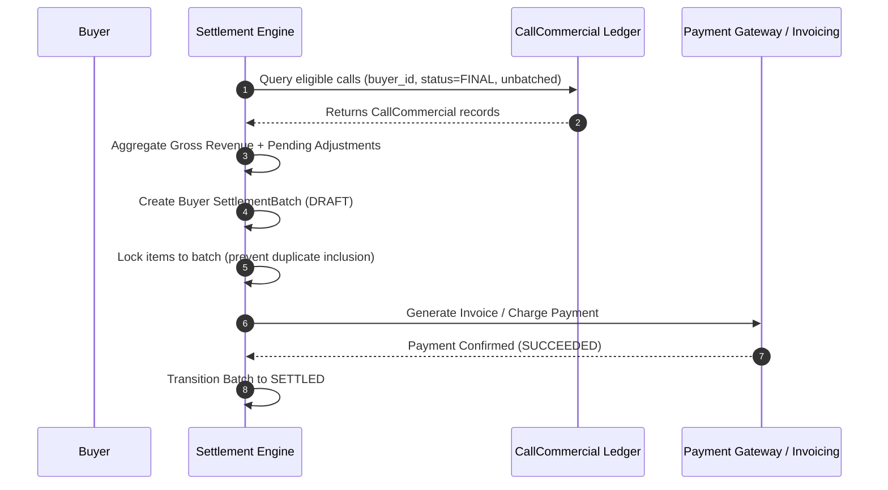
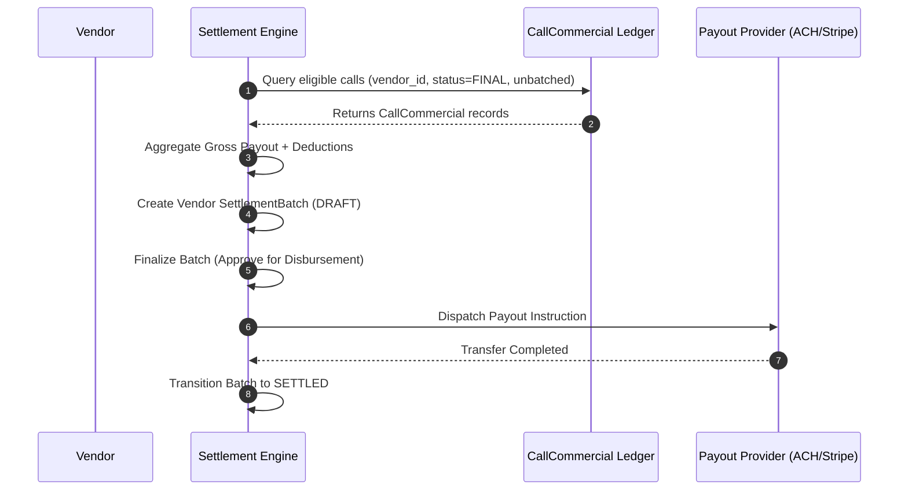
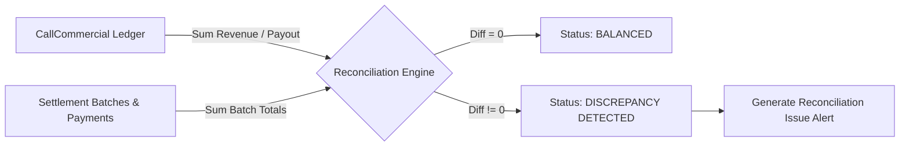
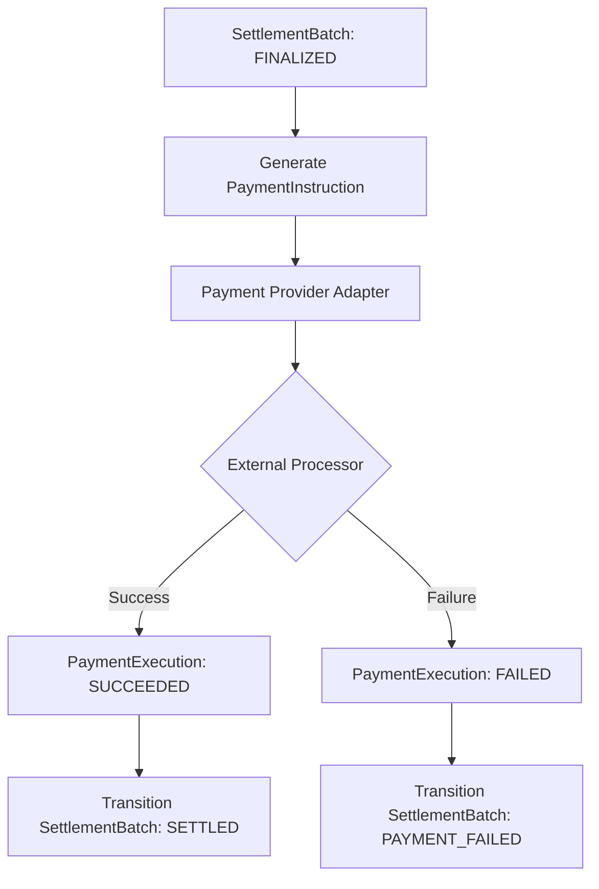
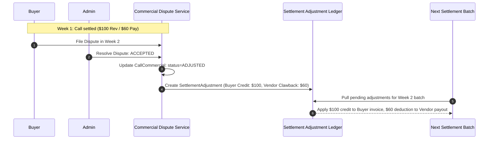

# COMM-10 — Settlement Architecture & Specification

## 1. Executive Summary

This specification establishes the architectural blueprint for the future settlement and reconciliation subsystem in CallFlow. Rooted in the frozen commercial foundation established across stages **COMM-1 through COMM-9** (authoritative baseline commit `9e15867`), this document defines how financial settlement and balance reconciliation operate without modifying the existing commercial ledger or violating accepted multi-tenant and participant privacy boundaries.

### Core Architecture Principles
1. **Separation of Economic Truth and Settlement Execution**: `CallCommercial` is the historical economic ledger of call outcomes. The future settlement layer is a downstream operational execution ledger that aggregates and settles these outcomes. `CallCommercial` is never modified or converted into a payment transaction.
2. **Two Independent Financial Streams**: Buyer billing (accounts receivable) and Vendor disbursement (accounts payable) are decoupled. Inbound buyer collections and outbound vendor payouts have independent lifecycles, schedules, and reconciliation paths.
3. **Immutability and Auditability**: Finalized commercial snapshots, closed settlement batches, and executed payment transactions are immutable. Post-settlement adjustments do not rewrite history; they generate discrete, forward-offsetting ledger entries.
4. **Zero Float Drift & Currency Segregation**: All calculations rely on exact `Decimal(12, 4)` arithmetic. All settlement batches and reconciliation runs are strictly single-currency; cross-currency conversion is explicitly deferred.

---

## 2. Current Commercial Ledger

### Economic Model
CallFlow functions as a commercial platform intermediary:
$$\text{Revenue} = \text{Amount charged to Buyer}$$
$$\text{Payout} = \text{Amount owed to Vendor}$$
$$\text{Cost} = \text{Operational carrier usage cost (CALL\_SETTLEMENT transaction)}$$
$$\text{Profit} = \text{Revenue} - \text{Payout} - \text{Cost}$$

### Authoritative Ledger Entities
- **`CallCommercial`**: Persists the immutable snapshot of a call's economics upon transition to `CallState.COMPLETED`. Contains: `workspace_id`, `call_id` (`@unique`), `campaign_id`, `vendor_id`, `buyer_id`, `qualified`, `converted`, `duplicate`, `revenue`, `payout`, `cost`, `profit`, `currency`, `status` (`PENDING`, `FINAL`, `ADJUSTED`), and `finalizes_at`.
- **`CallDispute`**: Tracks buyer dispute challenges (`PENDING`, `ACCEPTED`, `REJECTED`). Exactly one dispute per `CallCommercial` (`@unique` on `call_commercial_id`).
- **`CallFinancialAdjustment`**: Generated on dispute acceptance. Preserves `original_revenue`, `original_payout`, `adjusted_revenue` (`0.0000`), `adjusted_payout` (`0.0000`), and `reason`.
- **Delete Protection**: `Call -> CallCommercial` relation is strictly `onDelete: Restrict`. Historical commercial records cannot be deleted via upstream cascading.

---

## 3. Settlement vs Commercial Ledger

A fundamental boundary separates the commercial ledger from the settlement engine:

| Characteristic | Commercial Ledger (`CallCommercial`) | Settlement Subsystem (Future) |
| :--- | :--- | :--- |
| **Domain** | Call-level economic event | Financial batch aggregation & cash flow |
| **Trigger** | Immediate call completion & hangup | Periodic scheduled batch or manual trigger |
| **Granularity** | Single call transaction | Aggregated participant period (e.g. 500 calls) |
| **Parties** | Intermediary calculation (Rev, Pay, Cost) | Bilateral: CallFlow ↔ Buyer OR CallFlow ↔ Vendor |
| **Modification** | Immutable except via formal dispute | Immutable once finalized / executed |
| **Role** | Source of economic truth | Operational execution of payment transfers |

```mermaid
flowchart TD
    subgraph Commercial Ledger [Commercial Ledger (COMM-3 to COMM-8)]
        A[Inbound Call Completed] --> B[Operational Billing CALL_SETTLEMENT]
        B --> C[Commercial Evaluation]
        C --> D[CallCommercial Snapshot Created: PENDING]
        D -.->|If Disputed| E[Dispute Resolution: ACCEPTED / REJECTED]
        E -.->|If Accepted| F[CallFinancialAdjustment Created: ADJUSTED]
    end

    subgraph Settlement Subsystem [Settlement Subsystem (Future)]
        D -->|Eligibility Verification| G[Eligible Commercial Records]
        F -->|Eligibility Verification| G
        G --> H[Settlement Batch Generation]
        H --> I[Payment Instruction & Execution]
        I --> J[Post-Payment Reconciliation]
    end
```

---

## 4. Settlement Eligibility

### Analysis of States
A `CallCommercial` record is eligible for inclusion in a settlement batch if and only if it satisfies all of the following criteria:

1. **Workspace Scope**: Belongs to the target `workspace_id`.
2. **Attribution**:
   - For Buyer Settlement: `buyer_id` is NOT NULL and matches target Buyer.
   - For Vendor Settlement: `vendor_id` is NOT NULL and matches target Vendor.
3. **Currency**: Matches the target settlement batch currency.
4. **Commercial Finality**:
   - `status` MUST be `FINAL` OR (`PENDING` with `finalizes_at <= NOW()` and no open dispute).
   - If an open dispute exists (`CallDispute.status === 'PENDING'`), the record is **INELIGIBLE** for settlement until the dispute is resolved.
   - If `status === 'ADJUSTED'`, it is eligible only for dispute adjustment reconciliation (net 0 revenue/payout).
5. **Settlement Uniqueness**: The record has NOT been included in any active or completed settlement batch (`settlement_item_id IS NULL`).

### Eligibility Decision
- **Recommendation**: Introduce an explicit settlement lock when a record is assigned to a draft batch. Records with an open dispute cannot be locked into a settlement batch.

---

## 5. Settlement Period

### Purpose & Structure
A settlement period represents a defined time boundary (e.g., Weekly: Monday 00:00:00 to Sunday 23:59:59 UTC) for aggregating commercial records.

### Architectural Rules
- **Workspace-Specific**: Each workspace configures its settlement cadence based on its commercial agreements.
- **Asymmetric Buyer/Vendor Cadence**: Buyer billing (e.g., Daily or Weekly invoicing) does NOT need to align with Vendor payout cadence (e.g., Bi-weekly or Net-30). They are completely independent.
- **Strict UTC Canonicalization**: All period boundaries are evaluated in UTC. Timezones are applied as presentation offsets only.
- **Currency Isolation**: A settlement period contains distinct batches partitioned by currency. A single period in a workspace with USD and EUR traffic yields two separate Buyer batches and two separate Vendor batches.
- **Closed Period Immutability**: Once a settlement period is marked `CLOSED` or `FINALIZED`, no new records can be inserted into it. Late-arriving or late-finalized records roll forward into the next open period.

---

## 6. Settlement Batch

A `SettlementBatch` represents an atomic financial aggregation of commercial items for a specific participant over a period.

### Batch Schema Requirements
- `id` (UUID, Primary Key)
- `workspace_id` (UUID, Foreign Key)
- `participant_type` (`BUYER` | `VENDOR`)
- `buyer_id` (UUID, Nullable, Foreign Key)
- `vendor_id` (UUID, Nullable, Foreign Key)
- `period_start` (Timestamp)
- `period_end` (Timestamp)
- `currency` (String, ISO 4217)
- `gross_amount` (Decimal 12,4) — Sum of call revenues (Buyer) or payouts (Vendor)
- `adjustments_amount` (Decimal 12,4) — Sum of dispute adjustments and carry-forward balances
- `net_amount` (Decimal 12,4) — $\text{gross\_amount} + \text{adjustments\_amount}$
- `item_count` (Integer) — Total commercial calls included
- `status` (`DRAFT`, `FINALIZED`, `PROCESSING`, `SETTLED`, `FAILED`, `CANCELED`)
- `finalized_at` (Timestamp, Nullable)
- `settled_at` (Timestamp, Nullable)
- `created_at` / `updated_at` (Timestamps)

---

## 7. Buyer Settlement

### Lifecycle & Mechanics
Buyer settlement collects accounts receivable owed to CallFlow for converted calls delivered to that buyer.



### Business Rules
1. **Gross Revenue Calculation**: Sum of `CallCommercial.revenue` for converted calls.
2. **Pre-Settlement Disputes**: Calls under active dispute are held back. If rejected before batch generation, they are included. If accepted, they contribute `0.0000` revenue.
3. **Negative Balances**: If previous period credits exceed current gross revenue, the batch net amount is negative or zero. In V1, net credits roll forward as an offset against future batches rather than automated reverse payments.

---

## 8. Vendor Settlement

### Lifecycle & Mechanics
Vendor settlement disburses accounts payable owed by CallFlow to vendors for traffic delivered.



### Business Rules
1. **Gross Payout**: Derived exclusively from `CallCommercial.payout`.
2. **Independent Execution**: Vendor payouts are scheduled independently of buyer collection receipts. CallFlow guarantees platform solvency; vendor disbursement does not wait for individual buyer payment clearing.
3. **Negative Payout Batches**: If adjustments (e.g. clawbacks from accepted post-settlement disputes) exceed gross payout, the batch net amount is negative. **Negative disbursements are blocked**; the negative balance rolls forward as a deduction on subsequent vendor batches.

---

## 9. Cost and Profit Treatment

### Core Accounting Boundaries
1. **CallFlow Cost (`CallCommercial.cost`)**:
   - Represents platform carrier usage costs (Telnyx/Twilio SIP minutes, numbers, recording).
   - **Cost NEVER participates in Buyer settlement**: Buyers are invoiced for negotiated call revenue; operational costs are an internal intermediary liability.
   - **Cost NEVER participates in Vendor settlement**: Vendors are paid their agreed payout; operational expenses are not deducted from vendors.
2. **CallFlow Profit (`CallCommercial.profit`)**:
   - Profit ($\text{Revenue} - \text{Payout} - \text{Cost}$) is an **internal accounting and reporting metric**.
   - Profit is **never settled to external participants**. It represents platform gross margin recognized upon settlement execution.

---

## 10. Reconciliation Model

Reconciliation verifies that commercial ledger events and settlement executions match with zero drift.



### The 4 Reconciliation Invariants
1. **Call-Level Invariant**: Every `CallCommercial` record is in exactly one of three states:
   - `UNSETTLED`: Eligible or pending, not yet in any batch.
   - `BATCHED`: Assigned to exactly one open or processing batch.
   - `SETTLED`: Assigned to a finalized, paid batch.
2. **Buyer Reconciliation**:
   $$\sum \text{CallCommercial.revenue}_{\text{batch}} = \text{Batch Gross Revenue}$$
   $$\text{Batch Net Amount} = \text{Batch Gross Revenue} + \text{Prior Adjustments}$$
3. **Vendor Reconciliation**:
   $$\sum \text{CallCommercial.payout}_{\text{batch}} = \text{Batch Gross Payout}$$
   $$\text{Batch Net Amount} = \text{Batch Gross Payout} - \text{Clawback Adjustments}$$
4. **Ledger Balance**:
   $$\sum \text{Revenue}_{\text{settled}} - \sum \text{Payout}_{\text{settled}} - \sum \text{Cost}_{\text{settled}} = \sum \text{Recognized Platform Profit}$$

---

## 11. Idempotency / Double-Count Protection

To prevent double counting or duplicate disbursements:
1. **Unique Relational Link**: A future join table `settlement_items` will enforce a `@unique` constraint on `call_commercial_id`. A call can never belong to more than one active settlement batch.
2. **Batch Transition Atomicity**: Batch generation and status changes are wrapped in database transactions using `SERIALIZABLE` or `FOR UPDATE` row locks.
3. **Payment Execution Idempotency**: Payment instructions dispatched to external providers use deterministic idempotency keys:
   $$\text{IdempotencyKey} = \text{hash}(\text{workspace\_id} + \text{batch\_id} + \text{batch\_version} + \text{attempt\_number})$$
4. **Retry Protection**: Retrying a failed payment reuses the existing batch identity with an incremented execution attempt counter, preventing duplicate external transfer requests.

---

## 12. Partial Settlement Decision

### Analysis
- **Call-Level Selection**: In V1, batch generation is all-or-nothing for eligible calls within a period. Operators may exclude specific calls before batch finalization, but individual calls are either settled in full or not at all.
- **Payment-Level Partial Execution**: If a buyer makes a partial payment on an invoice, or a bank transfer partially fails:
  - Splitting individual calls across settlement records introduces substantial ledger complexity.
- **Recommendation**: **EXPLICITLY DEFERRED for V1**.
  - A settlement batch is either fully settled or remains in an unsettled/processing state.
  - Partial buyer payments are handled as accounts receivable on-account credits rather than partial call adjustments.

---

## 13. Payment Execution Boundary

The payment execution layer bridges internal settlement batches to external financial processors (e.g., Stripe, ACH, Modern Treasury):



### Separation of Concerns
- The settlement engine generates an immutable `PaymentInstruction`.
- The processor adapter dispatches the call with an idempotency key.
- Provider responses and webhook callbacks update `PaymentExecution` records without directly mutating `CallCommercial`.

---

## 14. Payment State Model

A clear decoupling exists between Batch status, Payment status, and Reconciliation status:

```
┌─────────────────────────────────┐
│ Settlement Batch Status         │
│ DRAFT -> FINALIZED -> SETTLED   │
└────────────────┬────────────────┘
                 │ triggers
┌────────────────▼────────────────┐
│ Payment Execution Status        │
│ PENDING -> PROCESSING -> SUCCEEDED / FAILED
└────────────────┬────────────────┘
                 │ feeds
┌────────────────▼────────────────┐
│ Reconciliation Status           │
│ UNRECONCILED -> RECONCILED / DISCREPANCY
└─────────────────────────────────┘
```

---

## 15. Post-Settlement Disputes

### The Problem
A call is settled in Week 1 (Buyer paid \$100, Vendor received \$60). In Week 2, a Buyer dispute is filed and **ACCEPTED**.
Under frozen COMM-5 rules:
- `CallCommercial.revenue = 0.0000`
- `CallCommercial.payout = 0.0000`
- `CallCommercial.status = ADJUSTED`
- `CallFinancialAdjustment` created with original vs adjusted amounts.

### The Post-Settlement Resolution Architecture
1. **Never Mutate Historical Settlements**: The Week 1 settlement batch and its completed bank transfers remain untouched.
2. **Forward Ledger Offset**:
   - **Buyer Side**: An account credit of \$100 is generated and applied as an adjustment offset on the Buyer's **next** settlement batch (Week 2 or Week 3).
   - **Vendor Side**: A clawback deduction of \$60 is generated and applied as an adjustment deduction on the Vendor's **next** settlement batch.
3. **Audit Continuity**: The adjustment links directly to `CallFinancialAdjustment.id` and the original `SettlementBatch.id`.



---

## 16. Adjustments / Reversals

| Term | Architectural Definition | Application in CallFlow |
| :--- | :--- | :--- |
| **Original Settlement** | Initial payment/collection of an unadjusted batch | Standard batch settlement |
| **Adjustment** | Forward-looking credit or debit applied to a future batch | Primary dispute remedy |
| **Reversal** | Voiding an unexecuted or draft settlement batch | Canceled draft batches |
| **Refund** | Direct cash return to buyer outside the batch schedule | Exception handling only |
| **Credit** | Balance owed to participant reducing future obligations | Buyer dispute recovery |
| **Clawback** | Deduction from vendor reducing future disbursements | Vendor dispute recovery |

---

## 17. Currency Model

### Rules
1. **Single-Currency Batches**: Every `SettlementBatch` enforces a single ISO 4217 currency.
2. **No Implicit Conversion**: Calls evaluated in USD can only be batched with USD calls. EUR calls are batched separately.
3. **Partitioned Invoicing**: Multi-currency participants receive separate invoices and payouts per currency.
4. **No Foreign Exchange (FX) in V1**: Cross-currency settlement and conversion rates are strictly deferred.

---

## 18. Immutability Rules

1. **Commercial Snapshot**: Immutable once evaluated, except for status transition to `ADJUSTED` and revenue/payout zeroing upon formal dispute acceptance.
2. **Finalized Settlement Batch**: Once marked `FINALIZED`, line items cannot be added, edited, or removed.
3. **Payment Execution**: Provider transaction records are append-only.
4. **Audit Logs**: Adjustment records and reconciliation reports are strictly permanent and cannot be deleted or modified.

---

## 19. Audit Requirements

All settlement actions must produce entries in `SecurityAuditLog`:
- `settlement.batch.created`: User, workspace, batch ID, participant, initial amount.
- `settlement.batch.finalized`: User, workspace, batch ID, total gross/net amounts.
- `settlement.payment.dispatched`: User/system, provider, instruction ID, idempotency key.
- `settlement.payment.completed`: Provider transaction ID, settlement timestamp.
- `settlement.payment.failed`: Error code, failure reason, retry eligibility.
- `settlement.adjustment.applied`: Adjustment ID, source dispute, target batch ID.

---

## 20. RBAC Requirements

Settlement features inherit and extend the workspace participant security model:
- **OWNER / ADMIN**: Full visibility into all Buyer and Vendor settlement batches, payment executions, and reconciliation logs. Can create, finalize, and execute settlements.
- **INTERNAL MEMBER / VIEWER**: No access to settlement batches, banking details, or financial payout data.
- **BUYER**: Strictly scoped to own settlement batches and invoices. Cannot see vendor payouts, platform costs, or platform profit.
- **VENDOR**: Strictly scoped to own payout batches. Cannot see buyer invoices, platform costs, or platform profit.

---

## 21. Future Reporting Requirements

The future settlement layer requires specialized reporting metrics:
- `unsettled_revenue`: Total revenue from finalized calls not yet batched.
- `unsettled_payout`: Total payout from finalized calls not yet batched.
- `settled_volume`: Total volume processed through finalized settlement batches.
- `outstanding_receivables`: Total invoiced buyer revenue awaiting payment confirmation.
- `pending_disbursements`: Total finalized vendor payouts scheduled for disbursement.
- `dispute_adjustments_volume`: Total volume of credits/clawbacks applied in settlement periods.
- `reconciliation_variance`: Real-time delta between commercial ledger and settlement ledger.

---

## 22. Proposed Conceptual Data Model

```
┌─────────────────────────────────┐
│ SettlementPeriod                │
│ - id                            │
│ - workspace_id                  │
│ - start_time                    │
│ - end_time                      │
│ - status (OPEN/CLOSED)          │
└────────────────┬────────────────┘
                 │ 1:N
┌────────────────▼────────────────┐       1:N      ┌──────────────────────────────┐
│ SettlementBatch                 ├────────────────► SettlementItem               │
│ - id                            │                │ - id                         │
│ - workspace_id                  │                │ - batch_id                   │
│ - participant_type              │                │ - call_commercial_id (UNIQUE)│
│ - buyer_id / vendor_id          │                │ - amount                     │
│ - currency                      │                └──────────────────────────────┘
│ - gross_amount / net_amount     │
│ - status                        │       1:N      ┌──────────────────────────────┐
└────────────────┬────────────────┼────────────────► SettlementAdjustment         │
                 │ 1:N            │                │ - id                         │
┌────────────────▼────────────────┐│                │ - batch_id                   │
│ PaymentExecution                ││                │ - call_financial_adj_id      │
│ - id                            ││                │ - amount (Credit/Debit)      │
│ - batch_id                      ││                └──────────────────────────────┘
│ - provider                      ││
│ - provider_tx_id                ││
│ - status (PENDING/SUCCESS/FAIL) ││
└─────────────────────────────────┘│
                                   │ 1:N
┌─────────────────────────────────┐│
│ ReconciliationRun               │◄
│ - id                            │
│ - workspace_id                  │
│ - matched_count                 │
│ - discrepancy_count             │
│ - status (BALANCED/DISCREPANCY) │
└─────────────────────────────────┘
```

---

## 23. V1 Settlement Scope

### Included in V1 Scope
- Manual and scheduled batch generation for eligible `CallCommercial` records.
- Independent Buyer accounts receivable and Vendor accounts payable aggregation.
- Forward-offsetting settlement adjustments for post-settlement disputes.
- Single-currency batching and reconciliation.
- Automated reconciliation verifying 100% balance between `CallCommercial` and batches.
- Comprehensive audit trail for batch creation, approval, and execution.

---

## 24. Explicitly Deferred Scope

The following features are **explicitly excluded** from V1:
- Multi-currency conversion and foreign exchange (FX) rate hedging.
- Partial settlement of individual calls or partial invoice allocations.
- Automated tax calculation, withholding, or 1099/VAT generation.
- Automated merchant collections and customer dunning/collections workflows.
- Direct general ledger / ERP integrations (NetSuite, QuickBooks).

---

## 25. Risks & Open Questions

### Risks
1. **Vendor Clawback Insolvency**: If an accepted dispute creates a vendor clawback on a vendor who has no further call volume, the platform carries an unrecoverable negative balance unless external collections or escrow holdbacks exist.
2. **Dispute Timing Race Conditions**: An open dispute filed seconds before batch generation must reliably block the record from inclusion.

### Open Decisions
- **`OPEN DECISION 1: Default Settlement Grace Period`**: What is the canonical duration before a `PENDING` commercial record auto-transitions to `FINAL` (e.g. 7 days vs 14 days)?
- **`OPEN DECISION 2: Minimum Payout Threshold`**: Should vendor payout batches enforce a minimum threshold (e.g., \$50.00) to avoid micro-transaction fees?
- **`OPEN DECISION 3: Vendor Escrow / Holdback Percentage`**: Should CallFlow withhold a rolling reserve (e.g. 5% for 30 days) from vendors to cover future dispute clawbacks?

---

## 26. Required Decision Table

| Decision | Recommendation | Reason | V1? |
| :--- | :--- | :--- | :--- |
| **Settlement Eligibility** | Require `status === FINAL` and no open dispute | Prevents settling calls subject to active buyer challenge | **YES** |
| **Settlement Period** | Workspace-configurable, UTC-canonical | Respects diverse partner payment terms with no timezone drift | **YES** |
| **Buyer Settlement** | Sourced strictly from `CallCommercial.revenue` | Decoupled accounts receivable ledger | **YES** |
| **Vendor Settlement** | Sourced strictly from `CallCommercial.payout` | Decoupled accounts payable ledger | **YES** |
| **Partial Settlement** | Defer; settle batches atomically | Avoids fractional call ledger complexity in initial release | **DEFERRED** |
| **Multi-Currency** | Strict single-currency batches; no FX | Prevents currency mixing without FX complexity | **YES** |
| **Post-Settlement Dispute** | Forward-offset adjustment on next batch | Preserves immutability of historical payments | **YES** |
| **Adjustment Model** | Link to `CallFinancialAdjustment` | Single source of truth for financial reversals | **YES** |
| **Payment Execution** | Decoupled via `PaymentInstruction` | Allows swapping payment gateways without altering data | **YES** |
| **Reconciliation** | Automated run verifying all 4 invariants | Proves zero drift and zero double-counting | **YES** |
| **Idempotency** | `@unique` on `call_commercial_id` in items | Guarantees call cannot be settled twice | **YES** |
| **Negative Settlements** | Block payout disbursement; roll forward credit | Prevents invalid reverse bank transfers | **YES** |
| **Failed Payments** | Transition to `PAYMENT_FAILED`; retry with same batch | Preserves batch identity during external gateway retries | **YES** |
| **Reopening Closed Batches** | Strictly forbidden | Essential for financial auditability and compliance | **YES** |

---

## 27. Final Architecture Verdict

**VERDICT: APPROVED SPECIFICATION**.

The commercial ledger (`CallCommercial`) established in COMM-3 through COMM-8 provides complete, unambiguous, and immutable financial foundations. The settlement architecture specified herein builds cleanly on top of this foundation without requiring schema mutations, recalculations, or architectural rework.
