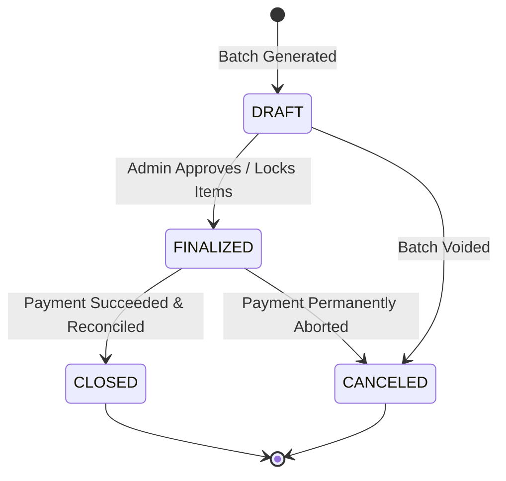
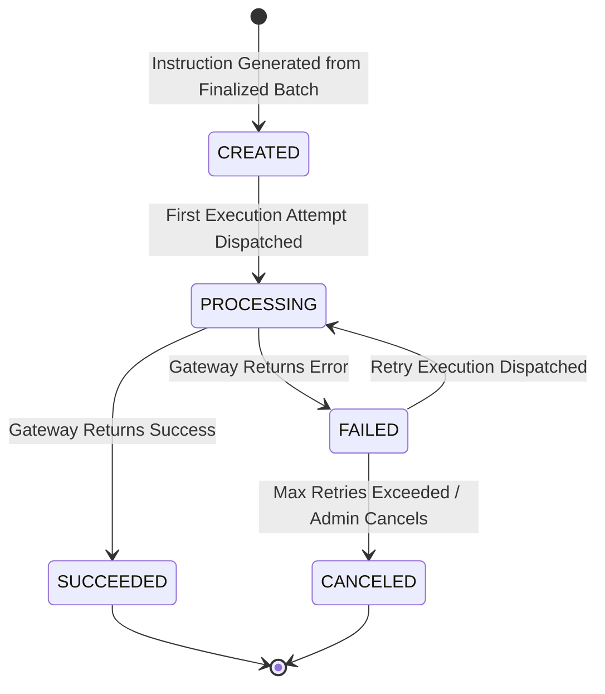
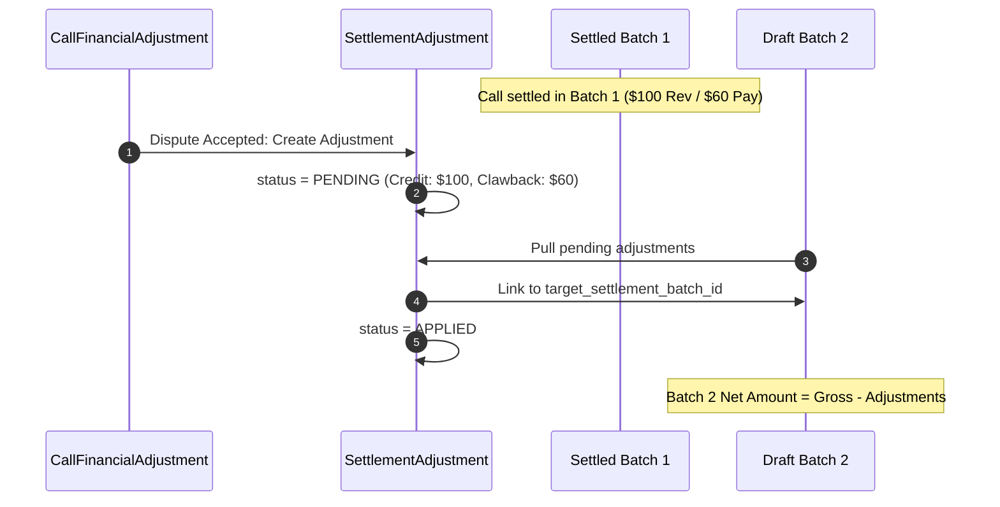

# COMM-12 — Settlement Data Model & Migration Design

## 1. Executive Summary

This document establishes the implementation-ready PostgreSQL and Prisma data model design for the CallFlow settlement and reconciliation subsystem. Rooted in the frozen commercial foundation established across stages **COMM-1 through COMM-11** (authoritative baseline commit `c348d1b`), this design translates the conceptual architecture (`COMM-10`) and frozen business rules (`COMM-11`) into an auditable, normalized relational database specification.

### Design Principles
1. **Three-Layer Separation**:
   - **Layer 1: Economic Truth** (`CallCommercial`, `CallDispute`, `CallFinancialAdjustment`) — "What happened economically?"
   - **Layer 2: Settlement Ledger** (`SettlementBatch`, `SettlementItem`, `SettlementAdjustment`) — "What aggregated amounts are being settled?"
   - **Layer 3: Payment Execution** (`PaymentInstruction`, `PaymentExecution`) — "Was money actually transferred externally?"
2. **Strict Immutability**: Historical commercial snapshots and finalized settlement batches are never mutated. Post-settlement adjustments are modeled as forward ledger adjustments on downstream batches.
3. **Tenant & Referential Safety**: Direct `workspace_id` foreign keys exist on all settlement entities. Cascade behavior is strictly `Restrict` on financial relationships to prevent accidental data loss.
4. **Normalized Participant Identity**: Explicit, nullable foreign keys (`buyer_id`, `vendor_id`) with a discriminant enum (`participant_type`) replace fragile polymorphic IDs, preserving full PostgreSQL referential integrity.

---

## 2. Source of Truth

- **Specification**: `MVP1_BUILD_SPEC_v5.md`
- **Architecture**: `docs/COMM-10-SETTLEMENT-ARCHITECTURE.md` (`edf9718`)
- **Business Rules**: `docs/COMM-11-SETTLEMENT-BUSINESS-RULES.md` (`c348d1b`)
- **Core Invariant**: `CallCommercial` remains the uncompromised historical source of economic truth. Settlement records never overwrite or recalculate `CallCommercial.revenue`, `payout`, `cost`, `profit`, `currency`, `buyer_id`, or `vendor_id`.

---

## 3. Architectural Layers

```mermaid
flowchart TD
    subgraph Layer 1: Economic Truth [Layer 1: Economic Truth (Frozen COMM-3 to COMM-8)]
        CC[CallCommercial Snapshot]
        CD[CallDispute]
        CFA[CallFinancialAdjustment]
        CC -.-> CD
        CD -.-> CFA
    end

    subgraph Layer 2: Settlement Ledger [Layer 2: Settlement Ledger (V1 Design)]
        SB[SettlementBatch]
        SI[SettlementItem]
        SA[SettlementAdjustment]
        CC -->|1:1 Immutable Snapshot| SI
        SI -->|N:1 Aggregate| SB
        CFA -->|1:1 Post-Settlement Link| SA
        SA -->|N:1 Apply to Next Batch| SB
    end

    subgraph Layer 3: Payment Execution [Layer 3: Payment Execution (V1 Design)]
        PI[PaymentInstruction]
        PE[PaymentExecution Attempt]
        SB -->|1:1 Net Payable/Receivable| PI
        PI -->|1:N Retries & History| PE
    end
```

---

## 4. Entity Evaluation

| Candidate Entity | Recommendation | Purpose & Justification |
| :--- | :--- | :--- |
| **`SettlementPeriod`** | **EMBEDDED IN V1** | Period boundaries (`period_start`, `period_end`) are stored directly on `SettlementBatch`. A separate table adds foreign-key overhead without necessity in V1. |
| **`SettlementBatch`** | **REQUIRED** | Central financial aggregate for a participant and period. Slices gross amounts, adjustments, and net payable/receivable. |
| **`SettlementItem`** | **REQUIRED** | Atomic join linking `CallCommercial` to `SettlementBatch`. Snapshots the settled amount and guarantees single-settlement uniqueness. |
| **`SettlementAdjustment`** | **REQUIRED** | Records forward credit (Buyer) or clawback (Vendor) adjustments resulting from post-settlement accepted disputes. |
| **`PaymentInstruction`** | **REQUIRED** | Decoupled abstraction representing the intent to collect from a Buyer or disburse to a Vendor. |
| **`PaymentExecution`** | **REQUIRED** | Represents an actual external gateway execution attempt. Supports 1:N retry attempts without overwriting historical failures. |
| **`ReconciliationRun`** | **OPTIONAL / LIGHTWEIGHT** | Persists periodic automated balance audits and reconciliation verification runs. |
| **`ReconciliationIssue`** | **OPTIONAL / LIGHTWEIGHT** | Captures specific itemized discrepancies detected during a reconciliation run. |

---

## 5. SettlementPeriod

### Evaluation
In V1, recurring automated crons are not implemented. Batches are generated for specific date ranges (e.g., Weekly Mon-Sun UTC).
- **V1 Design**: Period boundaries are embedded directly into `SettlementBatch` via `period_start` and `period_end` timestamps (UTC canonical).
- **Future Extensibility**: A dedicated `SettlementPeriod` table can be added in a future recurring schedule stage without migrating or breaking `SettlementBatch`.

---

## 6. SettlementBatch

The central settlement entity representing aggregated financial obligations.

### Fields & Schema Design
- `id`: UUID (Primary Key)
- `workspace_id`: UUID (Foreign Key $\to$ `workspaces.id`, `onDelete: Cascade`)
- `batch_number`: String (Human-readable sequential identifier, e.g., `SB-202610-0012`)
- `participant_type`: Enum `SettlementParticipantType` (`BUYER` | `VENDOR`)
- `buyer_id`: UUID (Nullable, Foreign Key $\to$ `buyers.id`, `onDelete: Restrict`)
- `vendor_id`: UUID (Nullable, Foreign Key $\to$ `vendors.id`, `onDelete: Restrict`)
- `currency`: String (ISO 4217, e.g., `USD`)
- `period_start`: Timestamp (UTC)
- `period_end`: Timestamp (UTC)
- `gross_amount`: Decimal(12, 4) — Sum of line items
- `adjustments_amount`: Decimal(12, 4) — Sum of forward adjustments applied
- `net_amount`: Decimal(12, 4) — $\text{gross\_amount} + \text{adjustments\_amount}$
- `item_count`: Int — Total calls included
- `settlement_status`: Enum `SettlementStatus` (`DRAFT`, `FINALIZED`, `CLOSED`, `CANCELED`)
- `payment_status`: Enum `PaymentStatus` (`UNPROCESSED`, `PENDING`, `SUCCEEDED`, `FAILED`, `CANCELED`)
- `reconciliation_status`: Enum `ReconciliationStatus` (`UNRECONCILED`, `RECONCILED`, `DISCREPANCY`)
- `finalized_at`: Timestamp (Nullable)
- `closed_at`: Timestamp (Nullable)
- `created_by_user_id`: String (UUID)
- `created_at`: Timestamp
- `updated_at`: Timestamp

### Database Constraints
- Check constraint: `(participant_type = 'BUYER' AND buyer_id IS NOT NULL AND vendor_id IS NULL) OR (participant_type = 'VENDOR' AND vendor_id IS NOT NULL AND buyer_id IS NULL)`.

---

## 7. SettlementItem

The atomic join table linking a single `CallCommercial` record to a `SettlementBatch`.

### Fields & Schema Design
- `id`: UUID (Primary Key)
- `workspace_id`: UUID (Foreign Key $\to$ `workspaces.id`, `onDelete: Cascade`)
- `settlement_batch_id`: UUID (Foreign Key $\to$ `settlement_batches.id`, `onDelete: Restrict`)
- `call_commercial_id`: UUID (Foreign Key $\to$ `call_commercials.id`, `onDelete: Restrict`)
- `amount`: Decimal(12, 4) — Historical snapshot: `CallCommercial.revenue` (for Buyer) or `CallCommercial.payout` (for Vendor)
- `currency`: String (ISO 4217)
- `created_at`: Timestamp

### Database Constraints & Invariants
- `@unique([call_commercial_id])`: Guarantees a `CallCommercial` can appear in **at most one** settlement item (INV-1).
- `onDelete: Restrict`: Prevents deleting a `CallCommercial` or `SettlementBatch` that has active settlement items.

---

## 8. SettlementAdjustment

Handles post-settlement dispute adjustments (credits for Buyers, clawbacks for Vendors) arising from accepted disputes on previously settled calls.

### Fields & Schema Design
- `id`: UUID (Primary Key)
- `workspace_id`: UUID (Foreign Key $\to$ `workspaces.id`, `onDelete: Cascade`)
- `call_financial_adjustment_id`: UUID (`@unique`, Foreign Key $\to$ `call_financial_adjustments.id`, `onDelete: Restrict`)
- `source_call_commercial_id`: UUID (Foreign Key $\to$ `call_commercials.id`, `onDelete: Restrict`)
- `source_settlement_batch_id`: UUID (Foreign Key $\to$ `settlement_batches.id`, `onDelete: Restrict`)
- `target_settlement_batch_id`: UUID (Nullable, Foreign Key $\to$ `settlement_batches.id`, `onDelete: Restrict`)
- `participant_type`: Enum `SettlementParticipantType` (`BUYER` | `VENDOR`)
- `buyer_id`: UUID (Nullable, Foreign Key $\to$ `buyers.id`, `onDelete: Restrict`)
- `vendor_id`: UUID (Nullable, Foreign Key $\to$ `vendors.id`, `onDelete: Restrict`)
- `direction`: Enum `AdjustmentDirection` (`CREDIT` | `CLAWBACK`)
- `amount`: Decimal(12, 4) — Positive magnitude of the adjustment
- `currency`: String (ISO 4217)
- `reason`: String
- `status`: Enum `AdjustmentStatus` (`PENDING`, `APPLIED`, `VOIDED`)
- `applied_at`: Timestamp (Nullable)
- `created_at`: Timestamp

---

## 9. PaymentInstruction

The formal bridge between the settlement ledger and external payment execution rails.

### Fields & Schema Design
- `id`: UUID (Primary Key)
- `workspace_id`: UUID (Foreign Key $\to$ `workspaces.id`, `onDelete: Cascade`)
- `settlement_batch_id`: UUID (`@unique`, Foreign Key $\to$ `settlement_batches.id`, `onDelete: Restrict`)
- `direction`: Enum `PaymentDirection` (`COLLECTION` | `DISBURSEMENT`)
- `participant_type`: Enum `SettlementParticipantType` (`BUYER` | `VENDOR`)
- `buyer_id`: UUID (Nullable, Foreign Key $\to$ `buyers.id`, `onDelete: Restrict`)
- `vendor_id`: UUID (Nullable, Foreign Key $\to$ `vendors.id`, `onDelete: Restrict`)
- `amount`: Decimal(12, 4) — Exact net amount to be charged or disbursed
- `currency`: String (ISO 4217)
- `idempotency_key`: String (`@unique`)
- `status`: Enum `InstructionStatus` (`CREATED`, `PROCESSING`, `SUCCEEDED`, `FAILED`, `CANCELED`)
- `created_at`: Timestamp
- `updated_at`: Timestamp

---

## 10. PaymentExecution

Represents an individual external payment execution attempt. Supports a 1:N relationship with `PaymentInstruction` to preserve complete retry histories.

### Fields & Schema Design
- `id`: UUID (Primary Key)
- `workspace_id`: UUID (Foreign Key $\to$ `workspaces.id`, `onDelete: Cascade`)
- `payment_instruction_id`: UUID (Foreign Key $\to$ `payment_instructions.id`, `onDelete: Restrict`)
- `attempt_number`: Int
- `provider`: String (e.g., `stripe`, `ach_manual`, `wire`)
- `provider_transaction_id`: String (Nullable, Indexed)
- `idempotency_key`: String (`@unique`)
- `amount`: Decimal(12, 4)
- `currency`: String (ISO 4217)
- `status`: Enum `ExecutionStatus` (`INITIATED`, `PROCESSING`, `SUCCEEDED`, `FAILED`)
- `failure_code`: String (Nullable)
- `failure_reason`: String (Nullable)
- `initiated_at`: Timestamp
- `completed_at`: Timestamp (Nullable)

### Database Constraints
- `@unique([payment_instruction_id, attempt_number])`: Enforces deterministic sequencing of payment attempts.

---

## 11. ReconciliationRun & 12. ReconciliationIssue

### ReconciliationRun
- `id`: UUID (Primary Key)
- `workspace_id`: UUID (Foreign Key $\to$ `workspaces.id`, `onDelete: Cascade`)
- `run_type`: Enum `ReconciliationRunType` (`BATCH_LEVEL`, `WORKSPACE_LEVEL`)
- `settlement_batch_id`: UUID (Nullable, Foreign Key $\to$ `settlement_batches.id`, `onDelete: Restrict`)
- `status`: Enum `ReconciliationStatus` (`BALANCED`, `DISCREPANCY`)
- `items_checked`: Int
- `discrepancy_count`: Int
- `created_at`: Timestamp

### ReconciliationIssue
- `id`: UUID (Primary Key)
- `reconciliation_run_id`: UUID (Foreign Key $\to$ `reconciliation_runs.id`, `onDelete: Cascade`)
- `issue_type`: Enum `ReconciliationIssueType` (`SUM_MISMATCH`, `DUPLICATE_CALL`, `CURRENCY_MISMATCH`, `MISSING_PAYMENT`)
- `description`: String
- `call_commercial_id`: UUID (Nullable)
- `expected_amount`: Decimal(12, 4) (Nullable)
- `actual_amount`: Decimal(12, 4) (Nullable)
- `created_at`: Timestamp

---

## 13. Participant Modeling Decision

### Evaluation of Options
1. **Generic Polymorphic Foreign Key (`participant_type` + `participant_id`)**:
   - *Rejected*. Relational databases and Prisma cannot enforce foreign key constraints across polymorphic columns, resulting in potential dangling IDs and broken joins.
2. **Separate Tables (`BuyerSettlementBatch` vs `VendorSettlementBatch`)**:
   - *Rejected*. Duplicates schema, indexes, payment adapters, and report models without architectural benefit.
3. **Explicit Nullable Foreign Keys (`buyer_id`, `vendor_id`) with Discriminant Enum (`participant_type`)**:
   - **SELECTED**. Supported natively by Prisma and PostgreSQL. Enables direct relational navigation (`batch.buyer`, `batch.vendor`) and standard foreign key enforcement (`onDelete: Restrict`).

---

## 14. Status Models & State Machines

### The Three Independent Status Enums

```
1. SettlementStatus:      DRAFT ────────► FINALIZED ────────► CLOSED
                            │                  │
                            └──────────────────┴────────► CANCELED

2. PaymentStatus:         UNPROCESSED ──► PENDING ──► PROCESSING ──► SUCCEEDED
                                                         │
                                                         └────────► FAILED

3. ReconciliationStatus:  UNRECONCILED ─► RECONCILED / DISCREPANCY
```

### State Machine Diagrams

#### 1. SettlementBatch Lifecycle


#### 2. PaymentInstruction & PaymentExecution Lifecycle


#### 3. Post-Settlement Dispute Flow


---

## 15. Money and Currency Model

- **Exact Decimal Precision**: All monetary values are defined as `Decimal(12, 4)` in Prisma and PostgreSQL (`NUMERIC(12, 4)`).
- **Single-Currency Isolation**: Every `SettlementBatch`, `SettlementItem`, `PaymentInstruction`, and `PaymentExecution` enforces a single ISO 4217 currency.
- **Zero Currency Conversion**: No implicit FX conversion or cross-currency aggregation occurs. Multi-currency volume is partitioned into distinct batches per currency.

---

## 16. Immutability Rules

1. **`CallCommercial`**: Remains immutable; settlement does not alter economic values.
2. **`SettlementItem`**: Read-only once inserted into a batch.
3. **`SettlementBatch`**: Once `FINALIZED`, amounts, items, and adjustments are immutable.
4. **`PaymentInstruction`**: Immutable once created.
5. **`PaymentExecution`**: Append-only log of gateway attempts.

---

## 17. Delete / Cascade Policy

| Relationship | Rule | Rationale |
| :--- | :--- | :--- |
| `Workspace -> SettlementBatch` | `CASCADE` | Full tenant cleanup upon workspace deletion. |
| `CallCommercial -> SettlementItem` | `RESTRICT` | Cannot delete commercial calls that have settlement history. |
| `SettlementBatch -> SettlementItem` | `RESTRICT` | Cannot delete a settlement batch that has itemized records. |
| `SettlementBatch -> PaymentInstruction` | `RESTRICT` | Cannot delete a batch with financial instructions. |
| `PaymentInstruction -> PaymentExecution` | `RESTRICT` | Payment execution logs are permanent audit records. |
| `Buyer / Vendor -> SettlementBatch` | `RESTRICT` | Cannot delete participants with settlement history. |

---

## 18. Tenant Isolation

Every settlement entity directly contains a mandatory `workspace_id` foreign key. Authorization queries and database indexes scope by `workspace_id`, eliminating reliance on fragile multi-hop relational joins.

---

## 19. Indexing Strategy

- `settlement_batches`: `[workspace_id, settlement_status]`, `[workspace_id, participant_type, buyer_id]`, `[workspace_id, participant_type, vendor_id]`, `[period_start, period_end]`.
- `settlement_items`: `[call_commercial_id]` (`UNIQUE`), `[settlement_batch_id]`, `[workspace_id]`.
- `settlement_adjustments`: `[workspace_id, status]`, `[buyer_id]`, `[vendor_id]`, `[call_financial_adjustment_id]` (`UNIQUE`).
- `payment_instructions`: `[settlement_batch_id]` (`UNIQUE`), `[idempotency_key]` (`UNIQUE`).
- `payment_executions`: `[payment_instruction_id]`, `[provider_transaction_id]`, `[idempotency_key]` (`UNIQUE`).

---

## 20. Idempotency Constraints

- **Single Settlement Guard**: `settlement_items.call_commercial_id` has a `@unique` constraint. A call cannot be included in more than one settlement batch.
- **Single Instruction Guard**: `payment_instructions.settlement_batch_id` has a `@unique` constraint. A batch cannot generate duplicate payment instructions.
- **Gateway Idempotency**: `payment_executions.idempotency_key` has a `@unique` constraint. Prevents duplicate provider charge/transfer execution.

---

## 21. Required Invariants

| ID | Invariant Definition | Enforcement Level |
| :--- | :--- | :--- |
| **INV-1** | A `CallCommercial` may appear in at most one `SettlementItem` for a given settlement side. | **DATABASE** (`@unique([call_commercial_id])`) |
| **INV-2** | A `SettlementItem` must belong to the same `workspace_id` as its `CallCommercial`. | **APPLICATION** (Validated at batch creation) |
| **INV-3** | `SettlementItem.currency` must equal `SettlementBatch.currency`. | **APPLICATION** (Partitioned query validation) |
| **INV-4** | `SettlementBatch.gross_amount` equals sum of immutable `SettlementItem.amount`. | **APPLICATION / AUDIT** (Verified during reconciliation) |
| **INV-5** | `SettlementBatch.net_amount` equals `gross_amount` plus/minus `SettlementAdjustment.amount`. | **APPLICATION / AUDIT** (Verified during reconciliation) |
| **INV-6** | `PaymentInstruction.amount` equals finalized `SettlementBatch.net_amount`. | **APPLICATION** (Generated from finalized batch) |
| **INV-7** | `PaymentExecution.amount` cannot exceed `PaymentInstruction.amount`. | **APPLICATION** (Validated prior to dispatch) |
| **INV-8** | No payment execution can be associated with another workspace. | **DATABASE** (`workspace_id` foreign key) |
| **INV-9** | No historical settlement/payment record is mutated because of a later dispute. | **APPLICATION** (Enforced by forward adjustment model) |
| **INV-10** | No FX conversion occurs implicitly. | **APPLICATION / DATABASE** (Single currency per batch) |

---

## 22. V1 Database Scope

### In Scope for V1
- Buyer and Vendor periodic settlement batches.
- Atomic itemization of eligible `CallCommercial` records.
- Forward settlement adjustments for post-settlement dispute reversals.
- Payment instruction and execution tracking.
- Single-currency isolation.
- Audit logging of all settlement transitions.

### Explicitly Excluded from V1
- Foreign exchange (FX) conversion tables.
- Partial settlement of individual calls.
- Automated tax withholding / 1099 calculations.
- Merchant chargeback handling engines.

---

## 23. Proposed Prisma Model

```prisma
// =========================================================================
// PROPOSED — NOT IMPLEMENTED (Documentation Design Only)
// =========================================================================

enum SettlementParticipantType {
  BUYER
  VENDOR
}

enum SettlementStatus {
  DRAFT
  FINALIZED
  CLOSED
  CANCELED
}

enum PaymentStatus {
  UNPROCESSED
  PENDING
  SUCCEEDED
  FAILED
  CANCELED
}

enum PaymentDirection {
  COLLECTION
  DISBURSEMENT
}

enum AdjustmentDirection {
  CREDIT
  CLAWBACK
}

enum AdjustmentStatus {
  PENDING
  APPLIED
  VOIDED
}

enum InstructionStatus {
  CREATED
  PROCESSING
  SUCCEEDED
  FAILED
  CANCELED
}

enum ExecutionStatus {
  INITIATED
  PROCESSING
  SUCCEEDED
  FAILED
}

enum ReconciliationStatus {
  UNRECONCILED
  RECONCILED
  DISCREPANCY
}

model SettlementBatch {
  id                    String                    @id @default(uuid())
  workspace_id          String
  batch_number          String
  participant_type      SettlementParticipantType
  buyer_id              String?
  vendor_id             String?
  currency              String
  period_start          DateTime
  period_end            DateTime
  gross_amount          Decimal                   @default(0.0000) @db.Decimal(12, 4)
  adjustments_amount    Decimal                   @default(0.0000) @db.Decimal(12, 4)
  net_amount            Decimal                   @default(0.0000) @db.Decimal(12, 4)
  item_count            Int                       @default(0)
  settlement_status     SettlementStatus          @default(DRAFT)
  payment_status        PaymentStatus             @default(UNPROCESSED)
  reconciliation_status ReconciliationStatus      @default(UNRECONCILED)
  finalized_at          DateTime?
  closed_at             DateTime?
  created_by_user_id    String
  created_at            DateTime                  @default(now())
  updated_at            DateTime                  @updatedAt

  workspace             Workspace                 @relation(fields: [workspace_id], references: [id], onDelete: Cascade)
  buyer                 Buyer?                    @relation(fields: [buyer_id], references: [id], onDelete: Restrict)
  vendor                Vendor?                   @relation(fields: [vendor_id], references: [id], onDelete: Restrict)
  items                 SettlementItem[]
  adjustments           SettlementAdjustment[]    @relation("TargetBatchAdjustments")
  source_adjustments    SettlementAdjustment[]    @relation("SourceBatchAdjustments")
  payment_instruction   PaymentInstruction?
  reconciliation_runs   ReconciliationRun[]

  @@unique([workspace_id, batch_number])
  @@index([workspace_id, settlement_status])
  @@index([workspace_id, participant_type, buyer_id])
  @@index([workspace_id, participant_type, vendor_id])
  @@index([period_start, period_end])
  @@map("settlement_batches")
}

model SettlementItem {
  id                  String          @id @default(uuid())
  workspace_id        String
  settlement_batch_id String
  call_commercial_id  String          @unique
  amount              Decimal         @db.Decimal(12, 4)
  currency            String
  created_at          DateTime        @default(now())

  workspace           Workspace       @relation(fields: [workspace_id], references: [id], onDelete: Cascade)
  batch               SettlementBatch @relation(fields: [settlement_batch_id], references: [id], onDelete: Restrict)
  commercial          CallCommercial  @relation(fields: [call_commercial_id], references: [id], onDelete: Restrict)

  @@index([workspace_id])
  @@index([settlement_batch_id])
  @@map("settlement_items")
}

model SettlementAdjustment {
  id                          String                    @id @default(uuid())
  workspace_id                String
  call_financial_adjustment_id String                    @unique
  source_call_commercial_id   String
  source_settlement_batch_id  String
  target_settlement_batch_id  String?
  participant_type            SettlementParticipantType
  buyer_id                    String?
  vendor_id                   String?
  direction                   AdjustmentDirection
  amount                      Decimal                   @db.Decimal(12, 4)
  currency                    String
  reason                      String
  status                      AdjustmentStatus          @default(PENDING)
  applied_at                  DateTime?
  created_at                  DateTime                  @default(now())

  workspace                   Workspace                 @relation(fields: [workspace_id], references: [id], onDelete: Cascade)
  financial_adjustment        CallFinancialAdjustment   @relation(fields: [call_financial_adjustment_id], references: [id], onDelete: Restrict)
  source_commercial           CallCommercial            @relation(fields: [source_call_commercial_id], references: [id], onDelete: Restrict)
  source_batch                SettlementBatch           @relation("SourceBatchAdjustments", fields: [source_settlement_batch_id], references: [id], onDelete: Restrict)
  target_batch                SettlementBatch?          @relation("TargetBatchAdjustments", fields: [target_settlement_batch_id], references: [id], onDelete: Restrict)
  buyer                       Buyer?                    @relation(fields: [buyer_id], references: [id], onDelete: Restrict)
  vendor                      Vendor?                   @relation(fields: [vendor_id], references: [id], onDelete: Restrict)

  @@index([workspace_id, status])
  @@index([buyer_id])
  @@index([vendor_id])
  @@map("settlement_adjustments")
}

model PaymentInstruction {
  id                  String                    @id @default(uuid())
  workspace_id        String
  settlement_batch_id String                    @unique
  direction           PaymentDirection
  participant_type    SettlementParticipantType
  buyer_id            String?
  vendor_id           String?
  amount              Decimal                   @db.Decimal(12, 4)
  currency            String
  idempotency_key     String                    @unique
  status              InstructionStatus         @default(CREATED)
  created_at          DateTime                  @default(now())
  updated_at          DateTime                  @updatedAt

  workspace           Workspace                 @relation(fields: [workspace_id], references: [id], onDelete: Cascade)
  batch               SettlementBatch           @relation(fields: [settlement_batch_id], references: [id], onDelete: Restrict)
  buyer               Buyer?                    @relation(fields: [buyer_id], references: [id], onDelete: Restrict)
  vendor              Vendor?                   @relation(fields: [vendor_id], references: [id], onDelete: Restrict)
  executions          PaymentExecution[]

  @@index([workspace_id, status])
  @@map("payment_instructions")
}

model PaymentExecution {
  id                     String             @id @default(uuid())
  workspace_id           String
  payment_instruction_id String
  attempt_number         Int
  provider               String
  provider_transaction_id String?
  idempotency_key        String             @unique
  amount                 Decimal            @db.Decimal(12, 4)
  currency               String
  status                 ExecutionStatus    @default(INITIATED)
  failure_code           String?
  failure_reason         String?
  initiated_at           DateTime           @default(now())
  completed_at           DateTime?

  workspace              Workspace          @relation(fields: [workspace_id], references: [id], onDelete: Cascade)
  instruction            PaymentInstruction @relation(fields: [payment_instruction_id], references: [id], onDelete: Restrict)

  @@unique([payment_instruction_id, attempt_number])
  @@index([workspace_id])
  @@index([provider_transaction_id])
  @@map("payment_executions")
}

model ReconciliationRun {
  id                  String               @id @default(uuid())
  workspace_id        String
  settlement_batch_id String?
  status              ReconciliationStatus @default(UNRECONCILED)
  items_checked       Int                  @default(0)
  discrepancy_count   Int                  @default(0)
  created_at          DateTime             @default(now())

  workspace           Workspace            @relation(fields: [workspace_id], references: [id], onDelete: Cascade)
  batch               SettlementBatch?     @relation(fields: [settlement_batch_id], references: [id], onDelete: Restrict)
  issues              ReconciliationIssue[]

  @@index([workspace_id])
  @@map("reconciliation_runs")
}

model ReconciliationIssue {
  id                    String            @id @default(uuid())
  reconciliation_run_id String
  description           String
  call_commercial_id    String?
  expected_amount       Decimal?          @db.Decimal(12, 4)
  actual_amount         Decimal?          @db.Decimal(12, 4)
  created_at            DateTime          @default(now())

  run                   ReconciliationRun @relation(fields: [reconciliation_run_id], references: [id], onDelete: Cascade)

  @@index([reconciliation_run_id])
  @@map("reconciliation_issues")
}
```

---

## 24. Proposed Migration Sequence

The future database migration sequence should be structured in three deterministic, non-breaking migrations:

### Migration 1: Core Settlement Ledger
- Create tables: `settlement_batches`, `settlement_items`.
- Add foreign keys, indexes, and unique constraints.
- Dependencies: Requires `workspaces`, `buyers`, `vendors`, `call_commercials`.

### Migration 2: Settlement Adjustments
- Create table: `settlement_adjustments`.
- Add foreign keys to `call_financial_adjustments` and `settlement_batches`.
- Dependencies: Requires Migration 1 and `call_financial_adjustments`.

### Migration 3: Payment Abstraction & Reconciliation
- Create tables: `payment_instructions`, `payment_executions`, `reconciliation_runs`, `reconciliation_issues`.
- Add indexes and provider transaction tracking.
- Dependencies: Requires Migration 1.

---

## 25. Backfill Strategy

### Zero Historical Backfill
- **Decision**: **NO HISTORICAL SETTLEMENT BACKFILL**.
- Existing `CallCommercial` rows remain unsettled.
- When the settlement subsystem is enabled, existing finalized `CallCommercial` records are pulled into initial settlement batches through the normal eligibility query ($\text{NOW()} \ge \text{finalizes\_at}$).
- No synthetic or mock settlement records are created for pre-existing calls.

---

## 26. Risks & Mitigations

1. **Long-Running Batch Aggregation**: Large batches with tens of thousands of calls could lock tables if aggregated naively.
   - *Mitigation*: Batch creation operates in chunks; line-item insertion uses batch `createMany`.
2. **Double Payout on Provider Timeout**: Network failure while calling payment provider gateway could lead to retry duplication.
   - *Mitigation*: External gateway requests enforce mandatory `idempotency_key` stored on `PaymentExecution`.
3. **Orphaned Dispute Adjustments**: An accepted dispute occurs on a vendor with zero future call volume.
   - *Mitigation*: Unapplied adjustments remain `PENDING` on platform balance sheets, visible to Admins for manual offline collection.

---

## 27. Final Architecture Verdict

**VERDICT: APPROVED DATA MODEL DESIGN**.

The data model cleanly decouples economic truth (`CallCommercial`) from operational settlement batches and payment execution rails. It is fully normalized, auditable, mathematically consistent, and ready for future Prisma implementation without requiring breaking changes.
