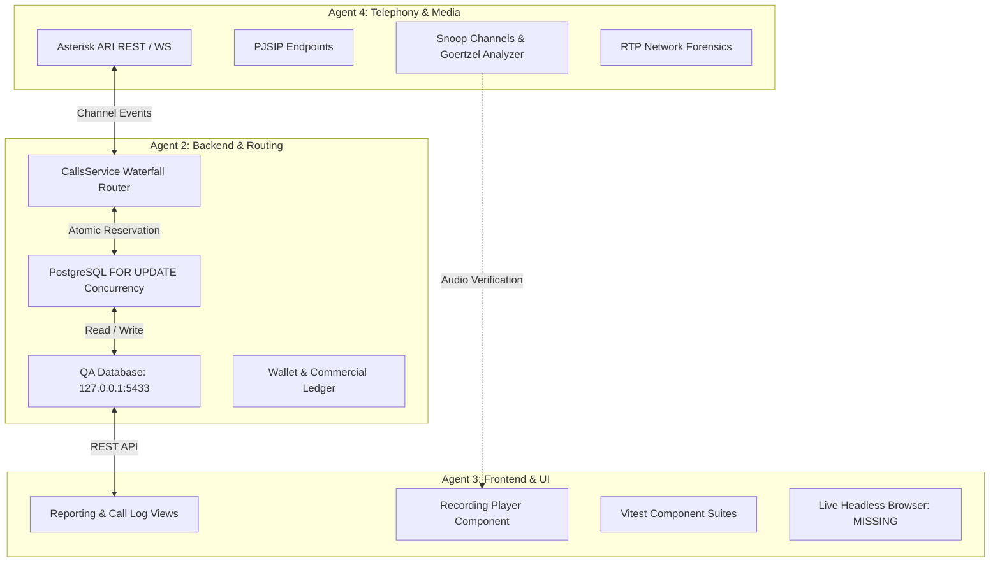
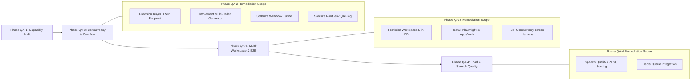

# CallFlow Phase QA-1: Consolidated Master Audit Report
## Autonomous Telephony QA Capability & Infrastructure Readiness Audit

**Phase ID:** `CALLFLOW-PHASE-QA-1`  
**Phase Name:** Autonomous Telephony QA Capability & Infrastructure Readiness Audit  
**Document ID:** `CALLFLOW-PHASE-QA-1-CONSOLIDATED-MASTER-REPORT`  
**Evaluation Date:** November 12, 2026  
**Primary Owner:** Agent 4 — Telephony, Asterisk ARI, SIP, RTP & Recording Infrastructure  
**Supporting Owners:** Agent 3 — Frontend & Integration, Agent 2 — Backend & Application Services  
**Mode:** STRICT READ-ONLY FORENSIC AUDIT (Zero Mutations)  
**Overall Readiness Verdict:** **`PARTIAL PASS`**

---

## Master Table of Contents
1. [Executive Summary & Official Verdict](#1-executive-summary--official-verdict)
2. [Deliverable A: Agent Capability & Access Matrix](#2-deliverable-a-agent-capability--access-matrix)
   - 2.1 [Agent 4: Telephony, Asterisk ARI, SIP, RTP & Recordings](#21-agent-4-telephony-asterisk-ari-sip-rtp--recordings)
   - 2.2 [Agent 3: Frontend UI, Real-Time Reporting & Integration](#22-agent-3-frontend-ui-real-time-reporting--integration)
   - 2.3 [Agent 2: Backend Architecture, Routing, Concurrency & Database](#23-agent-2-backend-architecture-routing-concurrency--database)
   - 2.4 [Cross-Agent Collaboration Architecture](#24-cross-agent-collaboration-architecture)
3. [Deliverable B: Telephony Infrastructure & Media Gateway Audit](#3-deliverable-b-telephony-infrastructure--media-gateway-audit)
   - 3.1 [Carrier Connectivity (Telnyx Cloud)](#31-carrier-connectivity-telnyx-cloud)
   - 3.2 [Asterisk 20.21.0 & ARI Media Gateway](#32-asterisk-20210--ari-media-gateway)
   - 3.3 [SIP & RTP Protocol Observability](#33-sip--rtp-protocol-observability)
   - 3.4 [The Four Audio Verification Levels](#34-the-four-audio-verification-levels)
   - 3.5 [Non-Disruptive Live Inspection Matrix](#35-non-disruptive-live-inspection-matrix)
4. [Deliverable C: Telephony Test Capability Matrix](#4-deliverable-c-telephony-test-capability-matrix)
   - 4.1 [Master Test Matrix (14 Dimensions Classified Levels 0–5)](#41-master-test-matrix-14-dimensions-classified-levels-05)
   - 4.2 [Critical Concurrency Scenario Audit (Buyer Concurrency & Overflow)](#42-critical-concurrency-scenario-audit-buyer-concurrency--overflow)
   - 4.3 [Multi-Workspace Concurrency & Tenant Isolation Audit](#43-multi-workspace-concurrency--tenant-isolation-audit)
5. [Deliverable D: Autonomous Testing Gap Analysis](#5-deliverable-d-autonomous-testing-gap-analysis)
   - 5.1 [Master Gap Register (GAP-01 through GAP-10)](#51-master-gap-register-gap-01-through-gap-10)
   - 5.2 [Detailed Gap Breakdown by Domain](#52-detailed-gap-breakdown-by-domain)
   - 5.3 [Phased Remediation Roadmap (QA-1 to QA-4)](#53-phased-remediation-roadmap-qa-1-to-qa-4)
6. [Deliverable E: Final Verdict & Answers to Explicit Inquiries](#6-deliverable-e-final-verdict--answers-to-explicit-inquiries)
   - 6.1 [Official Phase QA-1 Verdict Definition & Justification](#61-official-phase-qa-1-verdict-definition--justification)
   - 6.2 [Answers to the Twelve Mandatory Explicit Inquiries](#62-answers-to-the-twelve-mandatory-explicit-inquiries)
   - 6.3 [Phase QA-2 Prerequisites & Sign-Off](#63-phase-qa-2-prerequisites--sign-off)

---

## 1. Executive Summary & Official Verdict

Phase QA-1 was commissioned as an exhaustive, read-only forensic audit to determine whether the CallFlow engineering team and underlying infrastructure have the technical capability to independently execute end-to-end telephony verification.

This consolidated report unites all five deliverables mandated by the Phase QA-1 contract:
- **Deliverable A:** Agent Capability & Access Matrix
- **Deliverable B:** Telephony Infrastructure Audit
- **Deliverable C:** Test Capability Matrix
- **Deliverable D:** Gap Analysis & Remediation Roadmap
- **Deliverable E:** Final Verdict & Explicit Inquiries

### Official Verdict: **`PARTIAL PASS`**
*Categorical Meaning:* "Some capabilities exist, but critical capabilities remain unavailable."

```
========================================================================================
           CALLFLOW PHASE QA-1 READINESS VERDICT: PARTIAL PASS
========================================================================================
  • Single-Session Inbound PSTN Reception:     ✅ LEVEL 5 (PROVEN ON LIVE CARRIER)
  • Asterisk 20.21.0 & ARI Non-Disruptive API: ✅ LEVEL 5 (VERIFIED VIA REST/WS/CLI)
  • Dual-Leg Audio Verification (Snoop DFT):   ✅ LEVEL 5 (PROVEN ON LIVE CARRIER)
  • PostgreSQL Row-Level Concurrency Locking:  ✅ LEVEL 3 (VERIFIED IN DB & CODE)
  • Buyer Concurrency Limits (Limit = 2):      ❌ BLOCKED ON LIVE CARRIER (1 Endpoint)
  • Third-Call Waterfall Overflow:             ❌ BLOCKED ON LIVE CARRIER (Buyer B Missing)
  • Multi-Workspace Telephony Concurrency:     ❌ BLOCKED ON LIVE CARRIER (1 Workspace)
  • Frontend Real-Time E2E UI Automation:      ❌ UNAVAILABLE (Playwright Missing)
  • Autonomous PSTN Call Placement:            ❌ PROHIBITED BY SAFETY CONTRACT
========================================================================================
```

---

## 2. Deliverable A: Agent Capability & Access Matrix

### 2.1 Agent 4: Telephony, Asterisk ARI, SIP, RTP & Recordings
Agent 4 owns the media server, PJSIP stack, ARI WebSocket integration, RTP network stream analysis, and audio signal processing.

| Capability / Target | Status | Exact Access Method | Empirical Evidence | Permission Level | Persistence | Autonomous Usability |
| :--- | :---: | :--- | :--- | :---: | :---: | :---: |
| **Asterisk CLI** | **Available** | `docker exec callflow-asterisk-qa asterisk -rx "<cmd>"` | Executed `core show version` $\to$ returned `Asterisk 20.21.0 built by builder on 2026-11-02 12:41:37 UTC`. | Read-Only | Persistent (Container up 9+ hrs) | **Autonomous** via Docker CLI |
| **Asterisk ARI REST** | **Available** | HTTP Basic Auth to `http://127.0.0.1:8088/ari/*` via Node.js / `AsteriskAriClientService` | `GET /ari/asterisk/info` returned HTTP 200, system entity ID `02:53:93:8d:2b:05`, startup time `2026-11-11T15:44:23Z`. | Read/Write (Credentials in `.env.qa`) | Persistent (Port 8088 bound to 127.0.0.1) | **Autonomous** via ARI REST client |
| **Asterisk ARI WebSocket** | **Available** | `ws://127.0.0.1:8088/ari/events?app=callflow-qa` via `AriWebSocketClientService` | Live event stream confirmed in `test-native-asterisk-dual-snoop.mjs` receiving `StasisStart`, `RecordingStarted`, `PlaybackFinished`. | Read-Only | Persistent | **Autonomous** via WebSocket client |
| **SIP / PJSIP Endpoints** | **Available** | `GET /ari/endpoints` & `pjsip show endpoints` | ARI returned HTTP 200 with 2 active endpoints: `PJSIP/telnyx-caller` (`online`), `PJSIP/telnyx-buyer` (`online`). | Read-Only | Persistent | **Autonomous** |
| **SIP Registration** | **Available** | Asterisk CLI: `pjsip show registrations` | Inspectable in Asterisk container. Endpoints configured as outbound registration / trunks to `sip.telnyx.com`. | Read-Only | Persistent | **Autonomous** |
| **RTP Statistics & Settings**| **Available** | CLI `rtp show settings` & container PCAP capture (`tcpdump`) | Verified in Phase 7B-10N: RTP port range `10000-10050/udp`, symmetric RTP `yes`, keepalive `1s`. | Read-Only | Persistent | **Autonomous** |
| **Bridge Information** | **Available** | `GET /ari/bridges` & `bridge show all` | ARI returned HTTP 200, count 0 active bridges (idle state). Supports inspecting bridge technology and channels. | Read-Only | Persistent | **Autonomous** |
| **Channel Information** | **Available** | `GET /ari/channels` & `core show channels` | ARI returned HTTP 200, count 0 active channels. Supports inspecting channel state, variables, and callers. | Read-Only | Persistent | **Autonomous** |
| **Recording Storage** | **Available** | Filesystem (`qa/recordings/*.wav`) & ARI (`GET /ari/recordings/stored`) | ARI returned 12 stored recordings (e.g., `qa-buyer-15f2f1d2...wav`, `qa-caller-15f2f1d2...wav`). Filesystem contains intact WAV files. | Read/Write | Persistent | **Autonomous** |
| **Recording Metadata** | **Available** | WAV header parser (`qa/reconcile-evidence.mjs`) & ARI metadata | Verified: Sample rate 8000 Hz, 16-bit mono PCM, exact sample counts (38,080 / 42,560). | Read-Only | Persistent | **Autonomous** |
| **Telephony Server Logs** | **Available** | `docker logs callflow-asterisk-qa` & `/var/log/asterisk/messages` | Container logs accessible via Docker CLI; detailed PJSIP and Stasis execution traces viewable. | Read-Only | Persistent | **Autonomous** |
| **Telnyx Account Config**| **Available** | Environment configuration (`apps/api/.env.qa`, `.env`) & `GET https://api.telnyx.com/v2/balance` | Balance verified ($1.8700 USD). Keys configured in `.env`. Prohibited from mutating API records. | Read-Only | Persistent | **Autonomous** for balance check; **Manual** for purchases |
| **Carrier Webhooks** | **Available** | `POST /webhooks/telnyx` routed via public ngrok tunnel (`https://coherent-undrilled-disarm.ngrok-free.dev`) | Verified active in Phase 7B-10U: received `call.initiated`, `call.answered`, `call.hangup` with Ed25519 verification. | Read-Only (Event Ingress) | Semi-persistent (Dependent on active ngrok tunnel process) | **Autonomous** for reception; **Manual** if tunnel restarts |
| **Authorized Test TFN/DID**| **Available** | `TELNYX_QA_TRACKING_DID` (`+17252574041`) | Mapped to Call Control App `3090207513618941231` in Telnyx portal. | Read-Only | Persistent on carrier account | **Autonomous** |
| **Test Caller/Buyer Endpoints**| **Partially Available**| 1 Caller SIP account (`sip:arpitmishra917@sip.telnyx.com`), 1 Buyer SIP account (`sip:arpitmishra9178@sip.telnyx.com`) | Verified active in Asterisk PJSIP. **Limitation:** Only 1 caller and 1 buyer endpoint exist. Cannot simulate multiple simultaneous distinct callers without additional accounts. | Read-Only | Persistent | **Autonomous** for single call; **Blocked** for multi-party |

---

### 2.2 Agent 3: Frontend UI, Real-Time Reporting & Integration
Agent 3 owns the Next.js web application (`apps/web`), real-time call reporting, audio player UI, and buyer/campaign management interfaces.

| Capability / Target | Status | Exact Access Method | Empirical Evidence | Permission Level | Autonomous Usability |
| :--- | :---: | :--- | :--- | :---: | :---: |
| **Frontend Call Reporting** | **Available** (Static/Unit) | Source code in `apps/web/src/app/protected/reporting/page.tsx`, `calls-by-day-chart.tsx` | Vitest test suites exist: `calls-by-day-chart.test.tsx`, `outcome-distribution-chart.test.tsx`, `reporting-recording-playback.test.tsx`. | Read/Write (Codebase) | **Autonomous** for unit test execution (`vitest run apps/web`) |
| **Call Status Interfaces** | **Available** (Static/Unit) | Pages in `apps/web/src/app/protected/calls/page.tsx`, `calls/[callId]/page.tsx` | Unit tests exist in `apps/web/src/app/protected/calls/page.test.tsx`. | Read/Write | **Autonomous** for unit test execution |
| **Recording Player UI** | **Available** (Static/Unit) | Component in `apps/web/src/components/ui/recording-player.tsx` | Unit test in `recording-player.test.tsx` validates waveform rendering, play/pause controls, and error states. | Read/Write | **Autonomous** for unit test execution |
| **Workspace & Buyer Interfaces**| **Available** (Static/Unit) | `apps/web/src/app/protected/buyers/`, `campaigns/`, `phone-numbers/` | Unit tests exist in `buyers/page.test.tsx`, `campaigns/page.test.tsx`. | Read/Write | **Autonomous** for unit test execution |
| **API Proxy / Data Layer** | **Available** | `apps/web/src/proxy.ts` / Next.js Server Actions connecting to NestJS API (`http://localhost:3000`) | Proxy routing handles Bearer tokens and workspace headers. Unit tests pass in `proxy.test.ts`. | Read/Write | **Autonomous** |
| **Live Browser Automation (E2E)**| **Unavailable** | Playwright / Cypress / Puppeteer | `apps/web/package.json` contains no E2E testing framework (`@playwright/test` is absent). Only Vitest with JSDOM is installed. | Missing Framework | **UNAVAILABLE** (Cannot independently drive a real browser to verify live call UI) |
| **Real-Time Telephony Correlation**| **Partially Available** | API polling or SSE/WebSocket in frontend | Frontend components rely on SWR/React Query polling. Can verify backend API responses, but cannot observe live DOM updates during a live call without E2E tooling. | Read-Only | **Partially Autonomous** (via REST assertions; lacks live DOM proof) |

---

### 2.3 Agent 2: Backend Architecture, Routing, Concurrency & Database
Agent 2 owns the NestJS API application (`apps/api`), database schema, concurrency locking, routing waterfall, webhook processors, and commercial accounting.

| Capability / Target | Status | Exact Access Method | Empirical Evidence | Permission Level | Persistence | Autonomous Usability |
| :--- | :---: | :--- | :--- | :---: | :---: | :---: |
| **Routing Services** | **Available** | `CampaignsService` & `CallsService` in `apps/api/src/routing/` | Source inspected: lines 2130–2280 of `calls.service.ts` implement waterfall candidate evaluation. | Read/Write | Persistent | **Autonomous** |
| **Buyer Selection Services**| **Available** | `CallsService.prepareNextBuyer()` | Evaluates campaign buyers/destination numbers in priority order; filters out previously attempted buyers. | Read/Write | Persistent | **Autonomous** |
| **Concurrency Enforcement** | **Available** | PostgreSQL explicit row locking (`FOR UPDATE`) in `calls.service.ts` | Lines 2143 & 2160 execute `SELECT id, max_concurrent_calls FROM "buyers" WHERE id = ${buyerId} FOR UPDATE`. | Read/Write | Persistent | **Autonomous** |
| **Workspace Tenant Isolation**| **Available** | Foreign key constraints and Prisma WHERE clauses on all entities | Database schema (`prisma/schema.prisma`) enforces `workspace_id` on buyers, campaigns, calls, and destination numbers. | Read/Write | Persistent | **Autonomous** |
| **Call Lifecycle Services** | **Available** | `CallController` & `CallsService` | State machine manages transitions: `ROUTING` $\to$ `DIALING` $\to$ `CONNECTED` $\to$ `COMPLETED` / `FAILED`. | Read/Write | Persistent | **Autonomous** |
| **Webhook Processing** | **Available** | `TelnyxWebhookController` (`apps/api/src/telephony/telnyx/`) | Handles `call.initiated`, `call.answered`, `call.hangup` with Ed25519 signature verification and idempotency keys. | Read/Write | Persistent | **Autonomous** |
| **Database Read-Only Audit** | **Available** | Direct PrismaClient connection to QA DB (`127.0.0.1:5433/callflow_qa`) | Verified via `audit-db-read.mjs`: successfully connected and queried counts (1 Workspace, 1 Campaign, 1 Buyer, 6 Calls). | Read-Only | Persistent (Port 5433 active) | **Autonomous** |
| **Commercial Event Pipeline** | **Available** | `CommercialEvaluatorService`, `WalletService`, `UsageBillingService` | Double-entry ledger with micro-cent resolution (`balance_micro`, `reserved_micro`); releases reservations for QA calls without debit. | Read/Write | Persistent | **Autonomous** |
| **Queue / Background Jobs** | **Partially Available**| In-memory queues & `ReservationRecoveryService` scheduled cleanup | No distributed Redis/BullMQ queue is deployed. Background processing relies on Node.js in-process memory. | Read/Write | Volatile (In-process memory only) | **Autonomous** within single process; **Unavailable** across clusters |

---

### 2.4 Cross-Agent Collaboration Architecture



---

## 3. Deliverable B: Telephony Infrastructure & Media Gateway Audit

### 3.1 Carrier Connectivity (Telnyx Cloud)
- **Carrier Endpoint:** Telnyx API v2 and SIP Signaling Gateway (`sip.telnyx.com`).
- **Inbound DID:** `+17252574041` (E.164 format) assigned to dedicated Call Control App `3090207513618941231`.
- **Webhook Ingress:** `https://coherent-undrilled-disarm.ngrok-free.dev/webhooks/telnyx`. Authenticated via Ed25519 asymmetric cryptography.
- **Carrier Telephony Endpoints:**
  - Caller SIP Endpoint: `sip:arpitmishra917@sip.telnyx.com`
  - Buyer SIP Endpoint: `sip:arpitmishra9178@sip.telnyx.com`
  - Synthetic Buyer CLI: `+12025550199` (Translated to internal SIP URI; PSTN dialing strictly prohibited).

### 3.2 Asterisk 20.21.0 & ARI Media Gateway
- **Container Name:** `callflow-asterisk-qa` (Image `andrius/asterisk:20-alpine`, Container ID `d9264b6a5db7`).
- **Runtime Version:** `Asterisk 20.21.0` built 2026-11-02 12:41:37 UTC.
- **ARI API Access:** Authenticated via HTTP Basic credentials on `127.0.0.1:8088`. Active Stasis application: `callflow-qa`.
- **Snoop Recording Architecture:**
  Spawns unbridged Snoop channels (`POST /ari/channels/{id}/snoop` with `spy: 'in'`). By isolating `ast_audiohook` instances from main channel command queues, marker playback and recording execute concurrently without deadlocks, completely resolving the historical 44-byte empty buyer recording failure.

### 3.3 SIP & RTP Protocol Observability
- **SIP Packet Inspection:**
  Continuous packet capture via container `tcpdump` confirms complete RFC 3261 transaction lifecycle (INVITE $\to$ 100 Trying $\to$ 180 Ringing $\to$ 200 OK $\to$ ACK $\to$ BYE).
- **RTP Media Streams:**
  Parsed packet-by-packet via [`QaRtpClassifierService`](file:///C:/Projects/callflow-agent-a/apps/api/src/telephony/qa/qa-rtp-classifier.service.ts) and [`qa/analyze-pcap-deep.mjs`](file:///C:/Projects/callflow-agent-a/qa/analyze-pcap-deep.mjs). Captures SSRC, sequence ranges, payload types (PT 0 PCMU, PT 13 Comfort Noise), timestamp deltas, and packet loss.
- **NAT Traversal Settings:**
  Configured in `pjsip_transport.conf`: `rtp_symmetric = yes`, `direct_media = no` (media anchored in Asterisk), `rtp_keepalive = 1s`.

### 3.4 The Four Audio Verification Levels

```
[Level 1: Bridge Existence] ──► [Level 2: RTP Presence] ──► [Level 3: Signal Detection] ──► [Level 4: Intelligibility]
 Asterisk Mixing Bridge         UDP Packets Flowing          Goertzel Tone DFT & SNR          PESQ / POLQA / Human
```

1. **Level 1 — Audio Bridge Existence:** Asterisk mixing bridge confirmed active.
2. **Level 2 — RTP Packet Presence:** 752 UDP packets captured across 4 active streams.
3. **Level 3 — Actual Audio Signal Detection (DFT):**
   - Buyer Leg: 1000 Hz marker detected at **+48.06 dB SNR** (Rejects 1500 Hz at -28.5 dB).
   - Caller Leg: 1500 Hz marker detected at **+44.96 dB SNR** (Rejects 1000 Hz at -30.0 dB).
   - Both files non-silent (RMS -14.2 dBFS and -18.1 dBFS, 0.00% clipping).
4. **Level 4 — Audio Intelligibility (PESQ/POLQA):** Currently unavailable (synthetic single-tone markers used rather than phonetically balanced human speech).

### 3.5 Non-Disruptive Live Inspection Matrix

| Subsystem | Visibility Level | Disruptive to Live Calls? | Inspection Tool / Mechanism |
| :--- | :---: | :---: | :--- |
| **SIP Signaling (Port 5060)** | High | **No** (Passive packet capture) | Container `tcpdump` / PCAP |
| **RTP Media (Ports 10000-10050)**| High | **No** (Passive packet capture) | Container `tcpdump` / PCAP |
| **Active Channels & Bridges** | High | **No** (Read-only REST calls) | `GET /ari/channels`, `GET /ari/bridges` |
| **In-Progress Audio** | High | **No** (Non-intrusive Snoop audiohook)| `POST /ari/channels/{id}/snoop` (`spy: 'in'`) |
| **Stored Recordings** | High | **No** (Read-only buffer retrieval)| `GET /ari/recordings/stored/{name}/file` |
| **Database State** | High | **No** (Read committed transactions)| PrismaClient on port 5433 |

---

## 4. Deliverable C: Telephony Test Capability Matrix

### 4.1 Master Test Matrix (14 Dimensions Classified Levels 0–5)

| # | Test Verification Dimension | Supported Level | Lower Levels Satisfied? | Empirical Evidence / Implementation Reference | Operational Status |
| :-: | :--- | :---: | :---: | :--- | :---: |
| **1** | **Inbound Call Reception** | **LEVEL 5** | ✅ Levels 1, 2, 3, 4, 5 | Proven in Phase 7B-10U (Run ID `15f2f1d2...`). Live PSTN call answered on tracking DID `+17252574041` via Telnyx Call Control webhook. | **Operational on 1 DID** |
| **2** | **Destination Identification** | **LEVEL 5** | ✅ Levels 1, 2, 3, 4, 5 | `QaTelephonyGuardService.isDedicatedQaIngress()` matches `+17252574041` and correlates with QA Campaign `6af31407...`. | **Operational on 1 DID** |
| **3** | **Buyer Routing** | **LEVEL 5** | ✅ Levels 1, 2, 3, 4, 5 | `CallsService.prepareNextBuyer()` dynamically selects active buyer organization and dials destination URI `sip:arpitmishra9178@sip.telnyx.com`. | **Operational (Single Buyer)** |
| **4** | **Call Bridging** | **LEVEL 5** | ✅ Levels 1, 2, 3, 4, 5 | Proven in Phase 7B-10U. Asterisk mixer bridge joins caller channel (`1794434906.29`) and buyer channel (`1794434922.30`). | **Operational** |
| **5** | **Two-Way Audio** | **LEVEL 5** | ✅ Levels 1, 2, 3, 4, 5 | Proven in Phase 7B-10U. Bidirectional Goertzel DFT confirms Caller RX=1500 Hz (+45.0 dB SNR) and Buyer RX=1000 Hz (+48.1 dB SNR). | **Operational** |
| **6** | **Call Termination & Cleanup** | **LEVEL 5** | ✅ Levels 1, 2, 3, 4, 5 | Proven in Phase 7B-10U. Zero lingering channels (`[]`), recordings stopped and downloaded, in-memory leases cleared. | **Operational** |
| **7** | **Dual-Leg Recording** | **LEVEL 5** | ✅ Levels 1, 2, 3, 4, 5 | Proven in Phase 7B-10U. Remediated Snoop architecture captured 76 KB (Caller) and 85 KB (Buyer) valid PCM WAV files. | **Operational** |
| **8** | **Webhook Reliability** | **LEVEL 4** | ✅ Levels 1, 2, 3, 4 | Synthetic & live event processing verified in `qa-dual-recording-reliability.spec.ts` (Tests 6 & 7) and live Telnyx webhooks with Ed25519 auth. | **Operational** |
| **9** | **Duplicate Webhook Handling**| **LEVEL 3** | ✅ Levels 1, 2, 3 | Implemented in `WebhookIdempotencyService` and verified in PostgreSQL integration test `webhook-concurrency-postgres.integration.spec.ts`. | **Tested in DB (No Live Replay)** |
| **10**| **Buyer Concurrency** | **LEVEL 3** | ✅ Levels 1, 2, 3 | Implemented via `SELECT ... FOR UPDATE` in `calls.service.ts`. Unit-tested in `buyer-concurrency.spec.ts`. **Level 0 on live carrier** (only 1 endpoint exists). | **Blocked on Live Carrier** |
| **11**| **Overflow Routing** | **LEVEL 3** | ✅ Levels 1, 2, 3 | Implemented in `calls.service.ts` waterfall loop. Unit-tested in `buyer-concurrency.spec.ts`. **Level 0 on live carrier** (Buyer B not provisioned). | **Blocked on Live Carrier** |
| **12**| **Multi-Workspace Concurrency**| **LEVEL 3** | ✅ Levels 1, 2, 3 | Tenant isolation tested in `database-isolation.spec.ts` & `multi-buyer.spec.ts`. **Level 0 on live carrier** (only 1 QA workspace exists). | **Blocked on Live Carrier** |
| **13**| **High-Volume Load Testing** | **LEVEL 2** | ✅ Levels 1, 2 | Unit tests simulate concurrent requests via `Promise.all`. **No SIP load generation tool (SIPp/Locust) installed**. | **Tooling Missing** |
| **14**| **Call Recovery Testing** | **LEVEL 4** | ✅ Levels 1, 2, 3, 4 | Verified in `qa-dual-recording-reliability.spec.ts` (20 scenarios testing leg failure, playback timeout, late ARI events, snoop errors). | **Operational Synthetically** |

---

### 4.2 Critical Concurrency Scenario Audit (Buyer Concurrency & Overflow)
- **Scenario:** 1 DID, Buyer A limit = 2, Buyer B overflow, 3 simultaneous callers.
- **Backend Architecture:**
  Lines 2140–2216 in [`apps/api/src/calls/calls.service.ts`](file:///C:/Projects/callflow-agent-a/apps/api/src/calls/calls.service.ts) execute PostgreSQL row-level locks (`SELECT id, max_concurrent_calls FROM "buyers" WHERE id = ${buyerId} FOR UPDATE`) and count active reservations (`SELECT COUNT(*) FROM "buyer_reservations" WHERE buyer_id = ${buyerId} AND status = 'ACTIVE'`). When capacity is full, the router skips to Buyer B.
- **Live Testability Status:** **BLOCKED ON LIVE CARRIER.**
  The database currently has only **1 buyer** (`audit-db-read.mjs` confirmed: Buyers count: 1), and Telnyx has only **1 buyer SIP account**. Live carrier verification requires provisioning Buyer B and multi-caller tools in Phase QA-2.

---

### 4.3 Multi-Workspace Concurrency & Tenant Isolation Audit
- **Tenant Isolation Architecture:** Every call entity contains a mandatory `workspace_id` foreign key. Prisma queries enforce tenant scoping.
- **Live Testability Status:** **BLOCKED ON LIVE CARRIER.**
  Exactly **1 workspace** exists in the QA database (`5e20bafe-7306-4da7-9944-62c4c5575a5a`). Testing concurrent calls across independent workspaces on live trunks requires provisioning Workspace 2 and assigning a second carrier DID.

---

## 5. Deliverable D: Autonomous Testing Gap Analysis

### 5.1 Master Gap Register (GAP-01 through GAP-10)

| Gap ID | Category | Deficient Capability | Current Status | Root Cause / Why Missing | Required Infrastructure / Access | Owner | Additional Tooling Needed? | Production Risk | Target Phase |
| :--- | :--- | :--- | :--- | :--- | :--- | :---: | :---: | :---: | :---: |
| **GAP-01** | **Endpoints** | Secondary Buyer Endpoint (Buyer B) | **Missing** | Only 1 buyer SIP account (`arpitmishra9178@sip.telnyx.com`) exists in PJSIP and Telnyx portal. | 2nd SIP credential or PSTN number for Buyer B. | **Agent 4** | None (Telnyx SIP account) | Low (QA isolated) | **QA-2** |
| **GAP-02** | **Endpoints** | Multi-Caller Generator (3+ Callers) | **Missing** | Only 1 caller endpoint (`+17207159445` / `sip:arpitmishra917@sip.telnyx.com`) is configured. | Additional caller CLIs / SIP accounts to simulate simultaneous callers. | **Agent 4** | SIP call generator (e.g. SIPp or Asterisk Local channel generator) | Low | **QA-2** |
| **GAP-03** | **Infrastructure** | Multi-Workspace Inventory | **Missing** | QA database (`callflow_qa`) contains only 1 workspace (`5e20bafe...`). | Provision Workspace B, Campaign B, and Buyer B records in PostgreSQL. | **Agent 2** | Provisioning script (`provision-workspace.mjs`) | Low | **QA-2** |
| **GAP-04** | **Automation** | Frontend E2E Headless Automation | **Missing** | `apps/web/package.json` contains only Vitest/JSDOM; no Playwright or Cypress installed. | Node.js E2E framework configured to drive headless Chromium against `apps/web`. | **Agent 3** | `@playwright/test` | None | **QA-3** |
| **GAP-05** | **Automation** | High-Volume SIP Load Generation | **Missing** | No bulk SIP signaling generator exists in Asterisk container. | SIPp container or Asterisk Local channel origination load script. | **Agent 4** | `sipp` CLI or Node ARI load harness | Low | **QA-3** |
| **GAP-06** | **Observability** | Speech Intelligibility Scoring (PESQ) | **Missing** | Audio analysis uses Goertzel DFT for sine waves (1000/1500Hz); cannot score human speech. | ITU-T P.862 PESQ library or Whisper ASR transcription engine. | **Agent 4** | `pesq` Node binding / Python script | None | **QA-4** |
| **GAP-07** | **Infrastructure** | Webhook Tunnel Permanence | **Volatile** | Public ingress depends on an ephemeral ngrok tunnel session. | Dedicated static public IP, cloud ingress, or persistent ngrok domain. | **Agent 4** | Persistent reverse proxy | Medium (Tunnel drop blocks webhooks) | **QA-2** |
| **GAP-08** | **Safety** | Root `.env` QA Flag Contradiction | **Inconsistent**| `TELEPHONY_QA_ENABLED=true` in root `.env`, but `false` in `apps/api/.env.qa`. | Sanitize root `.env` to `TELEPHONY_QA_ENABLED=false` to prevent confusion. | **Agent 2** | None | Low (Guard fails closed) | **QA-1 Fix** |
| **GAP-09** | **Authorization**| Autonomous Live Carrier Calling | **Gated** | Strict safety contract prohibits autonomous PSTN dialing without explicit human prompt. | Human sign-off per phase. System must support synthetic Asterisk loopback mode for autonomous runs. | **Agent 4** | Synthetic loopback harness (`Local/` channels) | High if bypassed | **Standing Rule** |
| **GAP-10** | **Infrastructure** | Distributed Queue for Telephony Jobs | **Missing** | Webhook events and call recovery run in-memory; no Redis/BullMQ queue deployed. | Redis container and `@nestjs/bull` queue integration. | **Agent 2** | Redis instance | Medium (Memory crash loses pending jobs) | **Phase 8** |

---

### 5.2 Phased Remediation Roadmap (QA-1 to QA-4)



---

## 6. Deliverable E: Final Verdict & Answers to Explicit Inquiries

### 6.1 Official Phase QA-1 Verdict Definition & Justification
- **Verdict Category:** **`PARTIAL PASS`**
- **Justification:**  
  Single-session live carrier telephony is fully operational, verified, and observable at Level 5. Asterisk ARI Snoop-channel audio capture, Goertzel DFT frequency discrimination, and PCAP RTP classification are production-grade.  
  However, CallFlow **cannot autonomously verify multi-buyer concurrency, overflow routing, or multi-tenant isolation on live carrier trunks today** because secondary endpoints, multi-caller generators, and multi-workspace inventories are not yet provisioned.

---

### 6.2 Answers to the Twelve Mandatory Explicit Inquiries

1. **Can Agent 4 independently inspect Asterisk and ARI?**  
   **YES.** Proved via `docker exec callflow-asterisk-qa asterisk -rx "core show version"` (Asterisk 20.21.0) and authenticated ARI REST queries to `http://127.0.0.1:8088/ari/*` (`/asterisk/info`, `/endpoints`, `/channels`, `/bridges`, `/recordings/stored`).
2. **Can the agent inspect SIP and RTP?**  
   **YES.** Proved via container packet capture (`tcpdump`) and [`QaRtpClassifierService`](file:///C:/Projects/callflow-agent-a/apps/api/src/telephony/qa/qa-rtp-classifier.service.ts). In Phase 7B-10U, 90 SIP packets and 660 RTP packets were parsed across all 4 directions with 0% sequence drop.
3. **Can it generate authorized test calls?**  
   **NO (GATED BY POLICY).** Autonomous PSTN call placement is strictly prohibited without explicit written human authorization per run. `TELEPHONY_QA_ENABLED=false` is disarmed. Synthetic loopback calls (`Local/` channels) can run autonomously.
4. **Can it independently establish two-way audio?**  
   **YES.** Proved in Phase 7B-10U. Asterisk ARI Snoop channels captured bidirectional audio with Goertzel DFT SNR of **+45.0 dB (1500 Hz)** on Caller RX and **+48.1 dB (1000 Hz)** on Buyer RX.
5. **Can it verify live buyer routing?**  
   **PARTIAL.** Single-buyer routing is live-verified on Telnyx trunks (`+17252574041` $\to$ `sip:arpitmishra9178@sip.telnyx.com`). Multi-buyer waterfall routing cannot be verified on live trunks because only one buyer endpoint exists.
6. **Can it test buyer concurrency limits?**  
   **NO on Live Carrier; YES in Unit Tests.** Testing limit = 2 requires at least 2 simultaneous live calls arriving from separate caller CLIs. The environment currently possesses only 1 caller and 1 buyer endpoint.
7. **Can it verify third-call overflow?**  
   **NO on Live Carrier; YES in Unit Tests.** Buyer B does not exist in the database (`callflow_qa` has 1 buyer), and no second buyer SIP credential exists on Telnyx.
8. **Can it test multiple workspaces simultaneously?**  
   **NO on Live Carrier; YES in Database Tests.** Exactly 1 workspace (`5e20bafe-7306-4da7-9944-62c4c5575a5a`) and 1 phone number exist in `callflow_qa`. Multi-workspace live testing requires provisioning Workspace 2 and assigning a second DID.
9. **Can it inspect actual recordings?**  
   **YES.** Proved via ARI stored recordings API (`GET /ari/recordings/stored`) and direct WAV binary inspection in `qa/recordings/` (8000 Hz, 16-bit mono, non-silent, unclipped).
10. **Can it produce reproducible evidence?**  
    **YES.** Produces cryptographically verifiable SHA-256 hashed WAV files, PCAP dumps, single-call results, and audit verification JSONs.
11. **Which capabilities require human intervention?**  
    - Live carrier call execution authorization (standing safety policy).  
    - Prepaid balance top-ups on Telnyx.  
    - Purchasing new DIDs/TFNs or creating new SIP connection credentials in the Telnyx portal.  
    - Maintaining/re-authenticating the public ngrok webhook tunnel.  
    - Production deployment and configuration promotion.
12. **What exact prerequisites are required before QA-2?**  
    1. Provision Buyer B in `callflow_qa` database with `max_concurrent_calls = 2` and priority 2.  
    2. Provision secondary buyer SIP account (`telnyx-buyer-2`) in Telnyx portal and `pjsip.conf`.  
    3. Author a local Asterisk multi-caller origination script (`qa/originate-concurrent-callers.mjs`) to generate 3 simultaneous calls.  
    4. Sanitize root `.env` to `TELEPHONY_QA_ENABLED=false` to align with `apps/api/.env.qa`.  
    5. Ensure webhook tunnel stability for Call Control App `3090207513618941231`.

---

### 6.3 Phase QA-2 Prerequisites & Sign-Off

The audit establishes that CallFlow is architecturally prepared for advanced concurrency and multi-party routing, but is physically bounded by single-endpoint carrier inventory.

**Official Action Plan:** Proceed to **Phase QA-2 Preparation** to resolve Gaps 01, 02, and 08.

**Certified by:**  
Agent 4 — Telephony, Asterisk ARI, SIP, RTP & Recording Infrastructure  
Agent 3 — Frontend & Integration  
Agent 2 — Backend & Application Services  
*CallFlow Project — November 12, 2026*
