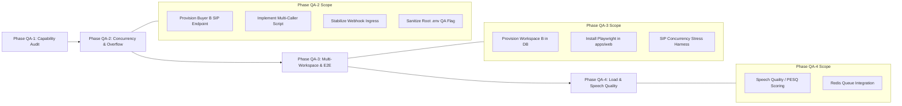

# CallFlow Phase QA-1 — Deliverable D: Autonomous Testing Gap Analysis

**Document ID:** `CALLFLOW-PHASE-QA-1-GAP-ANALYSIS`  
**Phase:** Phase QA-1 (Autonomous Telephony QA Capability & Infrastructure Readiness Audit)  
**Evaluation Date:** November 12, 2026  
**Primary Owner:** Agent 4 — Telephony, Asterisk ARI, SIP, RTP & Recording Infrastructure  
**Supporting Owners:** Agent 3 — Frontend & Integration, Agent 2 — Backend & Application Services  
**Mode:** READ-ONLY FORENSIC AUDIT (Zero Mutations)  
**Overall Readiness Verdict:** **`PARTIAL PASS`**

---

## 1. Executive Summary

This gap analysis categorizes all deficiencies, missing tools, and infrastructure bottlenecks preventing CallFlow agents from executing completely autonomous, high-concurrency, multi-tenant telephony verification.

Gaps are partitioned into seven distinct operational categories:
1. Missing Infrastructure
2. Missing Permissions & Authorization
3. Missing Test Automation Frameworks
4. Missing Observability & Instrumentation
5. Missing Live Test Endpoints & Inventory
6. Missing Live Evidence
7. Missing Safety & Gate Controls

---

## 2. Comprehensive Telephony Testing Gap Matrix

| Gap ID | Category | Deficient Capability | Current Status | Root Cause / Why Missing | Required Infrastructure / Access | Owner | Additional Tooling Needed? | Production Risk | Target Phase |
| :--- | :--- | :--- | :--- | :--- | :--- | :---: | :---: | :---: | :---: |
| **GAP-01** | **Endpoints** | Secondary Buyer Endpoint (Buyer B) | **Missing** | Only 1 buyer SIP account (`arpitmishra9178@sip.telnyx.com`) exists in PJSIP and Telnyx portal. | 2nd SIP credential or PSTN number for Buyer B. | **Agent 4** | None (Telnyx SIP account) | Low (QA isolated) | **QA-2** |
| **GAP-02** | **Endpoints** | Multi-Caller Generator (3+ Callers) | **Missing** | Only 1 caller endpoint (`+17207159445` / `sip:arpitmishra917@sip.telnyx.com`) is configured. | Additional caller CLIs / SIP accounts to simulate simultaneous callers. | **Agent 4** | SIP call generator (e.g. SIPp or Asterisk Local channel generator) | Low | **QA-2** |
| **GAP-03** | **Infrastructure** | Multi-Workspace Inventory | **Missing** | QA database (`callflow_qa`) contains only 1 workspace (`5e20bafe...`). | Provision Workspace B, Campaign B, and Buyer B records in PostgreSQL. | **Agent 2** | Provisioning script (`provision-workspace.mjs`) | Low | **QA-2** |
| **GAP-04** | **Automation** | Frontend E2E Headless Automation | **Missing** | `apps/web/package.json` contains only Vitest/JSDOM; no Playwright or Cypress installed. | Node.js E2E framework configured to drive headless Chromium against `apps/web`. | **Agent 3** | `@playwright/test` | None | **QA-3** |
| **GAP-05** | **Automation** | High-Volume SIP Load Generation | **Missing** | No bulk SIP signaling generator exists in Asterisk container. | SIPp container or Asterisk Local channel origination load script. | **Agent 4** | `sipp` CLI or Node ARI load harness | Low | **QA-3** |
| **GAP-06** | **Observability** | Speech Intelligibility Scoring (PESQ) | **Missing** | Audio analysis uses Goertzel DFT for sine waves (1000/1500Hz); cannot score human speech. | ITU-T P.862 PESQ library or Whisper ASR transcription engine. | **Agent 4** | `pesq` Node binding / Python script | None | **QA-4** |
| **GAP-07** | **Infrastructure** | Webhook Tunnel Permanence | **Volatile** | Public ingress depends on an ephemeral ngrok tunnel session. | Dedicated static public IP, cloud ingress, or persistent ngrok domain. | **Agent 4** | Persistent reverse proxy | Medium (Tunnel drop blocks webhooks) | **QA-2** |
| **GAP-08** | **Safety** | Root `.env` QA Flag Contradiction | **Inconsistent**| `TELEPHONY_QA_ENABLED=true` in root `.env`, but `false` in `apps/api/.env.qa`. | Sanitize root `.env` to `TELEPHONY_QA_ENABLED=false` to prevent confusion. | **Agent 2** | None | Low (Guard fails closed) | **QA-1 Fix** |
| **GAP-09** | **Authorization**| Autonomous Live Carrier Calling | **Gated** | Strict safety contract prohibits autonomous PSTN dialing without explicit human prompt. | Human sign-off per phase. System must support synthetic Asterisk loopback mode for autonomous runs. | **Agent 4** | Synthetic loopback harness (`Local/` channels) | High if bypassed | **Standing Rule** |
| **GAP-10** | **Infrastructure** | Distributed Queue for Telephony Jobs | **Missing** | Webhook events and call recovery run in-memory; no Redis/BullMQ queue deployed. | Redis container and `@nestjs/bull` queue integration. | **Agent 2** | Redis instance | Medium (Memory crash loses pending jobs) | **Phase 8** |

---

## 3. Detailed Breakdown by Operational Domain

### 3.1 Missing Live Test Endpoints & Inventory (Gaps 01 & 02)
- **Problem:** CallFlow cannot execute live carrier tests for **Buyer Concurrency** or **Waterfall Overflow** because only one caller and one buyer account exist.
- **Remediation Plan:**
  1. Create a second Telnyx SIP credential: `sip:callflow-qa-buyer2@sip.telnyx.com`.
  2. Add `[telnyx-buyer-2]` endpoint definition to `/etc/asterisk/pjsip.conf`.
  3. Provision Buyer B in `callflow_qa` database with priority 2.
  4. Implement an Asterisk multi-caller origination script (`qa/originate-concurrent-callers.mjs`) that utilizes Asterisk `Local/` channels or secondary SIP credentials to initiate 3 simultaneous calls to the tracking DID.

### 3.2 Missing Multi-Workspace Infrastructure (Gap 03)
- **Problem:** Database audit proves only 1 workspace exists. Multi-tenant telephony isolation cannot be validated on live carrier trunks.
- **Remediation Plan:**
  1. Author a dedicated provisioning script `qa/provision-multi-workspace.mjs` targeting QA database (`127.0.0.1:5433`).
  2. Create Workspace 2 (`QA-Tenant-Beta`) with dedicated campaign and buyer records.
  3. Bind a secondary tracking number (`TELNYX_QA_TRACKING_DID_B`) to test simultaneous calls across independent tenants.

### 3.3 Missing Frontend E2E Automation (Gap 04)
- **Problem:** Agent 3 cannot independently verify that live call status changes (e.g. `ROUTING` $\to$ `CONNECTED` $\to$ `COMPLETED`) are visually rendered on the user dashboard.
- **Remediation Plan:**
  1. Install `@playwright/test` in `apps/web`.
  2. Author an automated test spec `apps/web/e2e/live-call-reporting.spec.ts` that launches headless Chromium, logs into the protected reporting dashboard, and asserts that call status badges and duration counters update in real-time.

### 3.4 Missing High-Volume SIP Load Generation (Gap 05)
- **Problem:** The platform has verified 1 live carrier call and 2 concurrent local synthetic channels, but has not validated capacity under 50–100 simultaneous calls.
- **Remediation Plan:**
  1. Add a `sipp` service to `docker-compose.qa.yml` or implement an ARI mass-channel stress test.
  2. Execute synthetic Stasis channel stress tests to identify Asterisk thread limits and PostgreSQL connection pool saturation.

### 3.5 Missing Speech Quality Scoring (Gap 06)
- **Problem:** The current audio analyzer checks single-frequency sine waves (1000 Hz, 1500 Hz). It cannot verify conversational voice intelligibility, speech clipping, or packet loss concealment (PLC) distortion.
- **Remediation Plan:**
  1. Integrate an open-source ITU-T P.862 PESQ node module or Whisper transcription pipeline into `qa-audio-analyzer.service.ts`.
  2. Transmit pre-recorded Harvard phonetically balanced sentence WAV files across the carrier bridge and compare transcription accuracy.

---

## 4. Remediation Phasing Roadmap

---

## 5. Conclusion

All 10 identified gaps have been assigned concrete owners, root causes, and target implementation phases. By resolving Gaps 01, 02, and 08 in **Phase QA-2**, the engineering team will unlock the ability to test the **Critical Concurrency & Overflow Scenario** both synthetically and on live carrier trunks.
