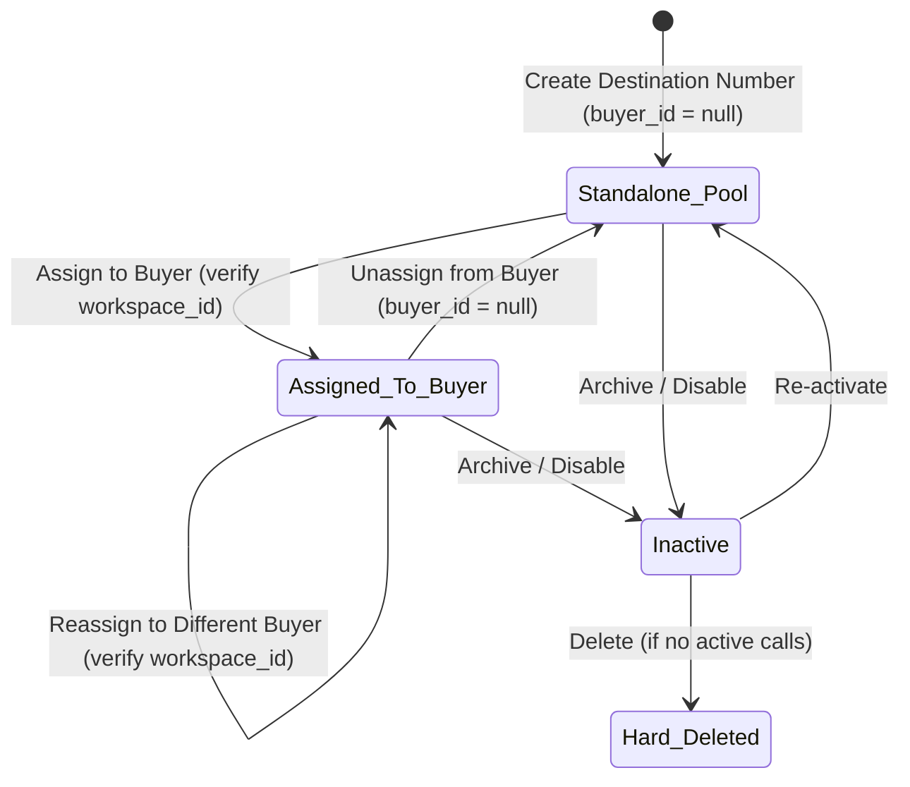

# CALLFLOW — PHASE DN-1: BACKEND, PRISMA & SUPABASE DESTINATION NUMBER ARCHITECTURE AUDIT

**Audit Owner:** Agent 2 — Backend, API, Database & Security  
**Audit Mode:** STRICT READ-ONLY FORENSIC AUDIT  
**Audit Status:** **`AUDIT COMPLETE`**  
**Date:** November 12, 2026  

---

## 1. Executive Summary

This forensic architectural audit evaluates the current state of **Destination Numbers**, **Buyer Organizations**, **Campaign Mappings**, **Workspace Scoping**, and **Call Attempt Snapshotting** across the CallFlow backend repository.

### Key Architectural Findings:
1. **Entity Independence Violation (Critical Database Gaps):**
   - In `apps/api/prisma/schema.prisma` (and migration `20261107120000_buyer_org_and_destination_number_foundation`), `destination_numbers.buyer_id` is defined as **`TEXT NOT NULL`**.
   - A `DestinationNumber` **cannot exist in an unassigned state** at the database level.
   - Foreign key constraint `destination_numbers_buyer_id_fkey` specifies `ON DELETE CASCADE`. If a `Buyer` is deleted, all assigned `DestinationNumber` records are **permanently destroyed**.
2. **Missing Assignment Lifecycle Endpoints (API Gap):**
   - Endpoints only support creating numbers nested under a specific buyer (`POST /workspaces/:workspaceId/buyers/:buyerId/destination-numbers`).
   - No top-level standalone creation endpoint (`POST /workspaces/:workspaceId/destination-numbers`) exists.
   - No assignment (`/assign`), reassignment (`/reassign`), or unassignment (`/unassign`) endpoints or service methods exist.
3. **Historical Call Snapshot Protection (Partial Implementation & Critical Risk):**
   - `call_attempts.destination_number` correctly stores an immutable E.164 string snapshot at dial time.
   - `call_attempts.destination_number_id` maintains a relation to `DestinationNumber` with `ON DELETE SET NULL`.
   - **However**, `call_attempts.buyer_id` specifies **`ON DELETE CASCADE`** (`buyer Buyer @relation(fields: [buyer_id], references: [id], onDelete: Cascade)`). Deleting a buyer causes PostgreSQL to cascade-delete historical `CallAttempt` records, permanently destroying reporting and audit trails.
4. **Campaign-to-Destination Mapping:**
   - Implemented via `CampaignDestinationNumber` junction table and dual-waterfall routing in `CallsService.prepareNextBuyer()`.
   - Missing dedicated listing, filtering, and standalone inspection endpoints for campaign-destination mappings.

---

## 2. Prisma Relationship Architecture (Mermaid)

```mermaid
erDiagram
    Workspace ||--o{ Buyer : "owns (1:N)"
    Workspace ||--o{ DestinationNumber : "pools (1:N)"
    Workspace ||--o{ Campaign : "manages (1:N)"
    Workspace ||--o{ CampaignDestinationNumber : "scopes (1:N)"
    Workspace ||--o{ WorkspaceMember : "has (1:N)"
    Workspace ||--o{ WorkspaceMemberBuyer : "links (1:N)"
    Workspace ||--o{ Call : "records (1:N)"

    WorkspaceMember ||--o{ WorkspaceMemberBuyer : "assigned (1:N)"
    Buyer ||--o{ WorkspaceMemberBuyer : "granted_to (1:N)"

    Buyer ||--o{ DestinationNumber : "currently owns (1:N) [CURRENT: NOT NULL, CASCADE]"
    Buyer ||--o{ CampaignBuyer : "legacy routes (1:N)"
    Buyer ||--o{ CallAttempt : "targeted [CURRENT: CASCADE]"
    Buyer ||--o{ CallCommercial : "attributed (1:N) [SET NULL]"

    Campaign ||--o{ CampaignDestinationNumber : "routes_via (1:N)"
    Campaign ||--o{ CampaignBuyer : "legacy_routes (1:N)"
    Campaign ||--o{ Call : "generates (1:N)"

    DestinationNumber ||--o{ CampaignDestinationNumber : "mapped_in (1:N) [CASCADE]"
    DestinationNumber ||--o{ CallAttempt : "dial_ref (1:N) [SET NULL]"

    Call ||--o{ CallAttempt : "attempts (1:N) [CASCADE]"
    Call ||--o| CallCommercial : "commercials (1:1) [RESTRICT]"

    CallAttempt {
        string id PK
        string call_id FK
        string buyer_id FK
        string destination_number_id FK_NULLABLE
        string destination_number "IMMUTABLE E.164 SNAPSHOT"
        CallAttemptState state
        int duration_secs
    }

    DestinationNumber {
        string id PK
        string workspace_id FK
        string buyer_id "DEFECT: NOT NULL [Should be Nullable]"
        string destination_number "E.164 UNIQUE per Workspace"
        string name
        int timeout
        int max_concurrent_calls
        string status
    }

    Buyer {
        string id PK
        string workspace_id FK
        string name
        string email
        string destination_number "LEGACY BACKWARD COMPAT"
        string status
        int timeout
        int max_concurrent_calls
    }

    CampaignDestinationNumber {
        string id PK
        string workspace_id FK
        string campaign_id FK
        string destination_number_id FK
        int priority
        int weight
        string status
    }
```

---

## 3. Database Architecture Forensic Breakdown

### 3.1 Model: `DestinationNumber`
- **Table Name:** `destination_numbers`
- **Location:** `apps/api/prisma/schema.prisma` (lines 273–294) & Migration `20261107120000_buyer_org_and_destination_number_foundation`
- **Primary Key:** `id` (`TEXT`, UUID)
- **Foreign Keys:**
  - `workspace_id`: References `workspaces(id)` on `DELETE CASCADE`.
  - `buyer_id`: References `buyers(id)` on `DELETE CASCADE`. **CRITICAL DEFECT:** Column is non-nullable (`NOT NULL`), forcing every destination number to be inextricably bound to a single buyer upon creation.
- **Unique Constraints:**
  - `@@unique([workspace_id, destination_number])`: Prevents duplicate phone numbers inside the same workspace pool.
- **Indexes:**
  - `@@index([workspace_id])`
  - `@@index([buyer_id])`
- **Nullability:**
  - `name`: Nullable (`String?`)
  - `buyer_id`: **NOT NULL** (Violates required business architecture)
- **Concurrency & Forwarding Controls:**
  - `timeout`: `Int @default(30)`
  - `max_concurrent_calls`: `Int @default(1)`
  - `status`: `String @default("ACTIVE")`

### 3.2 Model: `Buyer`
- **Table Name:** `buyers`
- **Location:** `apps/api/prisma/schema.prisma` (lines 243–271)
- **Primary Key:** `id` (`TEXT`, UUID)
- **Foreign Keys:**
  - `workspace_id`: References `workspaces(id)` on `DELETE CASCADE`.
- **Legacy Columns:**
  - `destination_number`: `String? @default("")` (Maintained for Step 2 backward compatibility)
  - `timeout`: `Int? @default(30)`
  - `max_concurrent_calls`: `Int? @default(1)`
- **Organization Identity:**
  - `name`: `String` (Required organization name)
  - `email`: `String?` (Organization primary billing/contact email)
  - `status`: `String @default("ACTIVE")`

### 3.3 Model: `CampaignDestinationNumber`
- **Table Name:** `campaign_destination_numbers`
- **Location:** `apps/api/prisma/schema.prisma` (lines 296–316)
- **Primary Key:** `id` (`TEXT`, UUID)
- **Foreign Keys:**
  - `workspace_id`: References `workspaces(id)` on `DELETE CASCADE`.
  - `campaign_id`: References `campaigns(id)` on `DELETE CASCADE`.
  - `destination_number_id`: References `destination_numbers(id)` on `DELETE CASCADE`.
- **Unique Constraints:**
  - `@@unique([campaign_id, destination_number_id])`: Guarantees a destination number appears at most once in a campaign routing list.
- **Indexes:**
  - `@@index([workspace_id])`
  - `@@index([campaign_id])`
  - `@@index([destination_number_id])`
- **Routing Attributes:**
  - `priority`: `Int @default(1)`
  - `weight`: `Int @default(100)`
  - `status`: `String @default("ACTIVE")`

### 3.4 Model: `WorkspaceMemberBuyer`
- **Table Name:** `workspace_member_buyers`
- **Location:** `apps/api/prisma/schema.prisma` (lines 1201–1217)
- **Primary Key:** `id` (`TEXT`, UUID)
- **Foreign Keys:**
  - `workspace_id`: References `workspaces(id)` on `DELETE CASCADE`.
  - `workspace_member_id`: References `workspace_members(id)` on `DELETE CASCADE`.
  - `buyer_id`: References `buyers(id)` on `DELETE CASCADE`.
- **Unique Constraints:**
  - `@@unique([workspace_member_id, buyer_id])`: Guarantees deterministic user-to-buyer mapping without duplicate associations.
- **Indexes:**
  - `@@index([workspace_id])`
  - `@@index([workspace_member_id])`
  - `@@index([buyer_id])`

### 3.5 Model: `CallAttempt`
- **Table Name:** `call_attempts`
- **Location:** `apps/api/prisma/schema.prisma` (lines 413–437)
- **Primary Key:** `id` (`TEXT`, UUID)
- **Foreign Keys:**
  - `call_id`: References `calls(id)` on `DELETE CASCADE`.
  - `buyer_id`: References `buyers(id)` on `DELETE CASCADE`. **CRITICAL DEFECT:** Cascade delete destroys historical dial records when a buyer is pruned.
  - `destination_number_id`: References `destination_numbers(id)` on `DELETE SET NULL`. (Properly configured)
- **Immutable Snapshot Fields:**
  - `destination_number`: `String?` (Stores the exact normalized E.164 string dialed at runtime, ensuring resilience against subsequent number reassignment or edits).

---

## 4. Existing API Endpoint Inventory

| HTTP Method | Route | Controller | Guard / Permission | Roles | Parameters & DTO | Status & Forensic Assessment |
|---|---|---|---|---|---|---|
| **POST** | `/workspaces/:workspaceId/buyers/:buyerId/destination-numbers` | `DestinationNumbersController` | `JwtAuthGuard`, `WorkspaceRolesGuard`, `PermissionsGuard`, `buyer:update` | `OWNER`, `ADMIN` | `destinationNumber` (E.164), `name`, `timeout`, `max_concurrent_calls` | **TIED TO BUYER**: Requires existing `buyerId`. Cannot create standalone/unassigned number. |
| **GET** | `/workspaces/:workspaceId/buyers/:buyerId/destination-numbers` | `DestinationNumbersController` | `buyer:read`, scope `buyer` | Any authenticated member with access | Query: None | **BUYER-SCOPED**: Lists numbers for a single buyer. Enforces RBAC through `isBuyerAccessAllowed`. |
| **GET** | `/workspaces/:workspaceId/destination-numbers` | `DestinationNumbersController` | `buyer:read` | Any authenticated member | Query: `search`, `status`, `limit`, `offset` | **WORKSPACE-WIDE**: Filters by assigned buyer IDs if user is a Buyer participant. Does not handle unassigned numbers. |
| **GET** | `/workspaces/:workspaceId/destination-numbers/:id` | `DestinationNumbersController` | `buyer:read` | Any authenticated member with access | Param: `id` | **SINGLE GET**: Enforces `isBuyerAccessAllowed(workspaceId, destinationNumber.buyer_id, userId)`. Will reject access if `buyer_id` is null unless updated. |
| **PUT/PATCH** | `/workspaces/:workspaceId/destination-numbers/:id` | `DestinationNumbersController` | `buyer:update` | `OWNER`, `ADMIN` | `name`, `timeout`, `max_concurrent_calls`, `status` | **MUTATION**: Cannot reassign or unassign `buyer_id`. Only updates labels and thresholds. |
| **POST** | `/workspaces/:workspaceId/destination-numbers/:id/archive` | `DestinationNumbersController` | `buyer:update` | `OWNER`, `ADMIN` | Param: `id` | **STATUS UPDATE**: Sets status to `INACTIVE`. |
| **POST** | `/workspaces/:workspaceId/destination-numbers/:id/activate` | `DestinationNumbersController` | `buyer:update` | `OWNER`, `ADMIN` | Param: `id` | **STATUS UPDATE**: Sets status to `ACTIVE`. |
| **DELETE** | `/workspaces/:workspaceId/destination-numbers/:id` | `DestinationNumbersController` | `buyer:update` | `OWNER`, `ADMIN` | Param: `id` | **HARD DELETE**: Hard-deletes destination number row from database. Sets `call_attempts.destination_number_id` to null. |
| **POST** | `/workspaces/:workspaceId/campaigns/:id/destinations` | `CampaignsController` | `campaign:update`, scope `campaign` | Any with permission | `destinationNumberId`, `priority`, `weight` | **MAPPING ATTACH**: Adds destination number to campaign waterfall. Verifies workspace boundary. |
| **DELETE** | `/workspaces/:workspaceId/campaigns/:id/destinations/:destinationNumberId` | `CampaignsController` | `campaign:update`, scope `campaign` | Any with permission | Param: `id`, `destinationNumberId` | **MAPPING DETACH**: Removes destination number from campaign waterfall. |
| **PUT** | `/workspaces/:workspaceId/campaigns/:id/destinations/reorder` | `CampaignsController` | `campaign:update`, scope `campaign` | Any with permission | `destinationNumberIds: string[]` | **MAPPING REORDER**: Updates priorities transactionally. |
| **POST** | `/workspaces/:workspaceId/destination-numbers` | *None* | *None* | *None* | *None* | **MISSING**: Top-level standalone creation for unassigned numbers. |
| **POST** | `/workspaces/:workspaceId/destination-numbers/:id/assign` | *None* | *None* | *None* | *None* | **MISSING**: Assign unassigned number to a buyer organization. |
| **POST** | `/workspaces/:workspaceId/destination-numbers/:id/reassign` | *None* | *None* | *None* | *None* | **MISSING**: Reassign number from Buyer A to Buyer B. |
| **POST** | `/workspaces/:workspaceId/destination-numbers/:id/unassign` | *None* | *None* | *None* | *None* | **MISSING**: Detach number from buyer, returning it to workspace unassigned pool. |
| **GET** | `/workspaces/:workspaceId/campaigns/:id/destinations` | *None* | *None* | *None* | *None* | **MISSING**: Dedicated listing of assigned destination numbers for a campaign. |
| **GET** | `/workspaces/:workspaceId/destination-numbers/:id/campaigns` | *None* | *None* | *None* | *None* | **MISSING**: Inspect which campaigns route to a specific destination number. |

---

## 5. Migration Inventory & Schema Forensic Analysis

### 5.1 Prisma Migration Analysis
- **Migration:** `20261107120000_buyer_org_and_destination_number_foundation`
- **File:** `apps/api/prisma/migrations/20261107120000_buyer_org_and_destination_number_foundation/migration.sql`
- **Application Status:** **APPLIED** to local schema.
- **DDL Forensic Verification:**
  ```sql
  CREATE TABLE IF NOT EXISTS "destination_numbers" (
      "id" TEXT NOT NULL,
      "workspace_id" TEXT NOT NULL,
      "buyer_id" TEXT NOT NULL,          -- DEFECT: Mandates buyer presence
      "destination_number" TEXT NOT NULL,
      "name" TEXT,
      "timeout" INTEGER NOT NULL DEFAULT 30,
      "max_concurrent_calls" INTEGER NOT NULL DEFAULT 1,
      "status" TEXT NOT NULL DEFAULT 'ACTIVE',
      "created_at" TIMESTAMP(3) NOT NULL DEFAULT CURRENT_TIMESTAMP,
      "updated_at" TIMESTAMP(3) NOT NULL DEFAULT CURRENT_TIMESTAMP,
      CONSTRAINT "destination_numbers_pkey" PRIMARY KEY ("id")
  );

  ALTER TABLE "destination_numbers" 
    ADD CONSTRAINT "destination_numbers_buyer_id_fkey" 
    FOREIGN KEY ("buyer_id") REFERENCES "buyers"("id") 
    ON DELETE CASCADE ON UPDATE CASCADE; -- DEFECT: Buyer deletion destroys numbers
  ```

### 5.2 Supabase Migrations
- **Status:** No separate out-of-sync Supabase migrations exist in the repo. Database schema is managed directly through Prisma migrations.

### 5.3 Required Database Alterations for DN-1 Compliance
To achieve compliance with the target architecture, the following DDL operations must be scheduled:
1. Make `destination_numbers.buyer_id` **nullable**:
   ```sql
   ALTER TABLE "destination_numbers" ALTER COLUMN "buyer_id" DROP NOT NULL;
   ```
2. Alter foreign key cascade rule on `destination_numbers.buyer_id`:
   ```sql
   ALTER TABLE "destination_numbers" DROP CONSTRAINT "destination_numbers_buyer_id_fkey";
   ALTER TABLE "destination_numbers" ADD CONSTRAINT "destination_numbers_buyer_id_fkey" 
     FOREIGN KEY ("buyer_id") REFERENCES "buyers"("id") 
     ON DELETE SET NULL ON UPDATE CASCADE;
   ```
3. Alter foreign key rule on `call_attempts.buyer_id` to prevent historical call purging:
   ```sql
   ALTER TABLE "call_attempts" DROP CONSTRAINT "call_attempts_buyer_id_fkey";
   ALTER TABLE "call_attempts" ADD CONSTRAINT "call_attempts_buyer_id_fkey" 
     FOREIGN KEY ("buyer_id") REFERENCES "buyers"("id") 
     ON DELETE RESTRICT ON UPDATE CASCADE;
   ```

---

## 6. Assignment Lifecycle Analysis



### 6.1 State 1: Creation of Unassigned Numbers
- **Current Behavior:** **IMPOSSIBLE**. Controller requires `buyerId` in route parameter, and service passes `buyer_id: buyer.id`. Database rejects `buyer_id = null`.
- **Target Architecture:** Admin calls `POST /workspaces/:workspaceId/destination-numbers` with `{ destinationNumber: "+15551234567", name: "Pool Line" }`. Record is created with `buyer_id = null`.

### 6.2 State 2: Assignment to Buyer Organization
- **Current Behavior:** **NOT IMPLEMENTED**. Only created directly attached to a buyer.
- **Target Architecture:** Admin calls `POST /workspaces/:workspaceId/destination-numbers/:id/assign` with `{ buyerId: "buyer-uuid" }`.
- **Mandatory Guardrails:**
  1. Verify destination number exists and belongs to `:workspaceId`.
  2. Verify buyer exists and belongs to `:workspaceId`.
  3. Ensure number is currently unassigned (`buyer_id === null`), or require explicit force/reassign parameter.
  4. Record security audit log entry.

### 6.3 State 3: Reassignment to Another Buyer
- **Current Behavior:** **NOT IMPLEMENTED**. `UpdateDestinationNumberDto` does not expose `buyerId`.
- **Target Architecture:** Admin calls `POST /workspaces/:workspaceId/destination-numbers/:id/reassign` with `{ newBuyerId: "buyer-2-uuid" }`.
- **Mandatory Guardrails:**
  1. Transactional validation that `newBuyerId` belongs to the exact same `workspaceId`.
  2. Handle active in-flight calls: Verify that active `call_attempts` referencing this number remain untouched with their historical `buyer_id` intact.
  3. Audit log action `DESTINATION_NUMBER_REASSIGNED`.

### 6.4 State 4: Unassignment from Buyer
- **Current Behavior:** **IMPOSSIBLE** due to NOT NULL constraint.
- **Target Architecture:** Admin calls `POST /workspaces/:workspaceId/destination-numbers/:id/unassign`.
- **Mandatory Guardrails:**
  1. Number is set to `buyer_id = null`.
  2. Campaign mappings (`campaign_destination_numbers`) must be evaluated: if a campaign requires buyer-attributed routing, the unassigned destination number must either be flagged or disabled in campaign waterfalls until reassigned.

---

## 7. Historical Call Integrity & Commercial Audit

### 7.1 Call Routing Snapshot (`prepareNextBuyer`)
In `apps/api/src/calls/calls.service.ts` (lines 2174–2184):
```typescript
const attempt = await tx.callAttempt.create({
  data: {
    call_id: call.id,
    buyer_id: buyerId,
    destination_number_id: cdn.destination_number_id,
    destination_number: cdn.destination_number.destination_number, // Immutable snapshot
    state: CallAttemptState.INITIATED,
  },
});
```
- **Audit Assessment:** Dialed E.164 string is permanently captured in `call_attempts.destination_number`. If the `DestinationNumber` record is renamed, edited, or reassigned later, the historical attempt retains the exact string dialed.
- **Relation Safety:** `call_attempts.destination_ref` has `onDelete: SetNull`. If the destination number record is deleted, `destination_number_id` becomes `null`, but the row and string snapshot survive.

### 7.2 Historical Attribution Risks
1. **Buyer Cascade Delete Risk (Critical):**
   - In `schema.prisma` line 429:
     ```prisma
     buyer Buyer @relation(fields: [buyer_id], references: [id], onDelete: Cascade)
     ```
   - If an administrator deletes a `Buyer` from the workspace, PostgreSQL cascades the deletion to `call_attempts`.
   - **Commercial Impact:** Historical conversion rates, disputes, and audit records lose their winning attempt references.
2. **Settlement and Billing Traceability:**
   - `CallCommercial` stores `buyer_id` directly, linking to `call_id`.
   - In `CommercialEvaluatorService.evaluateCall()`, winning buyer is selected from `call.attempts`:
     ```typescript
     const winningAttempt = call.attempts
       .filter(a => a.answered_at !== null && (a.state === COMPLETED || a.state === ANSWERED))
       .sort(...)[0];
     const buyerId = winningAttempt?.buyer_id ?? null;
     ```
   - If `call_attempts` were lost, commercial re-evaluation or settlement audits would fail.

---

## 8. Security, RBAC & Multi-Tenancy Matrix

| Attack Vector / Security Boundary | Existing Protection Mechanism | Forensic Assessment | Severity |
|---|---|---|---|
| **Cross-Workspace Number Hijacking** | Prisma queries filter `where: { workspace_id: workspaceId }` and unique constraint `@@unique([workspace_id, destination_number])`. | **PASS**: A tenant cannot create or assign another tenant's phone number. | Low |
| **Cross-Workspace Buyer Linkage** | In `createDestinationNumber`, service validates `buyer.workspace_id === workspaceId`. | **PASS**: Cannot attach a destination number to a buyer belonging to a foreign workspace. | Low |
| **Buyer Participant Data Leakage** | `PermissionsService` scopes Buyer users via `WorkspaceMemberBuyer`. `listWorkspaceDestinationNumbers` filters `where.buyer_id = { in: allowedBuyerIds }`. | **PASS**: A buyer portal user cannot view destination numbers belonging to other buyers. | Low |
| **Unassigned Number Leakage to Buyers** | When unassigned numbers (`buyer_id = null`) are introduced, buyer portal filter `buyer_id IN (...)` will exclude them. | **REQUIRES ENFORCEMENT**: Ensure unassigned numbers are only accessible to workspace `OWNER` / `ADMIN`. | Medium |
| **Historical Dial Data Destruction** | `call_attempts.buyer_id` foreign key has `ON DELETE CASCADE`. | **FAIL**: Deleting a buyer cascades to purge `call_attempts`, destroying financial and operational logs. | **CRITICAL** |
| **Concurrent Capacity Bypass** | PostgreSQL `SELECT ... FOR UPDATE` row-level locks on `destination_numbers` during waterfall evaluation (`calls.service.ts` line 2143). | **PASS**: Simultaneous workers cannot exceed `max_concurrent_calls` for an endpoint. | Low |

---

## 9. Implemented vs. Missing Matrix

| Architecture Requirement | Implemented | Partial | Missing | Forensic Notes |
|---|:---:|:---:|:---:|---|
| **Independent DestinationNumber Model** | | ⚠️ | | Table exists, but `buyer_id` is mandatory (`NOT NULL`), preventing true entity independence. |
| **Independent Buyer Organization Model** | ✅ | | | Buyer model supports multi-number relationships and organization scoping. |
| **Unassigned Destination Number State** | | | ❌ | Cannot create or store numbers with `buyer_id = null`. |
| **Subsequent Buyer Assignment** | | | ❌ | No assignment endpoint or service method exists. |
| **Buyer Reassignment / Transfer** | | | ❌ | No reassignment endpoint or transactional logic exists. |
| **Buyer Unassignment / Detach** | | | ❌ | No unassignment endpoint; blocked by DB constraint. |
| **Tenant & Workspace Scoping** | ✅ | | | Workspace isolation enforced at DB unique constraint and service queries. |
| **Campaign-Destination Mapping** | ✅ | | | `CampaignDestinationNumber` table and waterfall routing functional. |
| **Campaign Mapping Inspection** | | ⚠️ | | Can attach/detach/reorder, but lacks dedicated GET endpoints for mapping details. |
| **Buyer Workspace RBAC Filtering** | ✅ | | | Buyer users restricted to their assigned buyer organization numbers. |
| **Immutable Historical Snapshots** | | ⚠️ | | E.164 string snapshotted on attempt, but `CallAttempt` vulnerable to buyer cascade delete. |
| **Endpoint Capacity Management** | ✅ | | | Atomic `SELECT FOR UPDATE` locks on `destination_numbers` during call routing. |

---

## 10. Exact Source File References

All paths are verified within the active workspace:
- **Prisma Schema Definition:**  
  [`apps/api/prisma/schema.prisma`](file:///C:/Projects/callflow-agent-a/apps/api/prisma/schema.prisma#L273-L316)
- **Foundation Migration SQL:**  
  [`apps/api/prisma/migrations/20261107120000_buyer_org_and_destination_number_foundation/migration.sql`](file:///C:/Projects/callflow-agent-a/apps/api/prisma/migrations/20261107120000_buyer_org_and_destination_number_foundation/migration.sql#L1-L112)
- **Destination Numbers Controller:**  
  [`apps/api/src/routing/destination-numbers.controller.ts`](file:///C:/Projects/callflow-agent-a/apps/api/src/routing/destination-numbers.controller.ts#L1-L137)
- **Destination Numbers Service:**  
  [`apps/api/src/routing/destination-numbers.service.ts`](file:///C:/Projects/callflow-agent-a/apps/api/src/routing/destination-numbers.service.ts#L1-L355)
- **Buyers Controller:**  
  [`apps/api/src/routing/buyers.controller.ts`](file:///C:/Projects/callflow-agent-a/apps/api/src/routing/buyers.controller.ts#L1-L107)
- **Buyers Service:**  
  [`apps/api/src/routing/buyers.service.ts`](file:///C:/Projects/callflow-agent-a/apps/api/src/routing/buyers.service.ts#L1-L249)
- **Campaigns Controller:**  
  [`apps/api/src/routing/campaigns.controller.ts`](file:///C:/Projects/callflow-agent-a/apps/api/src/routing/campaigns.controller.ts#L165-L210)
- **Campaigns Service (Waterfall Routing & Destinations):**  
  [`apps/api/src/routing/campaigns.service.ts`](file:///C:/Projects/callflow-agent-a/apps/api/src/routing/campaigns.service.ts#L502-L619)
- **Calls Service (Attempt Snapshot & Waterfall Preparation):**  
  [`apps/api/src/calls/calls.service.ts`](file:///C:/Projects/callflow-agent-a/apps/api/src/calls/calls.service.ts#L2102-L2217)
- **Call Controller (Telephony Orchestration):**  
  [`apps/api/src/telephony/call-controller.ts`](file:///C:/Projects/callflow-agent-a/apps/api/src/telephony/call-controller.ts#L990-L1050)
- **Commercial Evaluator (Winning Buyer Attribution):**  
  [`apps/api/src/commercial/commercial-evaluator.service.ts`](file:///C:/Projects/callflow-agent-a/apps/api/src/commercial/commercial-evaluator.service.ts#L180-L195)
- **Workspace Member Buyer Management:**  
  [`apps/api/src/workspaces/workspaces.service.ts`](file:///C:/Projects/callflow-agent-a/apps/api/src/workspaces/workspaces.service.ts#L340-L407)

---

## 11. Recommended Implementation Sequence (Phase DN-2 Roadmap)

To transition from the current state to full architectural compliance without downtime or data corruption, execute in four sequential stages:

### Stage 1: Schema Decoupling & Historical Protection Migration
1. Update `apps/api/prisma/schema.prisma`:
   - Change `buyer_id String` in `DestinationNumber` to `buyer_id String?`.
   - Update relation `buyer Buyer? @relation(fields: [buyer_id], references: [id], onDelete: SetNull)`.
   - Change `call_attempts.buyer` relation from `onDelete: Cascade` to `onDelete: Restrict`.
2. Generate and verify Prisma migration SQL:
   - Ensure backward-compatible additive changes.
   - Run in QA test environment to confirm foreign key alteration.

### Stage 2: Service Layer Lifecycle Implementation
1. In `DestinationNumbersService`:
   - Add `createStandaloneDestinationNumber(workspaceId, dto)`.
   - Add `assignDestinationNumber(workspaceId, destinationId, buyerId)`.
   - Add `reassignDestinationNumber(workspaceId, destinationId, newBuyerId)`.
   - Add `unassignDestinationNumber(workspaceId, destinationId)`.
   - Update `listWorkspaceDestinationNumbers` to properly filter unassigned numbers (visible to Owners/Admins, hidden from Buyer participants).
   - Update `getDestinationNumber` to permit Owner/Admin access when `buyer_id` is null.

### Stage 3: API Controller & DTO Expansion
1. In `DestinationNumbersController`:
   - Mount `POST /workspaces/:workspaceId/destination-numbers` (standalone creation).
   - Mount `POST /workspaces/:workspaceId/destination-numbers/:id/assign`.
   - Mount `POST /workspaces/:workspaceId/destination-numbers/:id/reassign`.
   - Mount `POST /workspaces/:workspaceId/destination-numbers/:id/unassign`.
   - Apply `@RequirePermission('phone_number:manage')` or dedicated permission.
2. In `CampaignsController`:
   - Mount `GET /workspaces/:workspaceId/campaigns/:id/destinations`.
   - Mount `GET /workspaces/:workspaceId/destination-numbers/:id/campaigns`.

### Stage 4: Waterfall Routing & Telephony Hardening
1. In `CallsService.prepareNextBuyer()`:
   - Verify unassigned destination numbers mapped to campaigns do not cause null dereference errors.
   - If a destination number in a campaign has `buyer_id === null`, route the call or skip with warning according to campaign commercial requirements.
2. Add end-to-end unit and integration tests covering:
   - Standalone creation -> Assignment -> Reassignment -> Unassignment lifecycle.
   - Cross-workspace isolation rejection.
   - Buyer deletion rejection when historical `CallAttempt` rows exist.

---

## 12. Final Forensic Signoff

| Field | Value |
|---|---|
| **Auditor** | Agent 2 — Backend, API, Database & Security |
| **Audit Status** | **`AUDIT COMPLETE`** |
| **System Operability** | Read-Only Safe (0 database mutations executed) |
| **Readiness for Phase DN-2 Implementation** | **APPROVED** with clear implementation blueprint |
