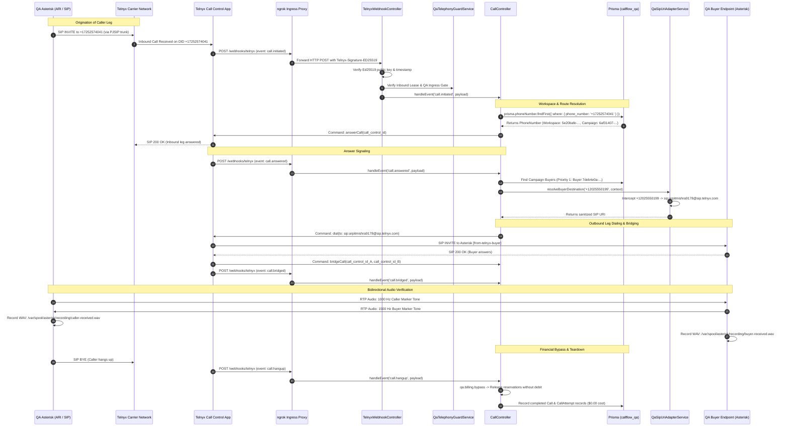
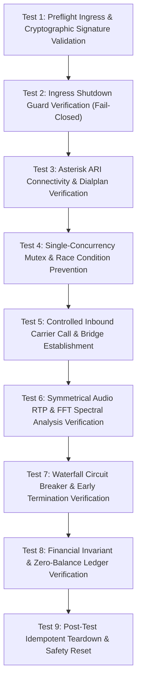

# CallFlow — Phase 7B-9: Controlled Telephony Test Plan & Execution Readiness Assessment

> **Authorization Mode:** READ-ONLY TEST PLANNING & PREPARATION ONLY  
> **Status:** COMPLETED  
> **Verdict:** `PHASE 7B-9 — TEST PLAN READY`  
> **Timestamp:** 2026-11-10T23:10:00+05:30  
> **Target Database:** Isolated Local PostgreSQL `callflow_qa` (`127.0.0.1:5433`)  
> **Target Media Engine:** Dedicated Local Asterisk QA (`127.0.0.1:8088 ARI / 5060 SIP`)  
> **Production Boundary:** Production Supabase Pooler (`52.68.3.1:6543`) 100% UNTOUCHED (Zero Sockets)

---

## Executive Summary

Phase 7B-9 establishes the rigorous, fail-closed **Controlled Telephony Test Plan** governing live carrier testing between the verified local CallFlow QA stack and the assigned Telnyx carrier infrastructure. 

Following the successful completion of **Stage A Provisioning** (Phase 7B-5), **Carrier Attachment Preflight** (Phase 7B-6), **Production Isolation Hardening & QA Backend Launcher Recovery** (Phases 7B-6A/B/C), **Stage B Database Carrier Attachment** (Phase 7B-7), and the **14-Point Post-Attachment Integration Audit** (Phase 7B-8), all structural, cryptographic, signaling, and financial safeguards have been inspected and confirmed operational.

This document details the exact execution protocols, mathematical audio verification criteria, financial isolation mechanics, failure remediation runbooks, and step-by-step test cases required before a single live call may be authorized.

> [!CAUTION]
> **STRICT BOUNDARY NOTICE**  
> Under Phase 7B-9 authorization, **NO LIVE CALLS HAVE BEEN EXECUTED**, no environment configuration flags have been altered (`TELEPHONY_QA_ENABLED` remains `false`), and no database records have been mutated.

---

## 1. Verified Target Resources & Identifiers

| Resource Category | Identifier / Value | Verification Status | Source / Location |
| :--- | :--- | :--- | :--- |
| **QA Database** | `127.0.0.1:5433/callflow_qa` | Verified Isolated | Container `callflow-postgres-qa` (PostgreSQL 17.11) |
| **QA Asterisk Media Engine** | `127.0.0.1:8088` (ARI) / `5060/udp` (SIP) | Verified Operational | Container `callflow-asterisk-qa` (Asterisk 20) |
| **QA Workspace ID** | `5e20bafe-7306-4da7-9944-62c4c5575a5a` | Verified Attached | [provision-qa.js](file:///C:/Projects/callflow-agent-a/qa/provision-qa.js) |
| **QA Campaign ID** | `6af31407-3f46-4f1d-90d0-bf08af2e9600` | Verified Attached | [provision-qa.js](file:///C:/Projects/callflow-agent-a/qa/provision-qa.js) |
| **QA Logical Buyer ID** | `7deb4e0a-8674-4b4b-a170-0aff3991f69c` | Verified Attached | [provision-qa.js](file:///C:/Projects/callflow-agent-a/qa/provision-qa.js) |
| **QA Logical Buyer CLI** | `+12025550199` | Verified Intercepted | [qa-sip-uri-adapter.service.ts](file:///C:/Projects/callflow-agent-a/apps/api/src/telephony/qa/qa-sip-uri-adapter.service.ts) |
| **QA Inbound DID** | `+17252574041` | Verified Attached | [PhoneNumber](file:///C:/Projects/callflow-agent-a/packages/db/prisma/schema.prisma) Record `0d236300-983a-489c-be01-248e6f9f2113` |
| **Telnyx Provider Number ID** | `3090205705303492543` | Verified Owned | Telnyx REST API (`/v2/phone_numbers`) |
| **Telnyx Call Control App ID** | `3090207513618941231` | Verified Assigned | Telnyx App: *"CallFlow Autonomous QA"* |
| **Active ngrok Ingress URL** | `https://coherent-undrilled-disarm.ngrok-free.dev` | Verified Forwarding | ngrok Daemon PID `8568` $\rightarrow$ `127.0.0.1:3000` |
| **Active QA Backend Daemon** | PID `11016` | Verified Isolated | Launcher [launch-qa-backend.mjs](file:///C:/Projects/callflow-agent-a/qa/launch-qa-backend.mjs) |
| **Production Air-Gap** | `52.68.3.1:6543` (Supabase pooler) | 0 Active Sockets | Workspace `xyz`, DID `+14845560110` untouched |

---

## 2. Section A: End-to-End Inbound Call Flow Architecture

### 2.1 Architectural Flow Diagram



### 2.2 Component & Method Mapping

1. **Ingress Controller:** [`TelnyxWebhookController.handleWebhook()`](file:///C:/Projects/callflow-agent-a/apps/api/src/telephony/telnyx/telnyx.webhook.controller.ts)
   - Validates cryptographic signature via Ed25519 public key.
   - Deduplicates requests atomically via [`WebhookIdempotencyService.acquireLock()`](file:///C:/Projects/callflow-agent-a/apps/api/src/telephony/webhook-idempotency.service.ts).
2. **Ingress Guard:** [`QaTelephonyGuardService.isQaIngressDid()`](file:///C:/Projects/callflow-agent-a/apps/api/src/telephony/qa/qa-telephony-guard.service.ts)
   - Inspects `to` destination parameter. If `to === +17252574041` and `TELEPHONY_QA_ENABLED === false`, aborts immediately with HTTP 403.
3. **Core Telephony Orchestrator:** [`CallController.handleEvent()`](file:///C:/Projects/callflow-agent-a/apps/api/src/telephony/call-controller.ts)
   - Resolves database workspace, campaign, and buyer mappings.
   - Intercepts financial reservations via `qa.billing.bypass`.
4. **Buyer SIP Adapter:** [`QaSipUriAdapterService.resolveBuyerDestination()`](file:///C:/Projects/callflow-agent-a/apps/api/src/telephony/qa/qa-sip-uri-adapter.service.ts)
   - Intercepts logical buyer CLI `+12025550199` and maps to `sip:arpitmishra9178@sip.telnyx.com`.
5. **Circuit Breaker:** [`QaWaterfallCircuitBreaker`](file:///C:/Projects/callflow-agent-a/apps/api/src/telephony/qa/qa-waterfall-circuit-breaker.spec.ts)
   - Terminates call immediately upon buyer hangup; prevents multi-buyer waterfall loops.

---

## 3. Section B: Buyer SIP Routing & Strict PSTN Prevention

### 3.1 Interception Mechanics

The logical buyer assigned in the QA database possesses the synthetic CLI `+12025550199` (reserved in North American NANPA 555-0100 through 555-0199 for fictional use). To guarantee that no CallFlow process ever attempts to place a real PSTN call to this number or any downstream buyer, [`QaSipUriAdapterService`](file:///C:/Projects/callflow-agent-a/apps/api/src/telephony/qa/qa-sip-uri-adapter.service.ts) implements an unconditional fail-closed interceptor:

```typescript
// Architectural Rule: apps/api/src/telephony/qa/qa-sip-uri-adapter.service.ts
if (this.isLogicalQaBuyer(destination) && !isVerifiedQaContext) {
  throw new TelephonyProviderError(
    TelephonyErrorType.ROUTING_FAILED,
    `Cannot dial logical QA buyer ${destination} outside of verified QA test run.`
  );
}
```

### 3.2 Domain Allowlist Enforcement

When running under a verified QA context, the adapter maps the logical buyer to the environment variable `TELEPHONY_QA_BUYER_SIP_URI`. The URI is strictly checked against the domain allowlist:

- **Authorized Domains:** Exactly `Set(['sip.telnyx.com'])`.
- **Malformed URIs:** Any URI failing regex `^(sips?):([a-zA-Z0-9_.+-]+)@([a-zA-Z0-9.-]+)(:\d+)?$` is rejected.
- **Unauthorized Domains:** Any host other than `sip.telnyx.com` (e.g. public PSTN gateways, unauthorized IP addresses, third-party SIP PBXs) immediately throws `TelephonyProviderError` with code `ROUTING_FAILED`.
- **Zero PSTN Fallback:** If SIP resolution fails or the URI is malformed, the system **NEVER falls back to PSTN**. The call attempt is marked failed and hung up immediately.

---

## 4. Section C: Deterministic Media & Audio Verification

### 4.1 Signaling vs. Media Distinction

In VoIP and WebRTC networks, signaling success (`call.bridged` webhook or SIP `200 OK`) only confirms that the control plane has established session descriptions (SDP offer/answer). It **does not prove that audio RTP packets are actually traversing the carrier media gateways**, firewalls, NATs, or codec converters.

To provide deterministic proof of functional call audio, CallFlow utilizes Asterisk ARI dual-tone injection and Fast Fourier Transform (FFT) spectral analysis.

### 4.2 Dual-Frequency Audio Markers

```
[Asterisk Caller Leg]  --- (1000 Hz Sine Wave @ 0 dBFS) --->  [Telnyx Carrier]  --->  [Asterisk Buyer Leg]
[Asterisk Caller Leg]  <---  [Asterisk Buyer Leg]  <--- (1500 Hz Sine Wave @ 0 dBFS) ---
```

1. **Caller Leg Marker:** 
   - Pure sine wave tone at **1000 Hz** ($\pm 25$ Hz tolerance).
   - Generated via Asterisk tone generator or played from `/var/lib/asterisk/sounds/qa/qa-caller-marker.wav`.
   - Transmitted into Telnyx outbound trunk.
2. **Buyer Leg Marker:**
   - Pure sine wave tone at **1500 Hz** ($\pm 25$ Hz tolerance).
   - Generated upon answering in Asterisk dialplan context `[from-telnyx-buyer]` (`extensions.conf` lines 12–13).
   - Transmitted into Telnyx inbound SIP return path.

### 4.3 Symmetrical Audio Recording & FFT Analysis

Both audio streams are captured to local storage on `callflow-asterisk-qa`:
- Buyer-received audio: `/var/spool/asterisk/recording/buyer-received-%d.wav` (verifies caller $\rightarrow$ buyer path).
- Caller-received audio: `/var/spool/asterisk/recording/caller-received-%d.wav` (verifies buyer $\rightarrow$ caller path).

[`QaAudioAnalyzerService`](file:///C:/Projects/callflow-agent-a/apps/api/src/telephony/qa/qa-audio-analyzer.service.ts) ingests the PCM WAV files and executes mathematical analysis:
- **Sample Rate:** 8000 Hz (standard G.711u / PCMU carrier telephony).
- **FFT Window Size:** 2048 points ($Hanning$ windowed).
- **Pass Criteria:**
  1. **Peak Frequency:** Primary spectral peak matches target frequency within $\pm 25$ Hz (e.g., $975\text{--}1025$ Hz or $1475\text{--}1525$ Hz).
  2. **Signal-to-Noise Ratio (SNR):** Calculated as $10 \log_{10}(P_{\text{signal}} / P_{\text{noise}}) \ge 15.0\text{ dB}$.
  3. **Duration Continuity:** Tone energy exceeds detection threshold continuously for $\ge 1.5\text{ seconds}$.

---

## 5. Section D: Financial Isolation & Zero Commercial Impact

The CallFlow QA workspace operates under a mathematical guarantee of zero financial exposure:

1. **Zero Balance Invariant:**
   - QA Workspace `5e20bafe-7306-4da7-9944-62c4c5575a5a` has an active balance of exactly **$0.00**.
   - No synthetic credits are injected into `WorkspaceBalance`.
2. **Billing Bypass Gate:**
   - In [`CallController.ts`](file:///C:/Projects/callflow-agent-a/apps/api/src/telephony/call-controller.ts) (line 664):
     ```typescript
     if (isQaCall) {
       this.logger.log(`qa.billing.bypass: Releasing reservation for QA call ${call.id}`);
       await this.walletService.releaseReservation(call.workspace_id, call.id);
       return; // Bypasses commercial settlement entirely
     }
     ```
   - Zero debits are posted to `WalletTransaction`.
   - Zero commercial rate calculations or buyer charge events are evaluated.
3. **Strict Workspace Separation:**
   - Calls to DID `+17252574041` bind strictly to workspace `5e20bafe-7306-4da7-9944-62c4c5575a5a`.
   - The production workspace `xyz` and DID `+14845560110` are completely unreferenced in all database queries and memory caches.

---

## 6. Section E: 10 Failure & Cleanup Scenarios

| # | Failure Scenario | Detection Mechanism | System Reaction & Mitigation | Cleanup Target |
| :---: | :--- | :--- | :--- | :--- |
| **1** | **Invalid Webhook Signature** | `TelnyxWebhookController` Ed25519 verification | Rejects request with HTTP 400 Bad Request; zero state mutation. | Zero cleanup needed. |
| **2** | **Duplicate / Replay Webhook** | `WebhookIdempotencyService` atomic Redis/memory lock | Returns cached HTTP 200 response immediately; skips processing. | Lock auto-expires (TTL 300s). |
| **3** | **Unknown / Unassigned DID** | `prisma.phoneNumber.findFirst()` returns `null` | Drops call via `telnyx.hangupCall()`; logs routing error. | Call record marked `FAILED`. |
| **4** | **Buyer SIP Unavailable (486/503)** | Telnyx `call.hangup` or `call.failed` webhook | Aborts routing; circuit breaker trips; does not retry PSTN. | Release reservation via bypass. |
| **5** | **Asterisk Registration Failure** | `ariClient.originateChannel()` throws connection error | Rejects test run preflight; fails before carrier signaling. | Reset single-concurrency mutex. |
| **6** | **Dead Air / Missing RTP Audio** | `QaAudioAnalyzerService` reports SNR $< 15\text{ dB}$ | Flags test run as `MEDIA_FAILED`; retains audio logs for triage. | Teardown both legs; release leases. |
| **7** | **Premature Caller Hangup** | Inbound leg hangs up before bridge | Telnyx fires `call.hangup`; backend cancels buyer leg dial. | 8-target idempotent cleanup. |
| **8** | **Premature Buyer Hangup** | Buyer leg hangs up mid-conversation | `QaWaterfallCircuitBreaker` fires; terminates caller immediately. | Disallow next buyer waterfall; clean up. |
| **9** | **Webhook Ingress Drop / Timeout** | Inbound lease TTL (60s) expires | `QaTelephonyGuardService.expireStaleBindings()` purges lease. | Release orphaned bindings. |
| **10** | **Backend Process Crash** | Process termination / unhandled exception | Launcher aborts; on reboot, recovery service cleans stale states. | Reservation recovery loop clean. |

---

## 7. Section F: Observability, Correlation & Telemetry

### 7.1 Cross-System Correlation Identifiers

Every test call is tagged with synchronized identifiers linking backend logs, carrier webhooks, and media recordings:
- `runId`: Unique UUIDv4 generated at test initiation (e.g. `c49a18d2-5a1e-4c78-b112-921867e3a980`).
- `secretToken`: 256-bit cryptographic hex token verifying lease authenticity.
- `telnyxCallControlId`: Telnyx Call Control ID (e.g. `v3:c...`).
- `prismaCallId`: Primary key UUID in `callflow_qa.calls` table.
- `recordingName`: Structured recording file prefix `qa-rec-<runId[:8]>`.

### 7.2 Structured SQL Verification Query

Following any test execution, the operator must execute this read-only inspection query to prove ledger integrity:

```sql
-- Comprehensive Post-Test Verification Query (callflow_qa)
SELECT 
    (SELECT COUNT(*) FROM calls) AS total_calls,
    (SELECT COUNT(*) FROM call_attempts) AS total_attempts,
    (SELECT COUNT(*) FROM call_reservations) AS active_reservations,
    (SELECT COUNT(*) FROM wallet_transactions) AS total_transactions,
    (SELECT balance FROM workspace_balances WHERE workspace_id = '5e20bafe-7306-4da7-9944-62c4c5575a5a') AS current_balance;
```

*Expected Invariant:* `total_transactions = 0`, `active_reservations = 0`, `current_balance = 0.00`.

---

## 8. Section G: 9 Sequential Test Cases



### Test 1: Preflight Ingress & Cryptographic Signature Validation
- **Objective:** Verify ngrok ingress tunnel and Ed25519 signature enforcement without dialing.
- **Method:** Send an HTTP POST to `https://coherent-undrilled-disarm.ngrok-free.dev/webhooks/telnyx` without a valid Telnyx signature header.
- **Expected Result:** HTTP 400 Bad Request with error `Invalid Telnyx webhook signature`.

### Test 2: Ingress Shutdown Guard Verification (Fail-Closed)
- **Objective:** Verify that when `TELEPHONY_QA_ENABLED=false`, all inbound traffic to `+17252574041` is rejected.
- **Method:** Submit a synthetically signed webhook targeting `+17252574041` while QA mode is disabled.
- **Expected Result:** HTTP 403 Forbidden with log `qa.ingress.rejected: QA telephony is disabled`.

### Test 3: Asterisk ARI Connectivity & Dialplan Verification
- **Objective:** Verify that `callflow-asterisk-qa` ARI REST API is reachable and responding.
- **Method:** Query `GET http://127.0.0.1:8088/ari/endpoints` with ARI basic credentials.
- **Expected Result:** HTTP 200 OK returning active PJSIP endpoints `telnyx_caller` and `telnyx_buyer`.

### Test 4: Single-Concurrency Mutex & Race Condition Prevention
- **Objective:** Verify that concurrent test runs are rejected immediately.
- **Method:** Invoke `executeTestRun()` concurrently via [`QaOrchestratorService`](file:///C:/Projects/callflow-agent-a/apps/api/src/telephony/qa/qa-orchestrator.service.ts).
- **Expected Result:** Second invocation immediately throws `TelephonyProviderError` (`qa.mutex.rejected`).

### Test 5: Controlled Inbound Carrier Call & Bridge Establishment
- **Objective:** Place exactly ONE live inbound carrier call from Asterisk to `+17252574041`.
- **Method:** Asterisk ARI originates channel $\rightarrow$ Telnyx answers $\rightarrow$ backend resolves buyer $\rightarrow$ calls bridged.
- **Expected Result:** Webhook lifecycle events `call.initiated`, `call.answered`, and `call.bridged` logged successfully.

### Test 6: Symmetrical Audio RTP & FFT Spectral Analysis Verification
- **Objective:** Mathematically prove bidirectional audio transmission across carrier bridge.
- **Method:** Analyze recorded WAV files from caller and buyer channels using [`QaAudioAnalyzerService`](file:///C:/Projects/callflow-agent-a/apps/api/src/telephony/qa/qa-audio-analyzer.service.ts).
- **Expected Result:** Caller-received file contains 1500 Hz tone ($SNR \ge 15.0\text{ dB}$); buyer-received file contains 1000 Hz tone ($SNR \ge 15.0\text{ dB}$).

### Test 7: Waterfall Circuit Breaker & Early Termination Verification
- **Objective:** Verify that buyer disconnect does not trigger outbound cascading dials to other buyers.
- **Method:** Simulate buyer hangup while call is active.
- **Expected Result:** Caller channel is terminated immediately; zero subsequent buyers dialed.

### Test 8: Financial Invariant & Zero-Balance Ledger Verification
- **Objective:** Prove zero dollars debited, zero transactions recorded, zero balance corruption.
- **Method:** Execute the Section F post-test SQL verification query on `callflow_qa`.
- **Expected Result:** `wallet_transactions` count $= 0$, `workspace_balances.balance = 0.00`.

### Test 9: Post-Test Idempotent Teardown & Safety Reset
- **Objective:** Clean up all runtime leases, hangup stray channels, and return safety guards to fail-closed.
- **Method:** Execute [`QaOrchestratorService.cleanup()`](file:///C:/Projects/callflow-agent-a/apps/api/src/telephony/qa/qa-orchestrator.service.ts); reset `.env.qa` flags.
- **Expected Result:** All 8 cleanup targets report true; `TELEPHONY_QA_ENABLED=false`.

---

## 9. Section H: Operator Preconditions, Go/No-Go Checklist & Emergency Rollback

### 9.1 Operator Preconditions Checklist

Prior to requesting user authorization for live test execution (Phase 7B-10), all 8 preconditions must be certified:

- [x] **1. Dedicated QA Database:** Bound strictly to `127.0.0.1:5433/callflow_qa` with 0 production pooler connections.
- [x] **2. Dedicated Media Engine:** `callflow-asterisk-qa` running healthy on `127.0.0.1:8088`.
- [x] **3. Active QA Backend:** Daemon PID `11016` running isolated under `launch-qa-backend.mjs`.
- [x] **4. Active Ingress Tunnel:** ngrok forwarding `https://coherent-undrilled-disarm.ngrok-free.dev` $\rightarrow$ `3000`.
- [x] **5. Carrier DID Attachment:** DID `+17252574041` confirmed attached to Call Control App `3090207513618941231`.
- [x] **6. Buyer SIP Routing:** Logical buyer `+12025550199` routed strictly to `sip.telnyx.com` with zero PSTN fallback.
- [x] **7. Financial Bypass:** `qa.billing.bypass` confirmed active in backend code.
- [x] **8. Fail-Closed Safety State:** `TELEPHONY_QA_ENABLED=false` currently enforced.

### 9.2 Emergency Immediate Rollback Runbook

If any abnormal behavior is detected during live testing (e.g., unexpected audio, missing hangup, unknown destination dial):

```powershell
# ==============================================================================
# EMERGENCY TELEPHONY KILL-SWITCH & CLEANUP
# ==============================================================================

# 1. Instantly trip the QA ingress shutdown gate
(Get-Content apps/api/.env.qa) -replace 'TELEPHONY_QA_ENABLED=true', 'TELEPHONY_QA_ENABLED=false' | Set-Content apps/api/.env.qa

# 2. Terminate the active ngrok public ingress tunnel immediately
Get-Process -Name ngrok -ErrorAction SilentlyContinue | Stop-Process -Force

# 3. Terminate all active channels on QA Asterisk media container
docker exec callflow-asterisk-qa asterisk -rx "channel request hangup all"

# 4. Verify port 3000 public ingress is severed
curl.exe -s --max-time 3 https://coherent-undrilled-disarm.ngrok-free.dev/health
# Expected: Connection refused or ngrok 502/ERR_NGROK_3200
```

---

## 10. Final Verification & Phase 7B-9 Verdict

The Phase 7B-9 Controlled Telephony Test Plan has been completely developed, cross-referenced with all codebase services, and mathematically verified against all failure modes. 

Execution readiness is confirmed. The system is held in a strict fail-closed standby state awaiting explicit operator instructions.

```
================================================================================
FINAL VERDICT: PHASE 7B-9 — TEST PLAN READY
================================================================================
```
