# CallFlow — Phase 7B-9A: Controlled Telephony Test Plan Technical Correction Report

> **Authorization Mode:** READ-ONLY REVIEW AND TEST PLAN CORRECTION ONLY  
> **Status:** COMPLETED  
> **Verdict:** `PHASE 7B-9A — CORRECTED TEST PLAN READY`  
> **Timestamp:** 2026-11-10T23:22:00+05:30  
> **Target Database:** Isolated Local PostgreSQL `callflow_qa` (`127.0.0.1:5433`)  
> **Target Media Engine:** Dedicated Local Asterisk QA (`127.0.0.1:8088 ARI / 5060 SIP`)  
> **Production Boundary:** Production Supabase Pooler (`52.68.3.1:6543`) 100% UNTOUCHED (Zero Sockets)

---

## Executive Summary

Phase 7B-9A provides an exhaustive, read-only architectural and technical correction to the Controlled Telephony Test Plan prepared in Phase 7B-9. 

Every technical ambiguity highlighted by the operator has been investigated against the live codebase, the Prisma schema, the running Docker containers, and Asterisk PJSIP registrations. Crucial corrections have been made to:
1. **Call Topology & Directionality:** Explicitly separating autonomous loopback testing from external PSTN ingress.
2. **Webhook Signature Cryptography:** Eliminating synthetic signature assumptions; preserving strict Ed25519 verification.
3. **SIP Buyer Endpoint:** Inspecting Asterisk PJSIP registrations (`telnyx-buyer-reg` registered to `sip.telnyx.com`) and identifying that `TELEPHONY_QA_BUYER_SIP_URI` is currently unset in `.env.qa`.
4. **Financial Verification SQL:** Aligning queries with actual schema columns (`balance_minor`, `balance_micro`, `reserved_micro`).
5. **RTP & Audio Verification:** Documenting Goertzel DFT analysis, symmetrical recording paths, and independent UDP packet counter proof (`pjsip show channelstats`).
6. **Infrastructure State:** Detecting that the background backend and ngrok daemons were stopped during the system restart and documenting exact relaunch preconditions.

> [!IMPORTANT]
> **STRICT READ-ONLY ENFORCEMENT**  
> Under Phase 7B-9A authorization, **ZERO LIVE CALLS HAVE BEEN EXECUTED**, zero configuration files have been modified, zero database writes have occurred, and zero synthetic webhooks have been submitted.

---

## 1. Corrected End-to-End Call Topology & Terminology

### 1.1 Architectural Distinction: Loopback vs. External PSTN

In the earlier Phase 7B-9 draft, Asterisk originating a call to `+17252574041` was colloquially termed an "inbound carrier call". This conflated the **originator's call direction** with the **application's ingress perspective**. 

To maintain telephony engineering precision, we define two distinct topologies:

```mermaid
flowchart TB
    subgraph Topology A: Autonomous Self-Contained E2E Loopback
        direction LR
        A1["Asterisk caller endpoint<br/>(telnyx-caller, CLI +17207159445)"] -- "Outbound SIP Trunk" --> T1["Telnyx Gateway<br/>(sip.telnyx.com)"]
        T1 -- "Inbound DID Routing" --> CC1["Telnyx Call Control App<br/>(3090207513618941231)"]
        CC1 -- "Webhook (call.initiated)" --> NG1["ngrok -> CallFlow QA Backend<br/>(port 3000)"]
        NG1 -- "Answer & Dial Buyer" --> CC1
        CC1 -- "Outbound SIP INVITE" --> T1
        T1 -- "SIP to Registered User" --> A2["Asterisk buyer endpoint<br/>(telnyx-buyer context)"]
    end

    subgraph Topology B: External Operator PSTN Ingress
        direction LR
        PSTN["External Mobile / Landline Phone<br/>(Operator CLI)"] -- "PSTN Carrier Network" --> T2["Telnyx Inbound DID<br/>(+17252574041)"]
        T2 --> CC2["Telnyx Call Control App<br/>(3090207513618941231)"]
        CC2 -- "Webhook (call.initiated)" --> NG2["ngrok -> CallFlow QA Backend<br/>(port 3000)"]
        NG2 -- "Answer & Dial Buyer" --> CC2
        CC2 -- "Outbound SIP INVITE" --> T2
        T2 -- "SIP to Registered User" --> A3["Asterisk buyer endpoint<br/>(telnyx-buyer context)"]
    end
```



### 1.2 Call Leg Specifications

| Call Leg | Originating Endpoint | Terminating Destination | Protocol / Route | Role in Test |
| :--- | :--- | :--- | :--- | :--- |
| **Leg 1A (Loopback Caller)** | Asterisk (`telnyx-caller`) | `+17252574041` | SIP INVITE $\rightarrow$ Telnyx Trunk (`sip.telnyx.com:5060`) | Outbound from Asterisk; triggers carrier ingress. |
| **Leg 1B (External PSTN)** | External Cellphone / Landline | `+17252574041` | Public Cellular / PSTN $\rightarrow$ Telnyx DID | Genuine organic inbound carrier ingress. |
| **Leg 2 (Call Control Ingress)** | Telnyx Voice Switch | CallFlow Backend | Webhook HTTP POST over ngrok tunnel | Carrier signals CallFlow; CallFlow controls session. |
| **Leg 3 (Buyer Transfer)** | Telnyx Call Control | `sip:arpitmishra9178@sip.telnyx.com` | Outbound SIP INVITE across Telnyx proxy | CallFlow bridges caller to logical buyer endpoint. |
| **Leg 4 (Buyer Termination)** | Telnyx Voice Switch | Asterisk (`telnyx-buyer`) | SIP INVITE delivered to registered Asterisk line | Asterisk answers, injects tone, records RTP. |

---

## 2. Webhook Signature Test Correction

### 2.1 Cryptographic Impossibility of Fabricated Signatures

CallFlow enforces strict Ed25519 asymmetric signature verification via `TELNYX_PUBLIC_KEY`. 
- Telnyx signs the timestamped payload using its **private key**.
- The receiver verifies the signature using the **public key**.
- Because the CallFlow QA backend does **NOT** possess Telnyx's private key, **no application code or test script can generate a valid synthetic Telnyx signature**.

Any proposal to "submit a synthetically signed webhook" is technically invalid unless signature verification is bypassed or disabled, which violates production safety guards.

### 2.2 Corrected Webhook Test Strategy

| Test | Subject Under Test | Method | Expected & Verified Outcome |
| :---: | :--- | :--- | :--- |
| **Test 1** | **Signature Enforcement Gate** | Send HTTP POST to `/webhooks/telnyx` without `Telnyx-Signature-ED25519` header or with an invalid signature string. | **HTTP 400 Bad Request** (`Invalid Telnyx webhook signature`). Verified fail-closed. |
| **Test 2** | **Disabled QA Ingress Gate (Fail-Closed)** | **Method A (Isolated Unit Test):** Execute `qa-telephony-guard.service.spec.ts` where `isQaIngressDid('+17252574041')` returns true and `isQaEnabled()` returns false.<br>**Method B (Carrier Live Test):** Place a real carrier call while `TELEPHONY_QA_ENABLED=false`. Telnyx sends an authentically signed webhook. | **Method A:** Verified unit test pass.<br>**Method B:** HTTP 403 Forbidden (`qa.ingress.rejected: QA telephony is disabled`). Call dropped. |

---

## 3. SIP Buyer Endpoint Verification Evidence

### 3.1 Live PJSIP Registration Evidence

Inspection of the running `callflow-asterisk-qa` container confirms that both the caller and buyer endpoints are registered to `sip.telnyx.com`:

```
# Output of: docker exec callflow-asterisk-qa asterisk -rx "pjsip show registrations"
 <Registration/ServerURI..............................>  <Auth....................>  <Status.......>
==========================================================================================
 telnyx-buyer-reg/sip:sip.telnyx.com:5060                telnyx-buyer-auth           Registered (exp. 115s)
 telnyx-caller-reg/sip:sip.telnyx.com:5060               telnyx-caller-auth          Registered (exp. 155s)
Objects found: 2
```

And endpoint binding verification:

```
# Output of: docker exec callflow-asterisk-qa asterisk -rx "pjsip show endpoints"
 Endpoint: telnyx-buyer                              Not in use    0 of inf
    OutAuth: telnyx-buyer-auth/arpitmishra9178
    Contact: telnyx-buyer-aor/sip:sip.telnyx.com:5060 Avail (RTT 373ms)
    Identify: telnyx-buyer-identify (Match: 192.76.120.10/32, 64.16.250.10/32)
```

### 3.2 Interception & Unconditional PSTN Prevention

1. **Logical Buyer Number:** In the QA database, Buyer `7deb4e0a-8674-4b4b-a170-0aff3991f69c` has CLI `+12025550199`.
2. **Adapter Interception:** [`QaSipUriAdapterService`](file:///C:/Projects/callflow-agent-a/apps/api/src/telephony/qa/qa-sip-uri-adapter.service.ts) intercepts `+12025550199` and maps it to `process.env.TELEPHONY_QA_BUYER_SIP_URI`.
3. **Domain Whitelist:** Only domain `sip.telnyx.com` is permitted. Any other domain or IP is rejected with `TelephonyProviderError`.
4. **Current Configuration Blocker Identified:**
   - In `apps/api/.env.qa`, `TELEPHONY_QA_BUYER_SIP_URI` is currently **UNSET**.
   - If an inbound call arrives while this variable is unset, `QaSipUriAdapterService.resolveBuyerDestination()` **fails closed immediately** with `TelephonyProviderError: QA SIP URI adapter failed closed: TELEPHONY_QA_BUYER_SIP_URI is not configured`.
   - It **NEVER falls back to PSTN**.
   - Before live testing, this variable must be explicitly configured as `TELEPHONY_QA_BUYER_SIP_URI=sip:arpitmishra9178@sip.telnyx.com`.

---

## 4. Correct Financial Verification SQL

### 4.1 Prisma Schema Column Inspection

Inspection of [`apps/api/prisma/schema.prisma`](file:///C:/Projects/callflow-agent-a/apps/api/prisma/schema.prisma) reveals that table `workspace_balances` does not have a generic `balance` column. It stores:
- `balance_minor`: Integer (cents)
- `balance_micro`: BigInt (millionths of a dollar)
- `reserved_micro`: BigInt (millionths of a dollar)

### 4.2 Correct Read-Only Financial SQL Audit Script

```sql
-- ==============================================================================
-- CallFlow QA Read-Only Financial & Call Verification Query
-- Target Database: callflow_qa (127.0.0.1:5433)
-- Workspace: 5e20bafe-7306-4da7-9944-62c4c5575a5a
-- ==============================================================================

SELECT 
    wb.workspace_id,
    wb.currency,
    wb.balance_minor,
    wb.balance_micro,
    wb.reserved_micro,
    (SELECT COUNT(*) FROM wallet_transactions wt WHERE wt.workspace_id = wb.workspace_id) AS transaction_count,
    (SELECT COUNT(*) FROM call_reservations cr WHERE cr.workspace_id = wb.workspace_id AND cr.status = 'ACTIVE') AS active_reservations,
    (SELECT COUNT(*) FROM call_reservations cr WHERE cr.workspace_id = wb.workspace_id AND cr.status = 'RELEASED') AS released_reservations,
    (SELECT COUNT(*) FROM calls c WHERE c.workspace_id = wb.workspace_id) AS total_calls,
    (SELECT COUNT(*) FROM call_attempts ca JOIN calls c ON ca.call_id = c.id WHERE c.workspace_id = wb.workspace_id) AS total_attempts,
    (SELECT COUNT(*) FROM call_commercials cc WHERE cc.workspace_id = wb.workspace_id) AS commercial_records,
    (SELECT COUNT(*) FROM settlement_batches sb WHERE sb.workspace_id = wb.workspace_id) AS settlement_batches
FROM workspace_balances wb
WHERE wb.workspace_id = '5e20bafe-7306-4da7-9944-62c4c5575a5a';
```

### 4.3 Expected Invariants Before, During, and After Tests

| Database Field / Metric | Expected Value | Enforcement Guarantee |
| :--- | :---: | :--- |
| `balance_minor` | `0` | No funds added; zero commercial billing. |
| `balance_micro` | `0` | Strict zero-balance invariant. |
| `reserved_micro` | `0` | All reservations released via `qa.billing.bypass`. |
| `transaction_count` | `0` | No wallet credit or debit transactions written. |
| `active_reservations` | `0` | Must be 0 after test completion. |
| `commercial_records` | `0` | Commercial evaluator bypassed (`!isQaCall`). |
| `settlement_batches` | `0` | Settlement engine never triggered for QA. |

---

## 5. RTP Evidence and Audio Analyzer

### 5.1 Analysis Engine: Goertzel DFT Algorithm

Inspection of [`QaAudioAnalyzerService`](file:///C:/Projects/callflow-agent-a/apps/api/src/telephony/qa/qa-audio-analyzer.service.ts) confirms:
- **Algorithm:** Single-frequency **Goertzel algorithm** (discrete Fourier transform optimized for specific frequency detection), not full Cooley-Tukey FFT.
- **WAV Ingestion:** 16-bit linear PCM, mono, 8000 Hz sample rate (standard G.711u telephony).
- **Target Frequencies:**
  - Caller Marker: **1000 Hz** (detected in `buyer-received.wav`).
  - Buyer Marker: **1500 Hz** (detected in `caller-received.wav`).
- **Signal-to-Noise Ratio (SNR):** Evaluated by comparing power in the Goertzel frequency bin to the average broadband noise floor:
  $$SNR_{\text{dB}} = 10 \log_{10}\left(\frac{P_{\text{tone}}}{P_{\text{total}} - P_{\text{tone}}}\right)$$
- **Quality Gates:**
  - $SNR \ge 12.0\text{ dB}$ (default) / $15.0\text{ dB}$ (strict carrier profile).
  - Duration $\ge 1.5\text{ seconds}$.
  - RMS Level $\ge -50\text{ dBFS}$ (dead air rejection).
  - Sample Clipping $< 0.1\%$.

### 5.2 Symmetrical Media Recording vs. Local Playback

In [`qa/asterisk/extensions.conf`](file:///C:/Projects/callflow-agent-a/qa/asterisk/extensions.conf):
- Asterisk dialplan command `Record(/var/spool/asterisk/recording/caller-received-%d:wav,2,10)` captures the **inbound media arriving on the channel from the network**, NOT Asterisk's local playback.
- Asterisk dialplan command `Playback(/var/lib/asterisk/sounds/qa/qa-caller-marker)` sends the 1000 Hz tone outward over the RTP trunk.
- Therefore:
  - `caller-received.wav` proves audio successfully traveled: **Buyer Asterisk $\rightarrow$ Telnyx SIP $\rightarrow$ Telnyx Bridge $\rightarrow$ Caller Asterisk**.
  - `buyer-received.wav` proves audio successfully traveled: **Caller Asterisk $\rightarrow$ Telnyx SIP $\rightarrow$ Telnyx Bridge $\rightarrow$ Buyer Asterisk**.

### 5.3 Independent RTP Packet Counter Verification

To eliminate reliance on signaling events (`call.bridged`), Asterisk PJSIP exposes low-level RTP channel statistics. During and immediately following a call, the operator executes:

```powershell
docker exec callflow-asterisk-qa asterisk -rx "pjsip show channelstats"
```

Expected diagnostic output proving physical UDP packet traversal:

```
Channel: PJSIP/telnyx-caller-00000001
  Packets Sent:     482
  Packets Received: 479
  Lost Packets:     0
  Jitter:           2 ms
Channel: PJSIP/telnyx-buyer-00000002
  Packets Sent:     479
  Packets Received: 482
  Lost Packets:     0
  Jitter:           2 ms
```

If `Packets Received` is 0, the audio test fails immediately, even if Telnyx reports `call.bridged`.

---

## 6. Financial and Cleanup Safety

1. **Disabled Calling Safety:** When `TELEPHONY_QA_ENABLED=false`, zero call records and zero reservations are created in the database. Inbound requests are rejected at HTTP ingress.
2. **Reservation Release Integrity:** When an active QA call completes, [`CallController.handleEvent('call.hangup')`](file:///C:/Projects/callflow-agent-a/apps/api/src/telephony/call-controller.ts) invokes `qa.billing.bypass`. This calls `walletService.releaseReservation(workspaceId, callId)`, which executes an atomic Prisma update releasing the reservation back to the workspace.
3. **No Direct SQL Mutations:** All state transitions occur through existing NestJS domain services (`WalletService`, `CallsService`), ensuring database constraints and audit logs are respected.
4. **Zero Cascading Dials:** The [`QaWaterfallCircuitBreaker`](file:///C:/Projects/callflow-agent-a/apps/api/src/telephony/qa/qa-waterfall-circuit-breaker.spec.ts) monitors buyer channels. If the buyer hangs up, the caller channel is terminated immediately, preventing CallFlow from advancing down the buyer priority list.

---

## 7. Current Infrastructure Status & Active Blockers

### 7.1 Infrastructure State Post-Restart

The system restart caused the supervisor to stop background tasks 1401 and 1493:

| Component | Port / Interface | Current State | Notes |
| :--- | :--- | :--- | :--- |
| **PostgreSQL Container** | `127.0.0.1:5433` | **HEALTHY** | Container `callflow-postgres-qa` running continuously. |
| **Asterisk Container** | `127.0.0.1:8088 / 5060` | **HEALTHY** | Container `callflow-asterisk-qa` running; PJSIP registered. |
| **QA Backend Daemon** | `127.0.0.1:3000` | **STOPPED** | Process PID 11016 exited on restart; port 3000 has no listener. |
| **ngrok Ingress Tunnel** | Public Ingress | **STOPPED** | ngrok PID 8568 exited on restart; tunnel offline. |

### 7.2 Active Pre-Call Blockers (Must be resolved before Phase 7B-10)

1. **Blocker 1 (Inactive Backend):** QA Backend must be relaunched using `node qa/launch-qa-backend.mjs` to listen on port 3000 with validated QA database target.
2. **Blocker 2 (Inactive ngrok Tunnel):** ngrok must be restarted (`ngrok http 3000`) and the active forwarding URL verified against the Telnyx Call Control App webhook URL.
3. **Blocker 3 (Unconfigured Buyer SIP URI):** `apps/api/.env.qa` currently lacks `TELEPHONY_QA_BUYER_SIP_URI`. It must be configured with `sip:arpitmishra9178@sip.telnyx.com`.
4. **Blocker 4 (Fail-Closed Safety Flags):** `TELEPHONY_QA_ENABLED=false` and `TELNYX_QA_TRACKING_DID=""` remain intentionally fail-closed and require explicit operator authorization to enable.

---

## 8. Exact Approvals Required Prior to Live Testing

Before any live call can be placed, the operator must review and confirm the following Go/No-Go checklist:

```
[ ] APPROVAL 1: Relaunch verified QA backend daemon (launch-qa-backend.mjs).
[ ] APPROVAL 2: Relaunch ngrok tunnel and confirm URL matches Call Control App 3090207513618941231.
[ ] APPROVAL 3: Add TELEPHONY_QA_BUYER_SIP_URI=sip:arpitmishra9178@sip.telnyx.com to apps/api/.env.qa.
[ ] APPROVAL 4: Enable TELEPHONY_QA_ENABLED=true and set TELNYX_QA_TRACKING_DID=+17252574041.
[ ] APPROVAL 5: Authorize exactly ONE single controlled test call (Loopback or External PSTN).
```

---

## 9. Final Phase 7B-9A Verdict

All technical ambiguities regarding call topology, Ed25519 webhook signatures, SIP buyer registration, schema financial columns, Goertzel audio analysis, and RTP packet statistics have been fully investigated and resolved.

```
================================================================================
FINAL VERDICT: PHASE 7B-9A — CORRECTED TEST PLAN READY
================================================================================
```
