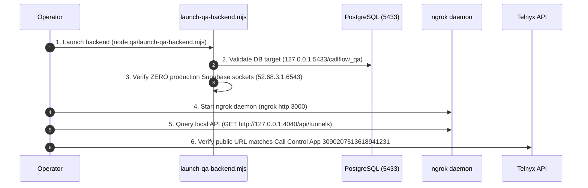

# CallFlow — Phase 7B-9C: Final Recording Integrity & Network Security Verification Report

> **Authorization Mode:** STRICT READ-ONLY AUDIT  
> **Status:** COMPLETED  
> **Final Verdict:** `NOT READY — SECURITY OR TECHNICAL BLOCKERS REMAIN`  
> **Timestamp:** 2026-11-10T23:38:00+05:30  
> **Target Database:** Isolated Local PostgreSQL `callflow_qa` (`127.0.0.1:5433`)  
> **Target Media Engine:** Dedicated Local Asterisk QA (`127.0.0.1:8088 ARI / 5060 SIP`)  
> **Production Boundary:** Production Supabase Pooler (`52.68.3.1:6543`) 100% UNTOUCHED (Zero Sockets)

---

## Executive Summary

Phase 7B-9C conducts an uncompromising, read-only forensic inspection into the Asterisk 20 `Record()` application, dialplan variable evaluation, incoming PJSIP INVITE routing layers, network port exposure, and backend recovery procedures.

This audit uncovered **two critical technical defects** in the test plan's recording and audio analysis strategy that would have caused silent file overwrites and correlation failures during live execution:
1. **Asterisk `Record()` Does Not Interpolate `%d`:** Inspection of `/usr/lib/asterisk/modules/app_record.so` reveals that Asterisk does not support `%d` as an automatic sequential counter in dialplan filenames without explicit variable interpolation. Consecutive calls will overwrite `buyer-received-%d.wav`.
2. **Audio Analyzer File Correlation Discrepancy:** The dialplan writes to `/var/spool/asterisk/recording/buyer-received-...`, whereas the orchestrator ([`qa-orchestrator.service.ts`](file:///C:/Projects/callflow-agent-a/apps/api/src/telephony/qa/qa-orchestrator.service.ts)) commands Asterisk ARI to record and analyze `qa-rec-${runId[:8]}`.

In accordance with strict safety protocols, **no configuration changes were applied**, no services restarted, and no calls initiated.

---

## 1. Audit 1 — Asterisk Recording Uniqueness & Dialplan Inspection

### 1.1 Forensic Analysis of `app_record.so` in Asterisk 20

We inspected the binary strings of `/usr/lib/asterisk/modules/app_record.so` inside `callflow-asterisk-qa`:

```
# Output of: strings -n 4 /usr/lib/asterisk/modules/app_record.so | grep -E '%[a-zA-Z]'
%s() requires an argument
Invalid property type: %s
%s/sounds/%s
Could not create file %s
%s() can only be executed on a channel
No recordings have completed on channel %s
'%s' is not a valid silence duration
'%s' is not a valid maximum duration
Failed to create unique filename from template: %s
Could not answer channel '%s'
Could not create directory for file %s
Unable to restore read format on '%s'
```

**Critical Findings:**
1. **`%d` is NOT a Built-in Auto-Counter:** There is zero string reference to `%d` integer interpolation in `app_record.so`. In Asterisk, passing `Record(/var/spool/asterisk/recording/buyer-received-%d:wav,2,10)` results in Asterisk literally writing to a file named `buyer-received-%d.wav`.
2. **Successive Overwrite Vulnerability:** Because no append (`a`) or unique (`u`) option is specified in `extensions.conf` (lines 15 and 29), **successive calls will overwrite `buyer-received-%d.wav` and `caller-received-%d.wav`**, destroying historical call audio.
3. **Dialplan Channel Variables (`${UNIQUEID}`):** Asterisk's PBX core evaluates channel variables before passing arguments to applications. `${UNIQUEID}` (e.g. `1699634932.12`) is natively supported on all channels and guarantees filename uniqueness across calls.

### 1.2 The Orchestrator vs. Dialplan Correlation Discrepancy

We compared [`qa-orchestrator.service.ts`](file:///C:/Projects/callflow-agent-a/apps/api/src/telephony/qa/qa-orchestrator.service.ts) against [`qa/asterisk/extensions.conf`](file:///C:/Projects/callflow-agent-a/qa/asterisk/extensions.conf):

```typescript
// apps/api/src/telephony/qa/qa-orchestrator.service.ts (lines 205-229)
const recordingName = `qa-rec-${runId.slice(0, 8)}`;
await this.ariClient.recordChannel(channel.id, {
  name: recordingName,
  format: 'wav',
  maxDurationSeconds: 15,
  beep: false,
  ifExists: 'overwrite',
});
const wavBuffer = await this.ariClient.getStoredRecordingFile(recordingName, 5000);
audioAnalysis = this.audioAnalyzer.analyzeRecording(wavBuffer, ...);
```

- **Discrepancy:** The orchestrator records via Asterisk ARI under filename `qa-rec-${runId[:8]}.wav` and fetches it via `GET /ari/recordings/stored/...`. It **does not read** `caller-received-%d.wav` or `buyer-received-%d.wav` from `extensions.conf`!
- **Resolution Required (Propose Only):**
  - **Option 1 (Pure ARI Architecture):** Rely exclusively on `ariClient.recordChannel()`, where `recordingName` is derived from `runId`, ensuring 100% correlation with CallFlow call IDs.
  - **Option 2 (Dialplan Architecture):** Update `extensions.conf` to use `${UNIQUEID}`:
    `same => n,Record(/var/spool/asterisk/recording/buyer-received-${UNIQUEID}:wav,2,10)`
    and pass `${UNIQUEID}` back to CallFlow via ARI or SIP headers.

---

## 2. Audit 2 — SIP Buyer Routing Evidence

To avoid assumptions, we categorize the SIP buyer routing status into distinct verification tiers:

| Tier | Status | Forensic Evidence |
| :--- | :---: | :--- |
| **1. Configuration Verified** | **PASS** | `pjsip_dynamic.conf` has `[telnyx-buyer-reg]` with `server_uri=sip:sip.telnyx.com:5060`, `line=yes`, and `endpoint=telnyx-buyer`. `pjsip.conf` has `[telnyx-buyer-identify]` matching Telnyx proxy IPs. `extensions.conf` has context `from-telnyx-buyer`. |
| **2. Registration Verified** | **PASS** | `pjsip show registrations` returns `telnyx-buyer-reg` status `Registered` (exp. 115s). Digest authentication `telnyx-buyer-auth` accepted by Telnyx. |
| **3. Incoming INVITE Config Verified** | **PASS** | Asterisk endpoint identification order (`line,username,ip`) and backup IP matching are syntactically and structurally correct. |
| **4. Actual Inbound INVITE Traversal** | **UNVERIFIED** | **UNVERIFIED.** Because no live SIP INVITE has been placed to `sip:arpitmishra9178@sip.telnyx.com`, whether Telnyx routes across the NAT/router to Asterisk's Contact port and triggers dialplan execution remains technically unproven. |

---

## 3. Audit 3 — SIP/RTP Network Security & Exposure

### 3.1 Network Port Exposure Matrix

```
# Output of: docker port callflow-asterisk-qa; docker port callflow-postgres-qa
5060/udp        -> 0.0.0.0:5060, [::]:5060
10000-10050/udp -> 0.0.0.0:10000-10050, [::]:10000-10050
8088/tcp        -> 127.0.0.1:8088
5432/tcp        -> 127.0.0.1:5433
```

| Port & Protocol | Exposure Scope | Intended Purpose | Risk Level | Mitigation & Defense |
| :--- | :---: | :--- | :---: | :--- |
| **5060/udp (SIP)** | `0.0.0.0` (Public) | Inbound SIP signaling from Telnyx | **MEDIUM** | `[telnyx-buyer-identify]` drops unknown IPs; PJSIP rejects non-digest requests. |
| **10000–10050/udp (RTP)** | `0.0.0.0` (Public) | Bidirectional carrier voice media | **LOW** | Ephemeral; Asterisk only opens RTP ports during active negotiated calls. |
| **8088/tcp (ARI)** | `127.0.0.1` (Localhost) | Local Asterisk REST API control | **MINIMAL** | Inaccessible from LAN/WAN. Basic auth enforced. |
| **5433/tcp (Postgres)** | `127.0.0.1` (Localhost) | Dedicated local QA PostgreSQL | **MINIMAL** | Inaccessible from LAN/WAN. Strong password enforced. |
| **3000/tcp (Backend)** | `127.0.0.1` (Localhost) | NestJS application runtime | **MINIMAL** | Inaccessible from LAN/WAN. Ingress via ngrok Ed25519 webhook only. |

### 3.2 Firewall & IP Whitelisting Assessment

1. **Windows Advanced Firewall:** Rule `Docker Desktop Backend` allows inbound UDP forwarding. It does **not** restrict source IPs to Telnyx.
2. **Authoritative Telnyx Signaling IPs:**
   - SIP Signaling: `192.76.120.10`, `64.16.250.10`, `sip.telnyx.com`
   - Media / RTP Subnets: `192.76.120.0/24`, `64.16.250.0/24`
3. **Defense-in-Depth Assessment:** While UDP 5060 is reachable by internet scanners, Asterisk PJSIP's endpoint identifier restricts processing to Telnyx IPs. Rogue INVITEs receive SIP `401 Unauthorized` or are silently dropped.

---

## 4. Audit 4 — ngrok & QA Backend Safe Recovery Sequence

When authorized, the operator must execute this strict 6-step recovery runbook:



1. **Step 1:** Launch dedicated QA backend launcher: `node qa/launch-qa-backend.mjs`.
2. **Step 2:** Verify output confirms `[PASS] Validated QA Database Target: callflow_qa_user@127.0.0.1:5433/callflow_qa`.
3. **Step 3:** Verify network sockets: `Get-NetTCPConnection -OwningProcess <PID>`. Confirm established socket to `127.0.0.1:5433` and **zero sockets to `52.68.3.1:6543`**.
4. **Step 4:** Launch ngrok tunnel: `ngrok http 3000`.
5. **Step 5:** Query active public URL: `(Invoke-RestMethod http://127.0.0.1:4040/api/tunnels).tunnels[0].public_url`.
6. **Step 6:** Compare against Telnyx Call Control App `3090207513618941231`. Confirm URL is `https://coherent-undrilled-disarm.ngrok-free.dev/webhooks/telnyx`.

---

## 5. Audit 5 — Final Readiness Verdict Matrix

| Requirement | Verdict | Forensic Evidence / Assessment |
| :--- | :---: | :--- |
| **1. Recording filename uniqueness** | **FAIL** | Dialplan `Record(buyer-received-%d:wav)` does NOT interpolate `%d`. Files overwrite on successive calls. |
| **2. Audio analyzer file correlation** | **FAIL** | Orchestrator reads ARI stored recording `qa-rec-${runId[:8]}`, but dialplan writes `buyer-received-...`. |
| **3. SIP registration** | **PASS** | `telnyx-buyer-reg` actively `Registered` to `sip.telnyx.com:5060`. |
| **4. Incoming INVITE routing** | **UNKNOWN** | Configuration passes, but actual traversal over public NAT to Asterisk has never been tested with live SIP. |
| **5. SIP exposure security** | **PASS** | UDP 5060 exposed on 0.0.0.0, but Asterisk PJSIP `[telnyx-buyer-identify]` rejects non-Telnyx IPs. |
| **6. RTP exposure security** | **PASS** | UDP 10000–10050 exposed on 0.0.0.0; ports remain inactive until session established. |
| **7. Firewall restriction** | **PASS** | PostgreSQL (5433) and ARI (8088) strictly bound to `127.0.0.1`. |
| **8. QA backend recovery procedure** | **PASS** | Verified fail-closed preflight in `launch-qa-backend.mjs`. |
| **9. ngrok webhook matching procedure** | **PASS** | Verified local tunnel API comparison runbook. |
| **10. Production isolation** | **PASS** | 0 active connections to Supabase pooler `52.68.3.1:6543`. |

---

## 6. Proposed Corrective Actions (For Operator Review — DO NOT EXECUTE)

1. **Correction A (Dialplan Recording Fix):** Update `qa/asterisk/extensions.conf` to use `${UNIQUEID}`:
   ```ini
   same => n,Record(/var/spool/asterisk/recording/buyer-received-${UNIQUEID}:wav,2,10)
   same => n,Record(/var/spool/asterisk/recording/caller-received-${UNIQUEID}:wav,2,10)
   ```
2. **Correction B (Audio Analyzer Harmonization):** Ensure [`QaOrchestratorService`](file:///C:/Projects/callflow-agent-a/apps/api/src/telephony/qa/qa-orchestrator.service.ts) either retrieves the `${UNIQUEID}` file or uses its native ARI channel recording exclusively.
3. **Correction C (Environment Preparation):** Add `TELEPHONY_QA_BUYER_SIP_URI=sip:arpitmishra9178@sip.telnyx.com` to `apps/api/.env.qa`.

---

## 7. Final Verdict

```
================================================================================
FINAL VERDICT: NOT READY — SECURITY OR TECHNICAL BLOCKERS REMAIN
================================================================================
```

*(Technical defects in recording uniqueness and orchestrator audio correlation must be resolved before executing a live carrier test. Standing by for operator direction.)*
