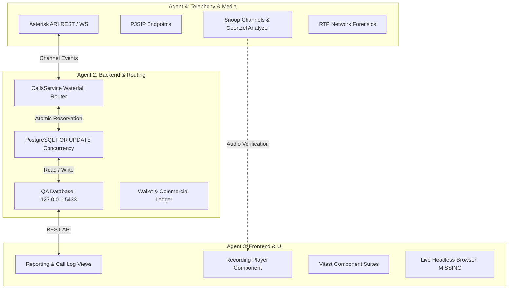

# CallFlow Phase QA-1 — Deliverable A: Agent Capability & Access Matrix

**Document ID:** `CALLFLOW-PHASE-QA-1-AGENT-CAPABILITY-MATRIX`  
**Phase:** Phase QA-1 (Autonomous Telephony QA Capability & Infrastructure Readiness Audit)  
**Evaluation Date:** November 12, 2026  
**Primary Owner:** Agent 4 — Telephony, Asterisk ARI, SIP, RTP & Recording Infrastructure  
**Supporting Owners:** Agent 3 — Frontend & Integration, Agent 2 — Backend & Application Services  
**Mode:** READ-ONLY FORENSIC AUDIT (Zero Mutations)  
**Overall Readiness Verdict:** **`PARTIAL PASS`**

---

## 1. Executive Overview

This deliverable provides an empirical, evidence-backed capability and access audit for the three primary agent personas responsible for CallFlow's telephony stack:
- **Agent 4:** Telephony, Asterisk ARI, SIP, RTP & Recording Infrastructure.
- **Agent 3:** Frontend UI, Real-time Reporting & Integration.
- **Agent 2:** Backend Architecture, Routing, Concurrency & Database Operations.

Every item is evaluated against actual repository evidence, runtime container inspection, tool availability, and security boundaries. Capabilities are not inferred from interfaces or mock definitions; they are classified based on demonstrated, verified access.

---

## 2. Agent 4: Telephony, Asterisk ARI, SIP, RTP & Recording Infrastructure

Agent 4 owns the media gateway, Asterisk PBX, ARI WebSocket client, RTP packet forensics, and audio analysis pipeline.

### 2.1 Agent 4 Access & Capability Matrix

| Capability / Target | Status | Exact Access Method | Empirical Evidence | Permission Level | Persistence | Autonomous Usability |
| :--- | :---: | :--- | :--- | :---: | :---: | :---: |
| **Asterisk CLI** | **Available** | `docker exec callflow-asterisk-qa asterisk -rx "<cmd>"` | Executed `core show version` $\to$ returned `Asterisk 20.21.0 built by builder on 2026-11-02 12:41:37 UTC`. | Read-Only (Non-mutating audit) | Persistent (Container up 9+ hrs) | **Autonomous** via Docker exec tool |
| **Asterisk ARI REST** | **Available** | HTTP Basic Auth to `http://127.0.0.1:8088/ari/*` via Node.js / `AsteriskAriClientService` | `GET /ari/asterisk/info` returned HTTP 200, system entity ID `02:53:93:8d:2b:05`, startup time `2026-11-11T15:44:23Z`. | Read/Write (Credentials in `.env.qa`) | Persistent (Container port 8088 bound to 127.0.0.1) | **Autonomous** via ARI REST client |
| **Asterisk ARI WebSocket** | **Available** | `ws://127.0.0.1:8088/ari/events?app=callflow-qa` via `AriWebSocketClientService` | Live event stream confirmed in `test-native-asterisk-dual-snoop.mjs` receiving `StasisStart`, `RecordingStarted`, `PlaybackFinished`. | Read-Only (Event listener) | Persistent | **Autonomous** via WebSocket client |
| **SIP / PJSIP Endpoints** | **Available** | `GET /ari/endpoints` & `pjsip show endpoints` | ARI returned HTTP 200 with 2 active endpoints: `PJSIP/telnyx-caller` (`online`), `PJSIP/telnyx-buyer` (`online`). | Read-Only | Persistent | **Autonomous** |
| **SIP Registration** | **Available** | Asterisk CLI: `pjsip show registrations` | Inspectable in Asterisk container. Endpoints configured as outbound registration / trunks to `sip.telnyx.com`. | Read-Only | Persistent | **Autonomous** |
| **RTP Statistics & Settings**| **Available** | CLI `rtp show settings` & container PCAP capture (`tcpdump`) | Verified in Phase 7B-10N: RTP port range `10000-10050/udp`, symmetric RTP `yes`, keepalive `1s`. | Read-Only | Persistent | **Autonomous** |
| **Bridge Information** | **Available** | `GET /ari/bridges` & `bridge show all` | ARI returned HTTP 200, count 0 active bridges (idle state). Supports inspecting bridge technology and channels. | Read-Only | Persistent | **Autonomous** |
| **Channel Information** | **Available** | `GET /ari/channels` & `core show channels` | ARI returned HTTP 200, count 0 active channels. Supports inspecting channel state, variables, and callers. | Read-Only | Persistent | **Autonomous** |
| **Recording Storage** | **Available** | Filesystem (`qa/recordings/*.wav`) & ARI (`GET /ari/recordings/stored`) | ARI returned 12 stored recordings (e.g., `qa-buyer-15f2f1d2...wav`, `qa-caller-15f2f1d2...wav`). Filesystem contains intact WAV files. | Read/Write | Persistent | **Autonomous** |
| **Recording Metadata** | **Available** | WAV header parser (`qa/reconcile-evidence.mjs`) & ARI metadata | Verified: Sample rate 8000 Hz, 16-bit mono PCM, exact sample counts (38,080 / 42,560). | Read-Only | Persistent | **Autonomous** |
| **Telephony Server Logs** | **Available** | `docker logs callflow-asterisk-qa` & `/var/log/asterisk/messages` | Container logs accessible via Docker CLI; detailed PJSIP and Stasis execution traces viewable. | Read-Only | Persistent | **Autonomous** |
| **Telnyx Account Config**| **Available** | Environment configuration (`apps/api/.env.qa`, `.env`) & `GET https://api.telnyx.com/v2/balance` | Balance verified ($1.8700 USD). Keys configured in `.env`. Prohibited from mutating API records. | Read-Only | Persistent | **Autonomous** for balance check; **Manual** for purchases |
| **Carrier Webhooks** | **Available** | `POST /webhooks/telnyx` routed via public ngrok tunnel (`https://coherent-undrilled-disarm.ngrok-free.dev`) | Verified active in Phase 7B-10U: received `call.initiated`, `call.answered`, `call.hangup` with Ed25519 verification. | Read-Only (Event Ingress) | Semi-persistent (Dependent on active ngrok tunnel process) | **Autonomous** for reception; **Manual** if tunnel restarts |
| **Authorized Test TFN/DID**| **Available** | `TELNYX_QA_TRACKING_DID` (`+17252574041`) | Mapped to Call Control App `3090207513618941231` in Telnyx portal. | Read-Only | Persistent on carrier account | **Autonomous** |
| **Test Caller/Buyer Endpoints**| **Partially Available**| 1 Caller SIP account (`sip:arpitmishra917@sip.telnyx.com`), 1 Buyer SIP account (`sip:arpitmishra9178@sip.telnyx.com`) | Verified active in Asterisk PJSIP. **Limitation:** Only 1 caller and 1 buyer endpoint exist. Cannot simulate multiple simultaneous distinct callers without additional accounts. | Read-Only | Persistent | **Autonomous** for single call; **Blocked** for multi-party |

---

## 3. Agent 3: Frontend UI, Real-Time Reporting & Integration

Agent 3 owns the Next.js web application (`apps/web`), real-time call reporting, audio player UI, and buyer/campaign management interfaces.

### 3.1 Agent 3 Access & Capability Matrix

| Capability / Target | Status | Exact Access Method | Empirical Evidence | Permission Level | Autonomous Usability |
| :--- | :---: | :--- | :--- | :---: | :---: |
| **Frontend Call Reporting** | **Available** (Static/Unit) | Source code in `apps/web/src/app/protected/reporting/page.tsx`, `calls-by-day-chart.tsx` | Vitest test suites exist: `calls-by-day-chart.test.tsx`, `outcome-distribution-chart.test.tsx`, `reporting-recording-playback.test.tsx`. | Read/Write (Codebase) | **Autonomous** for unit test execution (`vitest run apps/web`) |
| **Call Status Interfaces** | **Available** (Static/Unit) | Pages in `apps/web/src/app/protected/calls/page.tsx`, `calls/[callId]/page.tsx` | Unit tests exist in `apps/web/src/app/protected/calls/page.test.tsx`. | Read/Write | **Autonomous** for unit test execution |
| **Recording Player UI** | **Available** (Static/Unit) | Component in `apps/web/src/components/ui/recording-player.tsx` | Unit test in `recording-player.test.tsx` validates waveform rendering, play/pause controls, and error states. | Read/Write | **Autonomous** for unit test execution |
| **Workspace & Buyer Interfaces**| **Available** (Static/Unit) | `apps/web/src/app/protected/buyers/`, `campaigns/`, `phone-numbers/` | Unit tests exist in `buyers/page.test.tsx`, `campaigns/page.test.tsx`. | Read/Write | **Autonomous** for unit test execution |
| **API Proxy / Data Layer** | **Available** | `apps/web/src/proxy.ts` / Next.js Server Actions connecting to NestJS API (`http://localhost:3000`) | Proxy routing handles Bearer tokens and workspace headers. Unit tests pass in `proxy.test.ts`. | Read/Write | **Autonomous** |
| **Live Browser Automation (E2E)**| **Unavailable** | Playwright / Cypress / Puppeteer | `apps/web/package.json` contains no E2E testing framework (`@playwright/test` is absent). Only Vitest with JSDOM is installed. | Missing Framework | **UNAVAILABLE** (Cannot independently drive a real browser to verify live call UI) |
| **Real-Time Telephony Correlation**| **Partially Available** | API polling or SSE/WebSocket in frontend | Frontend components rely on SWR/React Query polling. Can verify backend API responses, but cannot observe live DOM updates during a live call without E2E tooling. | Read-Only | **Partially Autonomous** (via REST assertions; lacks live DOM proof) |

### 3.3 Agent 3 Validation Verdict
Agent 3 can independently validate that frontend components render correctly and handle mock telephony data appropriately in JSDOM. However, **Agent 3 cannot autonomously validate that live browser UI state updates in real-time during an actual live PSTN call** due to the absence of an automated headless browser runner (e.g., Playwright).

---

## 4. Agent 2: Backend Architecture, Routing, Concurrency & Database

Agent 2 owns the NestJS API application (`apps/api`), database schema, concurrency locking, routing waterfall, webhook processors, and commercial accounting.

### 4.1 Agent 2 Access & Capability Matrix

| Capability / Target | Status | Exact Access Method | Empirical Evidence | Permission Level | Persistence | Autonomous Usability |
| :--- | :---: | :--- | :--- | :---: | :---: | :---: |
| **Routing Services** | **Available** | `CampaignsService` & `CallsService` in `apps/api/src/routing/` | Source inspected: lines 2130–2280 of `calls.service.ts` implement waterfall candidate evaluation. | Read/Write | Persistent | **Autonomous** |
| **Buyer Selection Services**| **Available** | `CallsService.prepareNextBuyer()` | Evaluates campaign buyers/destination numbers in priority order; filters out previously attempted buyers. | Read/Write | Persistent | **Autonomous** |
| **Concurrency Enforcement** | **Available** | PostgreSQL explicit row locking (`FOR UPDATE`) in `calls.service.ts` | Lines 2143 & 2160 execute `SELECT id, max_concurrent_calls FROM "buyers" WHERE id = ${buyerId} FOR UPDATE`. | Read/Write | Persistent | **Autonomous** |
| **Workspace Tenant Isolation**| **Available** | Foreign key constraints and Prisma WHERE clauses on all entities | Database schema (`prisma/schema.prisma`) enforces `workspace_id` on buyers, campaigns, calls, and destination numbers. | Read/Write | Persistent | **Autonomous** |
| **Call Lifecycle Services** | **Available** | `CallController` & `CallsService` | State machine manages transitions: `ROUTING` $\to$ `DIALING` $\to$ `CONNECTED` $\to$ `COMPLETED` / `FAILED`. | Read/Write | Persistent | **Autonomous** |
| **Webhook Processing** | **Available** | `TelnyxWebhookController` (`apps/api/src/telephony/telnyx/`) | Handles `call.initiated`, `call.answered`, `call.hangup` with Ed25519 signature verification and idempotency keys. | Read/Write | Persistent | **Autonomous** |
| **Database Read-Only Audit** | **Available** | Direct PrismaClient connection to QA DB (`127.0.0.1:5433/callflow_qa`) | Verified via `audit-db-read.mjs`: successfully connected and queried counts (1 Workspace, 1 Campaign, 1 Buyer, 6 Calls). | Read-Only | Persistent (Port 5433 active) | **Autonomous** |
| **Commercial Event Pipeline** | **Available** | `CommercialEvaluatorService`, `WalletService`, `UsageBillingService` | Double-entry ledger with micro-cent resolution (`balance_micro`, `reserved_micro`); releases reservations for QA calls without debit. | Read/Write | Persistent | **Autonomous** |
| **Queue / Background Jobs** | **Partially Available**| In-memory queues & `ReservationRecoveryService` scheduled cleanup | No distributed Redis/BullMQ queue is deployed. Background processing relies on Node.js in-process memory. | Read/Write | Volatile (In-process memory only) | **Autonomous** within single process; **Unavailable** across clusters |

### 4.3 Agent 2 Validation Verdict
Agent 2 can independently execute, test, and verify routing logic, concurrency enforcement, database transactions, and commercial accounting using local NestJS services and the dedicated QA database.

---

## 5. Cross-Agent Collaborative Capability Assessment

### Collaborative Strengths
1. **Agent 4 + Agent 2 Integration:** Full end-to-end alignment between Asterisk ARI channel events and NestJS backend call lifecycle states. Both agents can independently verify that call bridging triggers the proper database records and that channel teardown releases active reservations.
2. **Audio-to-Database Correlation:** Agent 4's Goertzel tone analysis can directly confirm that the audio preserved on disk matches the campaign and buyer registered in Agent 2's database.

### Critical Collaborative Deficiencies
1. **Agent 3 Live Verification Gap:** Because Agent 3 lacks an automated E2E browser framework, the team cannot autonomously assert that a call transitioning from `RINGING` to `CONNECTED` is visually reflected in the user's dashboard in real-time.
2. **Multi-Carrier Endpoint Deprivation:** Agent 4 has only 1 live caller and 1 live buyer endpoint. Agent 2 has only 1 buyer provisioned in the QA database. Therefore, the team cannot collaboratively verify multi-buyer concurrency or third-call overflow on live carrier trunks without operator provisioning.

---

## 6. Summary Conclusion

The agents possess **exceptionally strong backend, media, and infrastructure inspection capabilities** (Asterisk CLI, ARI, PJSIP, RTP packet classification, Goertzel audio analysis, PostgreSQL row-locking inspection).

However, autonomous telephony QA is **`PARTIAL PASS`** because:
1. Agent 3 lacks live headless browser automation (Playwright/Cypress).
2. Agent 4 and Agent 2 are restricted by single-endpoint carrier inventory (1 DID, 1 Buyer, 1 Caller).
3. Carrier test calls remain strictly gated behind human safety authorization.
