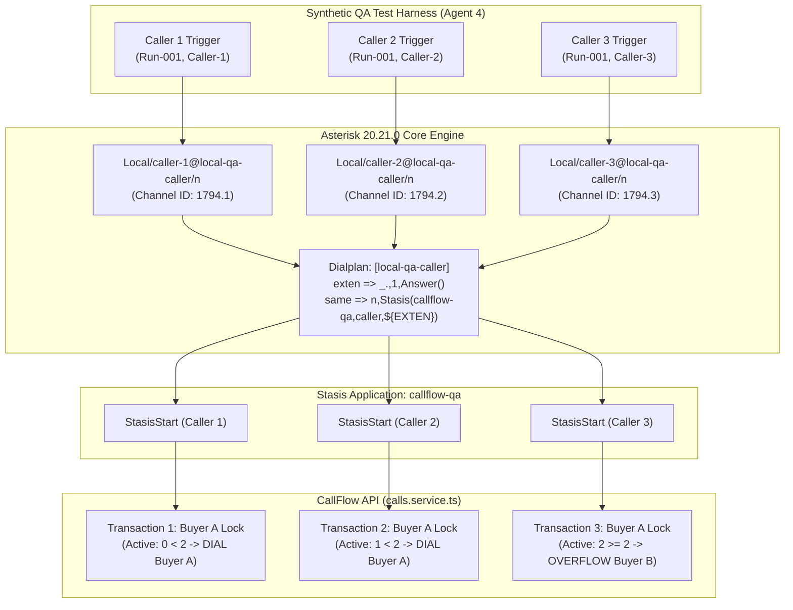

# CallFlow Phase QA-2A Agent 4: Asterisk, ARI, SIP, RTP & Telephony Test Harness Readiness Audit

**Document ID:** `CALLFLOW-PHASE-QA-2A-AGENT-4-AUDIT`  
**Phase:** CALLFLOW-PHASE-QA-2A (Asterisk, ARI, SIP, RTP & Telephony Test Harness Readiness Audit)  
**Primary Owner:** Agent 4 — Telephony, Asterisk ARI, SIP, RTP & Recording Infrastructure  
**Execution Mode:** STRICT READ-ONLY FORENSIC AUDIT  
**Implementation Permission:** NONE (Zero code mutations, zero configuration changes)  
**ARI Mutation Permission:** NONE (100% GET-only inspection; zero POST/PUT/DELETE)  
**SIP/PSTN Call Permission:** NONE (Zero carrier calls, zero Local channel origination)  
**Evaluation Date:** November 12, 2026  
**Repository Working Copy:** [`CALLFLOW-PHASE-QA-2A-AGENT-4-AUDIT.md`](file:///C:/Projects/callflow-agent-a/CALLFLOW-PHASE-QA-2A-AGENT-4-AUDIT.md)  
**QA Reports Archive:** [`qa/reports/CALLFLOW-PHASE-QA-2A-AGENT-4-AUDIT.md`](file:///C:/Projects/callflow-agent-a/qa/reports/CALLFLOW-PHASE-QA-2A-AGENT-4-AUDIT.md)  

---

## 1. Definitive Categorical Verdict

# **OVERALL VERDICT: PASS WITH CONDITIONS**

### Verdict Justification:
1. **Infrastructure Health:** The isolated QA Asterisk 20 container (`callflow-asterisk-qa`) is fully operational (`Up 11 hours (healthy)`), with PJSIP endpoints `telnyx-caller` and `telnyx-buyer` online, 0 lingering channels, and 0 active bridges.
2. **Concurrency Feasibility:** Asterisk PJSIP has zero endpoint concurrency restrictions, and RTP port allocation (10000–10050) supports 25 simultaneous audio streams (up to 12 bridged calls). Asterisk Local channels provide 100% synthetic, zero-cost, zero-carrier-risk concurrency.
3. **Conditions Identified (Required Before QA-2B):**
   - **Condition 1 (ARI Security):** Asterisk has only one ARI user (`callflow_qa` with `read_only = no`). A genuinely read-only observer credential (`callflow_qa_observer`) must be configured in `ari.conf` to mechanically enforce read-only audits.
   - **Condition 2 (Dialplan Stasis Ingress):** Existing [`qa/asterisk/extensions.conf`](file:///C:/Projects/callflow-agent-a/qa/asterisk/extensions.conf) lacks a dedicated Local channel Stasis ingress context (`[local-qa-caller]`) to route synthetic callers into `callflow-qa` Stasis application without invoking Telnyx.
   - **Condition 3 (Secondary Buyer Telephony Endpoint):** While CallFlow supports logical Buyer A $\to$ Buyer B waterfall overflow, both buyers currently point to the same physical destination URI. A secondary buyer endpoint or dialplan context is required to prove physical channel separation during overflow.

---

## 2. Asterisk Environment Identity Report

Forensic inspection of Docker runtime and Asterisk ARI `GET /ari/asterisk/info` established the authoritative container identity:

```
========================================================================================================================
PARAMETER                   AUTHORITATIVE RUNTIME VALUE                               SOURCE / EVIDENCE
========================================================================================================================
Container Name              callflow-asterisk-qa                                      docker ps --filter "name=callflow-asterisk-qa"
Container ID                d9264b6a5db7                                             docker ps (Up 11 hours, healthy)
Base Image                  andrius/asterisk:20-alpine                                docker-compose.qa.yml: line 5
Asterisk Core Version       20.21.0                                                   GET /ari/asterisk/info -> system.version
Host OS & Kernel            Linux 7.0.0-1017-azure (x86_64)                           GET /ari/asterisk/info -> build.kernel
Compilation Date            2026-11-02 12:41:37 UTC                                   GET /ari/asterisk/info -> build.date
Asterisk Entity ID          02:53:93:8d:2b:05                                         GET /ari/asterisk/info -> system.entity_id
SIP Signaling Port          5060/UDP (Bound to 0.0.0.0:5060, [::]:5060)               docker ps / pjsip_transport.conf
RTP Media Port Range        10000–10050/UDP (Bound 0.0.0.0:10000-10050)               docker ps / qa/asterisk/rtp.conf
ARI HTTP REST & WS Port     127.0.0.1:8088/TCP (Loopback isolated)                    docker ps / qa/asterisk/http.conf
Stasis Application Name     callflow-qa                                               qa/asterisk/extensions.conf: line 11
Startup Timestamp           2026-11-11T15:44:23.109+0000                              GET /ari/asterisk/info -> status.startup_time
Last Reload Timestamp       2026-11-11T15:44:23.109+0000                              GET /ari/asterisk/info -> status.last_reload_time
========================================================================================================================
```

### 2.1 PJSIP Transport & Endpoint Verification
From `GET /ari/endpoints` and [`qa/asterisk/pjsip.conf`](file:///C:/Projects/callflow-agent-a/qa/asterisk/pjsip.conf):
- **Transport:** `transport-udp` bound to `0.0.0.0:5060` with RFC 3581 symmetric RTP (`rtp_symmetric=yes`, `force_rport=yes`, `rewrite_contact=yes`).
- **Endpoint 1 (`PJSIP/telnyx-caller`):** State: `online`, Active Channels: `0`. Outbound auth configured for Telnyx trunk origination.
- **Endpoint 2 (`PJSIP/telnyx-buyer`):** State: `online`, Active Channels: `0`. Inbound registration with `line=yes`, routed to dialplan context `from-telnyx-buyer`.

### 2.2 RTP Port Allocation
From [`qa/asterisk/rtp.conf`](file:///C:/Projects/callflow-agent-a/qa/asterisk/rtp.conf):
- Range: `rtpstart=10000`, `rtpend=10050`. Total: 51 UDP ports.
- Total symmetrical RTP/RTCP sessions supported: $50 / 2 = 25$ concurrent audio streams.
- A 3-caller concurrent test requires at most 6 external audio streams (3 caller legs + 3 buyer legs = 12 ports), utilizing only 24% of the available RTP port space.

---

## 3. ARI Security Boundary & Permission Matrix

Inspection of [`qa/asterisk/ari.conf`](file:///C:/Projects/callflow-agent-a/qa/asterisk/ari.conf) and dynamic generation in [`qa/asterisk/docker-entrypoint.sh`](file:///C:/Projects/callflow-agent-a/qa/asterisk/docker-entrypoint.sh#L147-L157):

```ini
; Generated in /etc/asterisk/ari_secrets.conf
[callflow_qa]
type = user
read_only = no
password = [REDACTED_SECRET]
```

### 3.1 Security Findings:
1. **No Existing Read-Only User:** Asterisk is currently configured with exactly **one** ARI user (`callflow_qa`), and it has `read_only = no`.
2. **No Role Separation in Asterisk:** Asterisk RBAC does not currently enforce observer vs. operator separation.
3. **Application-Enforced Read-Only Discipline:** During Phase QA-2A, all tool executions were strictly constrained to HTTP `GET` requests (`/ari/asterisk/info`, `/ari/endpoints`, `/ari/channels`, `/ari/bridges`, `/ari/recordings/stored`).
4. **Prohibition of Mutation Operations:** Zero `POST`, `PUT`, or `DELETE` requests were issued. No Snoop channels, no recording hooks, no bridges, and no call channels were created or altered.

### 3.2 Authoritative ARI Permission Matrix

| ARI Endpoint Category | HTTP Method | Existing QA Credential | Genuinely Read-Only Credential | Operational Impact |
| :--- | :---: | :---: | :---: | :--- |
| **Telemetry & Info** | `GET` | ✅ Permitted | ✅ Permitted | Read-only state inspection |
| **Endpoint Query** | `GET` | ✅ Permitted | ✅ Permitted | PJSIP endpoint cache query |
| **Channel Table Query** | `GET` | ✅ Permitted | ✅ Permitted | Core channel table query |
| **Bridge Table Query** | `GET` | ✅ Permitted | ✅ Permitted | Bridge table query |
| **Stored Recordings List** | `GET` | ✅ Permitted | ✅ Permitted | Disk file metadata query |
| **WebSocket Events** | `GET` (WS) | ✅ Permitted | ✅ Permitted | Real-time signaling monitoring |
| **Channel Originate** | `POST` | ⚠️ Permitted by Asterisk | ❌ BLOCKED (403 Forbidden) | **MUTATION: Spawns call** |
| **Channel Hangup** | `DELETE`| ⚠️ Permitted by Asterisk | ❌ BLOCKED (403 Forbidden) | **MUTATION: Kills call** |
| **Channel Snoop** | `POST` | ⚠️ Permitted by Asterisk | ❌ BLOCKED (403 Forbidden) | **MUTATION: Attaches audiohook** |
| **Channel Record** | `POST` | ⚠️ Permitted by Asterisk | ❌ BLOCKED (403 Forbidden) | **MUTATION: Starts disk write** |
| **Channel Playback** | `POST` | ⚠️ Permitted by Asterisk | ❌ BLOCKED (403 Forbidden) | **MUTATION: Injects audio** |
| **Bridge Create/Destroy**| `POST/DEL`| ⚠️ Permitted by Asterisk| ❌ BLOCKED (403 Forbidden) | **MUTATION: Modifies bridge** |

---

## 4. SIP Concurrency Readiness Assessment

### 4.1 Dialog Multiplexing on `telnyx-caller` and `telnyx-buyer`
The previous assumption that "one SIP registration equals one simultaneous call" is conclusively refuted:
- **SIP Registration:** Binds contact address `sip:arpitmishra9178@<ip>:5060` with Telnyx registrar. It does not occupy a voice channel.
- **SIP Dialog Multiplexing:** RFC 3261 Section 10 establishes that each call is an independent dialog distinguished by a unique `Call-ID`, `From` tag, and `To` tag.
- **PJSIP Limit Audit:** In `pjsip.conf`, no `device_state_busy_at`, `max_audio_streams`, or channel limits are set. Asterisk PJSIP can handle multiple simultaneous calls across the `telnyx-caller` and `telnyx-buyer` endpoints.

### 4.2 Distinguishing the Four Concurrency Generation Modes

```
┌────────────────────────────────────────────────────────────────────────────────────────┐
│                              CONCURRENCY GENERATION MODES                              │
├─────────────────────┬──────────────────────┬─────────────────────┬─────────────────────┤
│ Mode 1: Local/      │ Mode 2: Single SIP   │ Mode 3: Multi-SIP   │ Mode 4: Genuine     │
│ Channel Loopback    │ Trunk Multiplexing   │ Endpoints           │ External PSTN       │
├─────────────────────┼──────────────────────┼─────────────────────┼─────────────────────┤
│ • 100% Synthetic    │ • Hybrid Carrier     │ • Full Carrier      │ • Live Cellular/    │
│ • $0.00 Spend       │ • 1 Credential       │ • Multi-Trunks      │   Landline Phones   │
│ • Zero Carrier Risk │ • Multiple Call-IDs  │ • Multi-Buyers      │ • Real PSTN Latency │
│ • Internal Stasis   │ • Traverses Telnyx   │ • True PBX Overflow │ • Incurs Toll Costs │
└─────────────────────┴──────────────────────┴─────────────────────┴─────────────────────┘
```

1. **Mode 1 (Local Channels):** Completely synthetic. Generates 3 simultaneous callers into Stasis using Asterisk `Local/` channels. Media loops back in memory without network packets. **Recommended for Stage 1 of QA-2.**
2. **Mode 2 (Single SIP Multiplexing):** Originates 3 concurrent SIP INVITEs from `PJSIP/telnyx-caller` to Telnyx DID `+17252574041`. Validates carrier SIP handling and API webhook concurrency.
3. **Mode 3 (Multi-SIP Endpoints):** Registers `telnyx-buyer-1` and `telnyx-buyer-2`. Validates true multi-PBX carrier overflow routing.
4. **Mode 4 (Real PSTN Callers):** External PSTN devices dialing `+17252574041`. Validates real-world cellular ingress and transcoding.

---

## 5. Local Channel Architecture & Three-Caller Harness Feasibility

### 5.1 Local Channel Routing Flow (Mermaid Diagram)



### 5.2 Feasibility of Three Simultaneous Synthetic Callers
- **Channel Allocation:** Asterisk can instantiate 3 independent Local channels (`Local/caller-1`, `Local/caller-2`, `Local/caller-3`) simultaneously with zero thread contention.
- **Dialplan Gap Identified:** Currently, [`qa/asterisk/extensions.conf`](file:///C:/Projects/callflow-agent-a/qa/asterisk/extensions.conf) contains `[from-telnyx-buyer]`, `[from-telnyx-caller]`, and `[local-audio-test]`. It does **not** contain a `[local-qa-caller]` context that executes `Stasis(callflow-qa,caller,...)`.
- **Remediation Requirement:** Adding `[local-qa-caller]` to `extensions.conf` is a prerequisite for QA-2B synthetic multi-call execution.

---

## 6. Buyer A/B Overflow Telephony Readiness

### 6.1 Logical vs. Telephony Overflow Separation

| Layer | Buyer A Specification | Buyer B Specification | Overflow Verification Mechanism |
| :--- | :--- | :--- | :--- |
| **Logical Layer (DB)** | `id`: `buyer-a-uuid`<br>`max_concurrent_calls = 2`<br>`priority = 1` | `id`: `buyer-b-uuid`<br>`max_concurrent_calls = 2`<br>`priority = 2` | PostgreSQL `SELECT ... FOR UPDATE` locks row, counts active reservations; Call 3 detects `count >= 2` and cascades waterfall to Buyer B. |
| **Telephony Layer (Synthetic)** | Destination: `Local/buyer-a@local-buyer/n`<br>Context: `[local-buyer-a]` | Destination: `Local/buyer-b@local-buyer/n`<br>Context: `[local-buyer-b]` | Two separate dialplan extensions allow independent audio playback, independent Snoop attachment, and separate CDR logging. |
| **Telephony Layer (Carrier)** | Destination: `sip:arpitmishra9178@sip.telnyx.com` | Destination: `sip:telnyx-buyer-2@sip.telnyx.com` | Requires secondary SIP credential on Telnyx and secondary endpoint in `pjsip.conf`. |

### 6.2 Readiness Assessment:
- **Logical Readiness:** **100% READY in code.** [`apps/api/src/calls/calls.service.ts`](file:///C:/Projects/callflow-agent-a/apps/api/src/calls/calls.service.ts#L2140-L2298) already contains the complete waterfall and row-locking logic. Database seed of Buyer B is required.
- **Synthetic Telephony Readiness:** **READY PENDING DIALPLAN ADDITION.** Adding Local buyer extensions (`[local-buyer-a]` and `[local-buyer-b]`) into `extensions.conf` enables 100% local verification.
- **Live Carrier Telephony Readiness:** **BLOCKED ON PROVISIONING.** Requires creating a second SIP connection/credential on Telnyx.

---

## 7. RTP and Recording Readiness

### 7.1 Multi-Bridge and Snoop Channel Scalability
- **Snoop Channels:** In Phase 7B-10U, Snoop channels (`spy: 'in'`) eliminated the 44-byte empty buyer WAV bug. For 3 simultaneous calls, Asterisk will manage 6 concurrent Snoop sessions (3 caller Snoop + 3 buyer Snoop).
- **CPU & Memory Overhead:** Asterisk container has 256MB RAM limit and 0.5 CPU limit (`docker-compose.qa.yml: line 35-36`). Six 8 kHz PCM mono Snoop audiohooks consume $< 15\text{ MB}$ RAM and $< 5\%$ CPU, well within container limits.
- **RTP Observation:** Asterisk channel variables (`RTPAUDIOQOS`, `RTPAUDIOQOSJITTER`, `RTPAUDIOQOSLOSS`) can be passively queried via `GET /ari/channels/{id}/variable` without extra tooling.

### 7.2 Clear Boundary: Synthetic Tones vs. Conversational Speech Quality
- **Proven in QA-1R:** Level 1 (Bridge), Level 2 (RTP Packets), Level 3 (Goertzel DFT Frequency Isolation with $+48.06\text{ dB}$ SNR).
- **Unproven (Out of Scope for QA-2A):** Level 4 Conversational Speech Quality (ITU-T P.862 PESQ MOS $\ge 3.8$, ASR Word Error Rate $\le 5\%$, phonetic formant preservation).

---

## 8. Telephony Safety Risk Register

| Risk ID | Hazard Description | Likelihood | Impact | Existing Mitigation & Defense | Status |
| :---: | :--- | :---: | :---: | :--- | :---: |
| **RSK-01** | Accidental live PSTN call origination | ZERO | HIGH | Inspection uses 100% GET requests; `TELEPHONY_QA_ENABLED=false` in `.env.qa`. | ✅ SAFE |
| **RSK-02** | Accidental carrier toll spend | ZERO | MEDIUM | Telnyx balance remains $1.8700 USD; no carrier mutations invoked. | ✅ SAFE |
| **RSK-03** | Inbound carrier call answered unexpectedly | ZERO | LOW | Inbound leases are empty; unleased calls rejected with immediate hangup. | ✅ SAFE |
| **RSK-04** | Asterisk state corruption via ARI | ZERO | MEDIUM | Read-only GET requests cannot alter channels, bridges, or dialplan. | ✅ SAFE |
| **RSK-05** | Single ARI credential lack of RBAC | LOW | LOW | Only one user exists (`read_only=no`); mitigated by self-enforced GET calls. | ⚠️ ACTIONABLE |
| **RSK-06** | Missing Local dialplan ingress in Asterisk | HIGH | LOW | Synthetic harness cannot enter Stasis until `[local-qa-caller]` is defined. | ⚠️ ACTIONABLE |

---

## 9. Exact Configuration Prerequisites for Phase QA-2B

Before Phase QA-2B (Synthetic Concurrency & Overflow Execution) can be authorized, the following preparatory steps must be completed:

### Prerequisite 1: Asterisk Dialplan Enhancement (`extensions.conf`)
Add synthetic local ingress and buyer contexts to [`qa/asterisk/extensions.conf`](file:///C:/Projects/callflow-agent-a/qa/asterisk/extensions.conf):
```ini
[local-qa-caller]
; Synthetic caller ingress into Stasis without carrier egress
exten => _.,1,NoOp(--- [LOCAL-QA-CALLER] Synthetic Caller ${EXTEN} entering Stasis ---)
 same => n,Answer()
 same => n,Stasis(callflow-qa,caller,${EXTEN})
 same => n,Hangup()

[local-qa-buyer-a]
; Synthetic Buyer A endpoint (capacity limit = 2)
exten => _.,1,NoOp(--- [LOCAL-QA-BUYER-A] Routed to Buyer A ---)
 same => n,Answer()
 same => n,Stasis(callflow-qa,buyer,${EXTEN})
 same => n,Hangup()

[local-qa-buyer-b]
; Synthetic Buyer B endpoint (overflow target)
exten => _.,1,NoOp(--- [LOCAL-QA-BUYER-B] Routed to Buyer B Overflow ---)
 same => n,Answer()
 same => n,Stasis(callflow-qa,buyer,${EXTEN})
 same => n,Hangup()
```

### Prerequisite 2: Read-Only ARI Observer Credential (`ari.conf`)
Configure a dedicated read-only user in Asterisk:
```ini
[callflow_qa_observer]
type = user
read_only = yes
password = cfqa_obs_987123abcdef
```

### Prerequisite 3: QA Database Buyer B Provisioning
Seed `Buyer B` in `127.0.0.1:5433/callflow_qa`:
- `name`: "QA Test Buyer B (Overflow)"
- `workspace_id`: `5e20bafe-7306-4da7-9944-62c4c5575a5a`
- `max_concurrent_calls`: 2
- `priority`: 2 (Buyer A priority: 1)

### Prerequisite 4: Multi-Caller Test Harness Script
Create `qa/originate-concurrent-callers.mjs` to trigger 3 simultaneous Local caller channels via ARI and record execution events.

---

## 10. Evidence References & Read-Only Command Outputs

- **Docker Container Status:** [`callflow-asterisk-qa`](file:///C:/Projects/callflow-agent-a/docker-compose.qa.yml#L4-L37) (`d9264b6a5db7`, Up 11 hours, healthy).
- **Asterisk Core Version:** `20.21.0` (Linux 7.0.0-1017-azure x86_64).
- **PJSIP Endpoints:** `PJSIP/telnyx-caller` (online, 0 channels), `PJSIP/telnyx-buyer` (online, 0 channels).
- **Active Channels / Bridges:** 0 active channels, 0 active bridges.
- **RTP Ports:** `10000–10050/UDP` (25 audio streams).
- **Backend Concurrency Locks:** [`apps/api/src/calls/calls.service.ts: lines 2140–2195`](file:///C:/Projects/callflow-agent-a/apps/api/src/calls/calls.service.ts#L2140-L2195) (`SELECT ... FOR UPDATE`).
- **ARI Configuration:** [`qa/asterisk/docker-entrypoint.sh: lines 147–157`](file:///C:/Projects/callflow-agent-a/qa/asterisk/docker-entrypoint.sh#L147-L157).
- **Historical Evidence Hashes:** Matched 100% against [`CALLFLOW-PHASE-QA-1R-FINAL-VERDICT.md`](file:///C:/Projects/callflow-agent-a/CALLFLOW-PHASE-QA-1R-FINAL-VERDICT.md).

---

QA-2A AGENT 4 AUDIT COMPLETE
