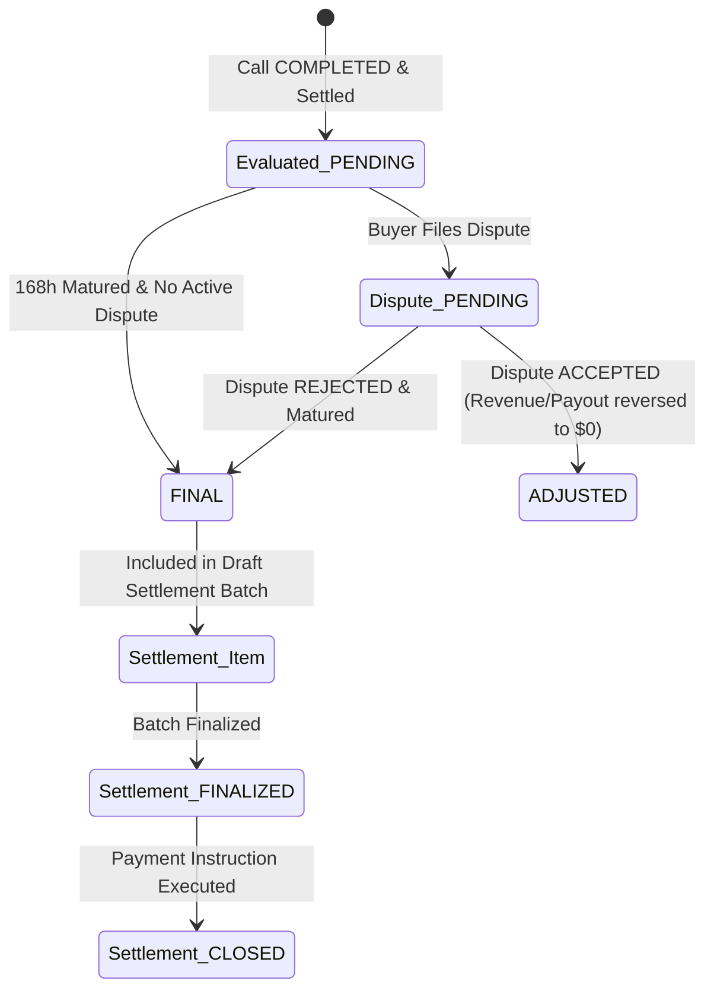
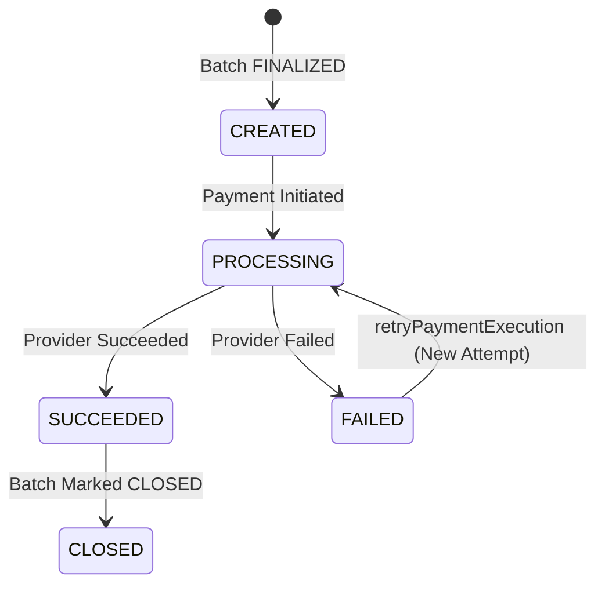

# CallFlow — Agent 3: Commercial Lifecycle & Settlement Subsystem Audit

**Generated Date:** 2026-11-11  
**Auditor:** Agent 3 (Database, Prisma, Wallet, Billing, Commercial & Settlement Audit)  
**Target Services:**
- `CommercialEvaluatorService` ([commercial-evaluator.service.ts](file:///C:/Projects/callflow-agent-a/apps/api/src/commercial/commercial-evaluator.service.ts))
- `CommercialFinalizationService` ([commercial-finalization.service.ts](file:///C:/Projects/callflow-agent-a/apps/api/src/commercial/commercial-finalization.service.ts))
- `CommercialDisputesService` ([commercial-disputes.service.ts](file:///C:/Projects/callflow-agent-a/apps/api/src/commercial/commercial-disputes.service.ts))
- `SettlementBatchService` ([settlement-batch.service.ts](file:///C:/Projects/callflow-agent-a/apps/api/src/settlement/settlement-batch.service.ts))
- `PaymentService` ([payment.service.ts](file:///C:/Projects/callflow-agent-a/apps/api/src/settlement/payment.service.ts))

---

## 1. Executive Summary & Verdicts

| Domain | Audit Scope | Test Verification | Verdict |
| :--- | :--- | :--- | :--- |
| **Commercial Evaluation** | Post-call commercial valuation, conversion qualification, duplicate detection, exact Decimal profit math | 85 passed tests in `commercial-evaluator.spec.ts` | **PASS** |
| **Commercial Finalization** | Frozen AD-01 & AD-02 rules (168h maturity, no early finalization, dispute blocking, JIT sweep) | 10 passed tests in `commercial-finalization.spec.ts`, 18 in `commercial-lifecycle-integration.spec.ts` | **PASS** |
| **Commercial Disputes** | Buyer-only filing, terminal ACCEPTED/REJECTED state, financial reversal to $0, post-settlement adjustments | 50 passed tests in `commercial-disputes.spec.ts` | **PASS** |
| **Settlement Generation** | Participant separation (Buyer/Vendor), `(call_commercial_id, participant_type)` uniqueness, gross/adjustments/net aggregates | 28 passed tests in `settlement-generation.e2e-spec.ts` & `settlement-jit-finalization.e2e-spec.ts` | **PASS** |
| **Payment Instructions & Executions** | Succeeded/Failed/Processing state machine, immutable retry attempts, monotonic attempt counting | 12 passed tests in `payment.service.spec.ts` | **PASS** |

---

## 2. Commercial Lifecycle Invariants & Architectural Alignment



### 2.1 Post-Call Commercial Evaluation Engine
- **Eligible Terminal State:** Only calls reaching `CallState.COMPLETED` are eligible for commercial valuation. Calls in `INITIATED`, `ROUTING`, `RINGING`, `FAILED`, `CANCELED`, or `NO_ANSWER` skip commercial evaluation.
- **Commercial Campaign Activation:** A campaign is commercially configured if and only if **both** `default_revenue_amount` and `default_payout_amount` are non-null.
- **Conversion Duration Rule:** Evaluated strictly using connected talk duration between `answered_at` and `ended_at`, excluding pre-answer ringing time.
- **Zero-Cost Handling (AD-03 Compliance):**
  - Distinguishes operational completion from carrier cost.
  - If `CallReservation.status !== SETTLED`, commercial evaluation aborts/defers.
  - If `SETTLED` and `CALL_SETTLEMENT` debit exists: uses exact carrier cost.
  - If `SETTLED` and no debit exists: assigns `cost = Decimal('0.0000')` without polluting the wallet ledger with fake transactions.
- **Profit Calculation:** Uses exact Decimal arithmetic:
  $$\text{profit} = \text{revenue} - \text{payout} - \text{cost}$$
- **Duplicate Detection & Advisory Locking:**
  - Evaluates within campaign's `duplicate_window_secs` (default 30 days / 2,592,000s).
  - Scope: Earliest converted call with identical caller and destination.
  - Transaction-level advisory lock prevents race conditions during concurrent incoming calls:
    ```sql
    SELECT pg_advisory_xact_lock(:lockKey)
    ```

---

## 3. Commercial Finalization Rules (Frozen AD-01 & AD-02 Audit)

| Rule # | Frozen Requirement | Actual Implementation in Code | Verification Evidence |
| :--- | :--- | :--- | :--- |
| **R1** | `finalizes_at` persisted deterministically | `finalizes_at = created_at + 168 hours` (7 days) synchronously stored at creation | `commercial-evaluator.service.ts#L367` |
| **R2** | No early finalization | Queries strictly filter `finalizes_at <= referenceTime` | `commercial-finalization.service.ts#L74` |
| **R3** | Disputes prevent finalization | Any record with `dispute.status === DisputeStatus.PENDING` is strictly filtered out | `commercial-finalization.service.ts#L96-L99` |
| **R4** | Idempotent transition | Uses atomic `updateMany` with predicate `status: CommercialStatus.PENDING` | `commercial-finalization.service.ts#L111-L119` |
| **R5** | JIT settlement finalization sweep | `sweepMaturedPendingToFinal` invoked immediately before batch candidate gathering | `settlement-batch.service.ts#L116-L179` |
| **R6** | Financial immutability | Finalization transitions status `PENDING -> FINAL` without modifying revenue, payout, cost, or profit | `commercial-finalization.spec.ts` (TEST 6) |

---

## 4. Commercial Disputes Architecture (COMM-5)

### 4.1 Permission & Role Scoping
- **Buyer-Only Access:** Only members with `participant_type: BUYER` where `member.buyer_id === commercial.buyer_id` are permitted to create disputes.
- **Vendors Blocked:** Vendors cannot view or dispute buyer commercial calls.
- **Status Guards:**
  - Cannot dispute a call with `status === ADJUSTED`.
  - Cannot create duplicate disputes: unique constraint `call_commercial_id String @unique` on `CallDispute`.
  - Cannot dispute a call while included in an unfinalized `DRAFT` settlement batch.

### 4.2 Dispute Resolution Flows
- **REJECTED Flow:**
  - `status -> REJECTED`, `resolved_at = now()`, `resolved_by_user_id` recorded.
  - Financial figures (`revenue`, `payout`, `profit`) remain completely untouched.
  - Unblocks commercial record for eventual finalization once matured.
- **ACCEPTED Flow (Reversal):**
  - Reverses `revenue -> 0.0000` and `payout -> 0.0000`.
  - **Preserves operational cost!**
  - Recalculates profit: `profit = 0 - 0 - cost = -cost`.
  - Creates immutable `CallFinancialAdjustment` record storing `original_revenue`, `original_payout`, `adjusted_revenue`, `adjusted_payout`.
  - Transitions `CallCommercial.status -> ADJUSTED`.
  - **Post-Settlement Handling:** If call was previously settled in a `FINALIZED` or `CLOSED` batch, creates a `SettlementAdjustment` with `direction: CREDIT` for the Buyer, offsetting future settlement invoices.

---

## 5. Settlement Subsystem (COMM-12 / COMM-13 / COMM-14)

### 5.1 Settlement Item Uniqueness Guard
The database enforces:
```prisma
model SettlementItem {
  ...
  @@unique([call_commercial_id, participant_type])
}
```
**Audit Check:**
- Buyer settlements create items with `participant_type = SettlementParticipantType.BUYER`.
- Vendor settlements create items with `participant_type = SettlementParticipantType.VENDOR`.
- A single call commercial record can never be settled twice for the same side. Attempted duplicate insertion is caught by unique constraint or handled idempotently with `skipDuplicates: true`.

### 5.2 Participant Partitioning & Batch Numbering
- **Buyer Batches:** Partitioned by `(buyer_id, currency)`.
- **Vendor Batches:** Partitioned by `(vendor_id, currency)`.
- **Batch Number Determinism:**
  `SB-<BUYER|VENDOR>-<PARTICIPANT_ID_PREFIX>-<CURRENCY>-<YYYYMMDD_START>-<YYYYMMDD_END>`
- **Aggregate Formulas:**
  - Gross Amount = $\sum \text{SettlementItem.amount}$
  - Adjustments Amount = $\sum \text{SettlementAdjustment.amount}$ (Credits decrease buyer invoice / clawbacks decrease vendor payout)
  - Net Amount = $\text{Gross Amount} + \text{Adjustments Amount}$

### 5.3 Concurrency & Serializable Isolation
Settlement batch generation handles high concurrency using:
1. `Prisma.TransactionIsolationLevel.Serializable`
2. `withRetry` helper with exponential backoff on transaction serialization failure (`40001`), deadlock (`40P01`), or unique constraint race (`P2002`).

---

## 6. Payment Execution Lifecycle



- Monotonic attempt counting: `@@unique([payment_instruction_id, attempt_number])`.
- Failed attempts are never overwritten or deleted; each retry creates attempt `N+1`.
- Terminal protection: Successful or closed payment instructions cannot be re-executed or retried.
