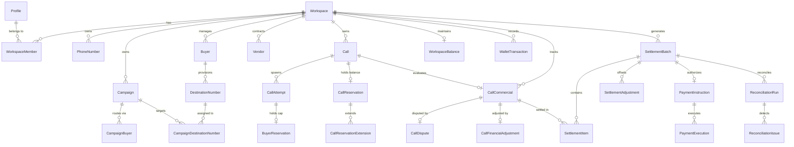

# CallFlow — Agent 3: Complete Data Model Relationship Map

**Generated Date:** 2026-11-11  
**Auditor:** Agent 3 (Database, Prisma, Wallet, Billing, Commercial & Settlement Audit)  
**Target Engine:** PostgreSQL 17 / Prisma ORM v6.0.0  

---

## 1. Executive Model Architecture Overview

The CallFlow data tier consists of **45 models** organized into 8 functional domains:
1. **Core Workspace & Identity:** `Profile`, `Workspace`, `WorkspaceMember`, `WorkspaceInvitation`, `WorkspaceMemberPermission`, `Permission`, `PasswordResetToken`, `WorkspaceMemberBuyer`, `SecurityAuditLog`, `ApiKey`
2. **Telephony Ingress & Call Lifecycle:** `PhoneNumber`, `Campaign`, `Buyer`, `DestinationNumber`, `CampaignDestinationNumber`, `CampaignBuyer`, `BlockedCaller`, `Call`, `CallAttempt`, `Recording`, `WebhookEvent`, `OutboundWebhook`, `WebhookDelivery`
3. **Wallet & Telephony Billing Engine:** `WorkspaceBalance`, `WalletTransaction`, `CallReservation`, `CallReservationExtension`, `BuyerReservation`, `UsageRecord`
4. **SaaS Subscription & Customer Invoicing:** `Plan`, `BillingCustomer`, `Subscription`, `Invoice`
5. **Commercial Evaluation:** `CallCommercial`, `CallDispute`, `CallFinancialAdjustment`
6. **Settlement Engine:** `SettlementBatch`, `SettlementItem`, `SettlementAdjustment`
7. **Disbursement & Payment Execution:** `PaymentInstruction`, `PaymentExecution`
8. **Reconciliation & Reporting:** `ReconciliationRun`, `ReconciliationIssue`, `SavedReport`

---

## 2. Entity-Relationship Diagram (Mermaid)

---

## 3. Detailed Model Inventory & Structural Specifications

| Model Name | Table Name | Primary Key | Key Foreign Keys | Unique Constraints | OnDelete Policy | Index Highlights |
| :--- | :--- | :--- | :--- | :--- | :--- | :--- |
| `Workspace` | `workspaces` | `id` (UUID) | None | `slug` | N/A | Primary tenant root |
| `Profile` | `profiles` | `id` (UUID) | None | None | N/A | User auth root |
| `WorkspaceMember` | `workspace_members` | `id` (UUID) | `workspace_id`, `user_id`, `vendor_id`, `buyer_id` | `[workspace_id, user_id]` | Cascade (`workspace`, `profile`), SetNull (`vendor`, `buyer`) | Multi-tenant auth scoping |
| `Vendor` | `vendors` | `id` (UUID) | `workspace_id` | None | Cascade (`workspace`) | `[workspace_id]` |
| `Buyer` | `buyers` | `id` (UUID) | `workspace_id` | None | Cascade (`workspace`) | `[workspace_id]` |
| `DestinationNumber` | `destination_numbers` | `id` (UUID) | `workspace_id`, `buyer_id` | `[workspace_id, destination_number]` | Cascade (`workspace`, `buyer`) | `[workspace_id]`, `[buyer_id]` |
| `Campaign` | `campaigns` | `id` (UUID) | `workspace_id` | None | Cascade (`workspace`) | `[workspace_id]` |
| `CampaignBuyer` | `campaign_buyers` | `id` (UUID) | `workspace_id`, `campaign_id`, `buyer_id` | `[campaign_id, priority]`, `[campaign_id, buyer_id]` | Cascade (`workspace`, `campaign`, `buyer`) | Priority & assignment |
| `CampaignDestinationNumber` | `campaign_destination_numbers` | `id` (UUID) | `workspace_id`, `campaign_id`, `destination_number_id` | `[campaign_id, destination_number_id]` | Cascade | Weight & routing |
| `PhoneNumber` | `phone_numbers` | `id` (UUID) | `workspace_id`, `campaign_id`, `vendor_id` | `phone_number` | Cascade (`workspace`), SetNull (`campaign`, `vendor`) | `phone_number`, `[workspace_id]` |
| `Call` | `calls` | `id` (UUID) | `workspace_id`, `campaign_id`, `phone_number_id`, `vendor_id` | `provider_call_id` | Cascade (`workspace`), SetNull (`campaign`, `phone`, `vendor`) | Ingress attribution & timeline |
| `CallAttempt` | `call_attempts` | `id` (UUID) | `call_id`, `buyer_id`, `destination_number_id` | `provider_call_id` | Cascade (`call`, `buyer`), SetNull (`destination_ref`) | `[call_id]`, `[buyer_id]` |
| `WorkspaceBalance` | `workspace_balances` | `workspace_id` | `workspace_id` | Primary Key is workspace_id | Cascade (`workspace`) | Exact atomic row locking |
| `WalletTransaction` | `wallet_transactions` | `id` (UUID) | `workspace_id` | `idempotency_key` | Cascade (`workspace`) | Ledger auditability |
| `CallReservation` | `call_reservations` | `id` (UUID) | `call_id`, `workspace_id` | `call_id` | Cascade (`call`, `workspace`) | `[workspace_id, status]`, `[status, expires_at]` |
| `CallReservationExtension` | `call_reservation_extensions` | `id` (UUID) | `reservation_id`, `call_id`, `workspace_id` | `idempotency_key` | Cascade (`reservation`, `call`, `workspace`) | Monotonic duration holds |
| `BuyerReservation` | `buyer_reservations` | `id` (UUID) | `workspace_id`, `buyer_id`, `call_id`, `attempt_id` | `attempt_id` | Cascade | Concurrency throttle |
| `CallCommercial` | `call_commercials` | `id` (UUID) | `workspace_id`, `call_id`, `campaign_id`, `vendor_id`, `buyer_id`, `duplicate_of_call_id` | `call_id` | **Restrict** (`call`), Cascade (`workspace`, `campaign`), SetNull (`vendor`, `buyer`, `duplicate_of_call`) | `[workspace_id, status]`, `[campaign_id, created_at]` |
| `CallDispute` | `call_disputes` | `id` (UUID) | `workspace_id`, `call_commercial_id`, `buyer_id` | `call_commercial_id` | Cascade (`commercial`, `buyer`, `workspace`) | `[workspace_id, status]` |
| `CallFinancialAdjustment` | `call_financial_adjustments` | `id` (UUID) | `workspace_id`, `call_commercial_id`, `dispute_id` | `call_commercial_id`, `dispute_id` | Cascade (`commercial`, `dispute`, `workspace`) | Reversal snapshot |
| `SettlementBatch` | `settlement_batches` | `id` (UUID) | `workspace_id`, `buyer_id`, `vendor_id` | `[workspace_id, batch_number]` | **Restrict** (`buyer`, `vendor`), Cascade (`workspace`) | Period & participant indexing |
| `SettlementItem` | `settlement_items` | `id` (UUID) | `workspace_id`, `settlement_batch_id`, `call_commercial_id` | **`[call_commercial_id, participant_type]`** | **Restrict** (`batch`, `commercial`), Cascade (`workspace`) | Frozen settlement uniqueness |
| `SettlementAdjustment` | `settlement_adjustments` | `id` (UUID) | `workspace_id`, `call_financial_adjustment_id`, `source_call_commercial_id`, `source_settlement_batch_id`, `target_settlement_batch_id`, `buyer_id`, `vendor_id` | `call_financial_adjustment_id` | **Restrict** (all parents), Cascade (`workspace`) | Post-settlement ledger offsets |
| `PaymentInstruction` | `payment_instructions` | `id` (UUID) | `workspace_id`, `settlement_batch_id`, `buyer_id`, `vendor_id` | `settlement_batch_id`, `idempotency_key` | **Restrict** (`batch`, `buyer`, `vendor`), Cascade (`workspace`) | Batch disbursement authority |
| `PaymentExecution` | `payment_executions` | `id` (UUID) | `workspace_id`, `payment_instruction_id` | `[payment_instruction_id, attempt_number]`, `idempotency_key` | **Restrict** (`instruction`), Cascade (`workspace`) | Immutable retry attempts |
| `ReconciliationRun` | `reconciliation_runs` | `id` (UUID) | `workspace_id`, `settlement_batch_id` | None | Cascade (`workspace`), Restrict (`batch`) | Audit verification run |
| `ReconciliationIssue` | `reconciliation_issues` | `id` (UUID) | `reconciliation_run_id` | None | Cascade (`run`) | Discrepancy tracking |

---

## 4. Referential Integrity & Cascade Safety Analysis

### 4.1 Strict Financial Cascade Protections (`onDelete: Restrict`)
The database schema intentionally enforces `onDelete: Restrict` on core financial entities:
1. **`CallCommercial` -> `Call` (`onDelete: Restrict`)**:
   - A `Call` record **cannot** be deleted if a `CallCommercial` record exists. This prevents accidental deletion of billable call events.
2. **`SettlementBatch` -> `Buyer` / `Vendor` (`onDelete: Restrict`)**:
   - A `Buyer` or `Vendor` entity **cannot** be deleted if included in any historical `SettlementBatch`.
3. **`SettlementItem` -> `SettlementBatch` & `CallCommercial` (`onDelete: Restrict`)**:
   - A `CallCommercial` record or `SettlementBatch` **cannot** be deleted while line items point to it.
4. **`SettlementAdjustment` -> `CallFinancialAdjustment`, `CallCommercial`, `SettlementBatch` (`onDelete: Restrict`)**:
   - Historical adjustments cannot be severed from their source audit records.
5. **`PaymentInstruction` -> `SettlementBatch` (`onDelete: Restrict`)** and **`PaymentExecution` -> `PaymentInstruction` (`onDelete: Restrict`)**:
   - Monies executed cannot be orphaned by deleting instructions or batches.

### 4.2 Workspace Cascade Bounds (`onDelete: Cascade`)
When an entire `Workspace` is hard-deleted, all child records (calls, balances, commercials, batches, members) cascade cleanly within tenant boundaries. In production SaaS environments, workspaces undergo soft-deletion (`status: "INACTIVE"` or `"ARCHIVED"`), preserving historical financial records.

---

## 5. Frozen Business Rules Reflected in Schema

1. **Settlement Item Uniqueness (COMM-12/13/14):**
   - Constraint: `@@unique([call_commercial_id, participant_type])`
   - Invariant: A commercial call record can be settled at most **once** on the `BUYER` side (as revenue) and at most **once** on the `VENDOR` side (as payout).
2. **Batch Number Uniqueness:**
   - Constraint: `@@unique([workspace_id, batch_number])`
   - Invariant: Batch identifiers are deterministically generated per tenant workspace, preventing duplicate batches.
3. **Call Commercial 1:1 Linkage:**
   - Constraint: `call_id String @unique` on `CallCommercial`
   - Invariant: A telephony call event can produce at most **one** financial evaluation.
4. **Dispute 1:1 Linkage:**
   - Constraint: `call_commercial_id String @unique` on `CallDispute`
   - Invariant: A commercial record can have at most **one** dispute lifecycle.
5. **Advisory Lock Key Concurrency Scope:**
   - Scope: `dup:{workspaceId}:{campaignId}:{normalizedCaller}:{normalizedDestination}`
   - Invariant: Serializes duplicate call evaluation across concurrent calls.
