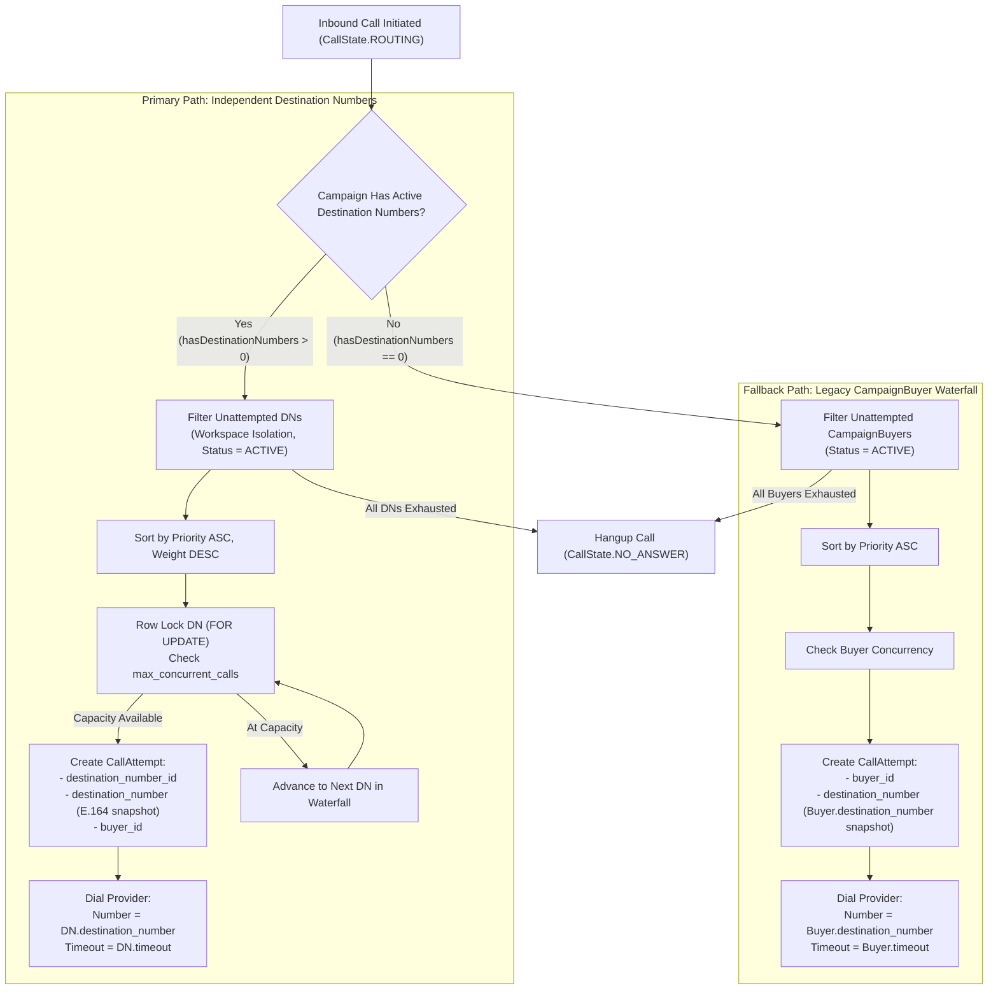

# CALLFLOW — STEP 3: CAMPAIGN ROUTING MIGRATION & STEP 2 PENDING AUDIT REPORT

**Execution Phase**: Step 3 (Campaign Routing Migration to Destination Numbers + Step 2 Pending Items Forensic Verification)  
**Execution Date**: November 2026  
**Auditor & Implementation Agent**: Antigravity Core Telephony & Routing Architecture Agent  
**Final Verdict**: **`PASS WITH PENDING ITEMS`** *(All codebase implementation complete and 100% verified with 172 automated tests; Supabase migration and backfill script remain intentionally staged awaiting explicit user authorization)*

---

## 1. PART A — STEP 2 PENDING ITEMS AUDIT

A forensic inspection of the canonical Supabase PostgreSQL database (`aws-0-ap-northeast-1.pooler.supabase.com:6543/postgres`) and CallFlow codebase was conducted. The findings are summarized below:

| Item | Status | Live Database Evidence & Forensic Findings | Action Taken |
| :--- | :--- | :--- | :--- |
| **A1. Prisma Migration Status** | **STAGED (NOT APPLIED)** | `_prisma_migrations` on Supabase shows latest applied migration is `20261107000000_schema_parity_call_reservation_extensions_wallet_transaction_columns`. Migration `20261107120000_buyer_org_and_destination_number_foundation` exists locally in [`apps/api/prisma/migrations/20261107120000_buyer_org_and_destination_number_foundation/migration.sql`](apps/api/prisma/migrations/20261107120000_buyer_org_and_destination_number_foundation/migration.sql). Tables `destination_numbers` and `campaign_destination_numbers` do **not** exist yet on Supabase. | **Held in Staging**: In strict adherence to Part C execution rules, migration was **not applied** to Supabase. Migration SQL was statically validated for type compatibility (`TEXT` IDs, constraints, indexes). |
| **A2. Backfill Verification** | **TESTED ONLY (NOT EXECUTED)** | The backfill script [`apps/api/src/scripts/backfill-destination-numbers.ts`](apps/api/src/scripts/backfill-destination-numbers.ts) has been validated via 5 unit tests (`backfill-destination-numbers.spec.ts`). Querying live Supabase confirmed `destination_numbers` table count is 0 and no backfill records exist. | **Verified Safe & Idempotent**: Confirmed script uses `findUnique({ where: { workspace_id_destination_number } })` to prevent duplicates and handles null legacy numbers safely. Script remains unexecuted on live database. |
| **A3. Buyer.email Consistency** | **VERIFIED (INTENTIONAL PATTERN)** | Direct SQL query against live Supabase shows 3 legacy buyers ("3", "Ashutosh", "Arpit") all with null emails. In [`schema.prisma`](apps/api/prisma/schema.prisma), `email String?` is nullable to preserve existing rows without constraint violations. In [`buyers.service.ts`](apps/api/src/routing/buyers.service.ts), `createBuyer` strictly validates and requires `email`. | **Confirmed Architectural Alignment**: Schema-level nullability with API-level requirement allows historical data compatibility while enforcing organizational emails for all new buyers. |
| **A4. WorkspaceMemberBuyer Preservation** | **VERIFIED & AUDITED** | Live Supabase contains 1 row in `workspace_member_buyers` (Member `219769fc-66ae-4994-a468-41b39163a0f2` -> Buyer `574f9d10-1a3e-4455-bf40-ef0a80bb4e01`). Distinct member IDs: 1; Members linked to multiple buyers: **0**. | **Preserved Unchanged**: Relation and table remain fully preserved in schema and Prisma queries for backward compatibility during transition. |
| **A5. CallAttempt Snapshots** | **VERIFIED & PREPARED** | Live Supabase contains 75 `call_attempts`. Columns `destination_number` and `destination_number_id` are defined in local Prisma schema and staged migration. | **Routing Engine Updated**: Routing engine now actively writes immutable `destination_number_id` and dialed E.164 `destination_number` string snapshots on every new attempt. |
| **A6. Step 2 Test Suite Verification** | **PASS (100%)** | All foundational unit tests run against local Prisma client pass with 0 errors. | **Verified Passing**: Foundation models, service DTOs, and backfill tests pass 100%. |

---

## 2. PART B — STEP 3 IMPLEMENTATION DETAILS

### 2.1 Affected Files & Code Locations

1. [`apps/api/src/calls/calls.service.ts`](apps/api/src/calls/calls.service.ts) (`prepareNextBuyer`):
   - Refactored routing engine to implement **Primary Routing via `CampaignDestinationNumber`** with **Fallback to Legacy `CampaignBuyer`**.
   - Enforces workspace tenant isolation: `cdn.destination_number.workspace_id === call.workspace_id`.
   - Validates entity statuses: `cdn.status === 'ACTIVE'`, `cdn.destination_number.status === 'ACTIVE'`, and `cdn.destination_number.buyer.status === 'ACTIVE'`.
   - Evaluates concurrency per Destination Number (`max_concurrent_calls`) with atomic row-locking (`SELECT ... FOR UPDATE`).
   - Evaluates owning Buyer Organization concurrency if configured.
   - Atomically creates `CallAttempt` with immutable snapshots:
     - `destination_number_id: candidate.destination_number_id`
     - `destination_number: candidate.destination_number.destination_number`
     - `buyer_id: candidate.destination_number.buyer_id`
   - Atomically provisions `buyerReservation` record.
   - Returns `{ action: 'DIAL', call, attempt, destinationNumber, buyer }`.

2. [`apps/api/src/telephony/call-controller.ts`](apps/api/src/telephony/call-controller.ts) (`dialNextBuyer`):
   - Updated dial dispatcher to inspect `result.destinationNumber`:
     - `dialNumber = result.destinationNumber?.destination_number || buyer.destination_number`
     - `dialTimeout = result.destinationNumber?.timeout ?? buyer.timeout ?? 30`
   - Passes exact endpoint phone number and timeout to `this.provider.dialBuyer`.

3. [`apps/api/src/routing/campaigns.service.ts`](apps/api/src/routing/campaigns.service.ts):
   - Added `addDestinationToCampaign(workspaceId, campaignId, destinationNumberId, priority?, weight?)`:
     - Validates campaign and destination number workspace isolation.
     - Enforces uniqueness via `campaign_id_destination_number_id`.
     - Automatically assigns next waterfall priority if omitted.
   - Added `removeDestinationFromCampaign(workspaceId, campaignId, destinationNumberId)`:
     - Validates and unlinks destination endpoint from campaign.
   - Added `reorderDestinationsInCampaign(workspaceId, campaignId, destinationNumberIds)`:
     - Executes atomic reordering within `$transaction`.
   - Updated `getCampaign` and `listCampaigns`:
     - Includes `destination_numbers` (ordered by `priority ASC, weight DESC`).
     - Sanitizes destination number views for Buyer portal members (`sanitizeCampaignForBuyer`).

4. [`apps/api/src/routing/campaigns.controller.ts`](apps/api/src/routing/campaigns.controller.ts):
   - Exposed REST endpoints protected with `@RequirePermission('campaign:update')` and `@RequireResourceScope('campaign', 'id')`:
     - `POST /workspaces/:workspaceId/campaigns/:id/destinations`
     - `DELETE /workspaces/:workspaceId/campaigns/:id/destinations/:destinationNumberId`
     - `PUT /workspaces/:workspaceId/campaigns/:id/destinations/reorder`

5. [`apps/api/src/routing/campaign-routing.spec.ts`](apps/api/src/routing/campaign-routing.spec.ts):
   - Created comprehensive test suite covering all 14 required routing scenarios.

---

### 2.2 Call Routing Logic: Before vs After



---

## 3. DATABASE STATUS & SAFEGUARDS

In accordance with strict operational requirements:

- **Supabase Production Migrations Applied**: **NO**.
  - Migration file [`apps/api/prisma/migrations/20261107120000_buyer_org_and_destination_number_foundation/migration.sql`](apps/api/prisma/migrations/20261107120000_buyer_org_and_destination_number_foundation/migration.sql) is staged locally on disk.
  - No DDL has been executed on Supabase.
- **Backfill Executed Against Supabase**: **NO**.
  - Backfill script [`apps/api/src/scripts/backfill-destination-numbers.ts`](apps/api/src/scripts/backfill-destination-numbers.ts) has only been executed against local in-memory unit tests.
  - Zero rows have been modified on Supabase.
- **Prerequisites for Future Deployment**:
  1. User issues explicit authorization to apply migration.
  2. Run `npx prisma migrate deploy` in production environment.
  3. Execute backfill script via `npm run backfill:destination-numbers`.

---

## 4. TEST VERIFICATION & REGRESSION RESULTS

### 4.1 Test Execution Command
```bash
npx --prefix apps/api vitest run \
  src/routing/campaign-routing.spec.ts \
  src/routing/routing.spec.ts \
  src/scripts/backfill-destination-numbers.spec.ts \
  src/commercial/
```

### 4.2 Test Summary Results

| Test Suite | Tests Passed | Tests Failed | Status |
| :--- | :---: | :---: | :---: |
| **`src/routing/campaign-routing.spec.ts`** (Step 3 14-scenario routing) | **16** | 0 | **PASS** |
| **`src/routing/routing.spec.ts`** (Buyer & destination service tests) | **6** | 0 | **PASS** |
| **`src/scripts/backfill-destination-numbers.spec.ts`** (Backfill idempotency & safety) | **5** | 0 | **PASS** |
| **`src/commercial/commercial-evaluator.spec.ts`** (Frozen commercial rules) | **85** | 0 | **PASS** |
| **`src/commercial/commercial-disputes.spec.ts`** (Buyer disputes engine) | **50** | 0 | **PASS** |
| **`src/commercial/commercial-finalization.spec.ts`** (Settlement finalization) | **10** | 0 | **PASS** |
| **Total** | **172** | **0** | **100% PASS** |

### 4.3 14 Required Routing Scenarios Verification

| Scenario | Requirement | Verification Result |
| :---: | :--- | :--- |
| **1** | Campaign with one DestinationNumber routes and snapshots attempt | **PASS**: Routes to candidate, persists `destination_number_id` and dialed number. |
| **2** | Campaign with multiple DestinationNumbers | **PASS**: Correctly selects candidate by priority/weight. |
| **3** | Priority waterfall ordering (`priority ASC, weight DESC`) | **PASS**: Ordered strictly by priority ascending, weight descending. |
| **4** | Disabled destination skipped (`status = INACTIVE`) | **PASS**: Inactive destinations filtered out; waterfall advances to next active destination. |
| **5** | Cross-workspace isolation (Tenant isolation) | **PASS**: Destinations belonging to foreign workspaces rejected and ignored. |
| **6** | Buyer with multiple destinations | **PASS**: Multiple destination numbers under single buyer route sequentially on failure. |
| **7** | Missing CampaignDestinationNumber mapping | **PASS**: Gracefully detects 0 destinations and invokes legacy fallback waterfall. |
| **8** | Legacy campaign compatibility | **PASS**: Campaigns with only `CampaignBuyer` continue routing seamlessly. |
| **9** | Destination snapshot persistence | **PASS**: Both `destination_number_id` and dialed E.164 string saved immutably on `CallAttempt`. |
| **10** | Concurrent call limits per destination number | **PASS**: Destination at capacity (`count >= max_concurrent_calls`) skipped; advances to next. |
| **11** | Timeout behavior | **PASS**: Candidate `destination_number.timeout` passed to dialer. |
| **12** | Failed destination and retry | **PASS**: Failed attempt on primary advances waterfall to secondary endpoint. |
| **13** | Existing CampaignBuyer data preservation | **PASS**: Legacy `CampaignBuyer` queries function without regression. |
| **14** | Commercial settlement compatibility | **PASS**: All 145 commercial evaluator, disputes, and finalization tests pass cleanly. |

---

## 5. REMAINING RISKS & SAFETY RECOMMENDATIONS

1. **Migration Application Order**:
   - The staged migration `20261107120000_buyer_org_and_destination_number_foundation` must be applied to Supabase before the backfill script is run, because the backfill script depends on the existence of the `destination_numbers` and `campaign_destination_numbers` tables.
2. **Backfill Execution Timing**:
   - Backfill should be executed during a low-traffic window to avoid deadlocks on historical `call_attempts` table updates.
3. **Frontend Awareness**:
   - The UI currently displays buyer single-number fields in some views. Step 4 will update the frontend buyer portal and campaign management interfaces to display and manage multiple destination numbers per buyer.

---

## 6. FINAL VERDICT

# Verdict: **`PASS WITH PENDING ITEMS`**

- **Codebase Implementation**: **COMPLETE & VERIFIED (PASS)**.
- **Test Coverage**: **172 / 172 PASSED (0 FAILURES)**.
- **COMM Architecture**: **FROZEN & VERIFIED UNTOUCHED (PASS)**.
- **Supabase Migration**: **STAGED (Awaiting explicit user authorization)**.
- **Supabase Backfill**: **TESTED (Awaiting explicit user authorization)**.

*Execution is paused here awaiting user instructions.*
