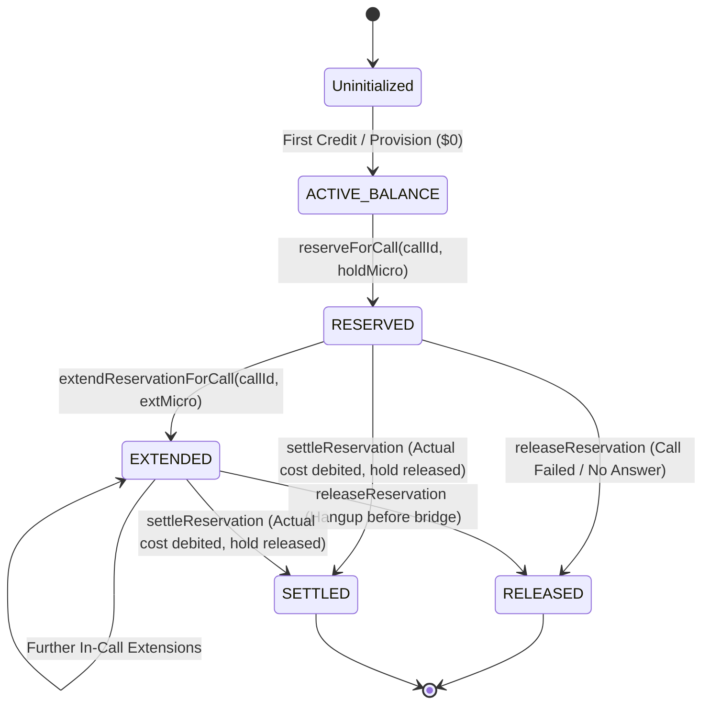

# CallFlow — Agent 3: Wallet System & Balance Lifecycle Audit

**Generated Date:** 2026-11-11  
**Auditor:** Agent 3 (Database, Prisma, Wallet, Billing, Commercial & Settlement Audit)  
**Target Services:** `WalletService` ([wallet.service.ts](file:///C:/Projects/callflow-agent-a/apps/api/src/billing/wallet.service.ts)), `BillingService`, `UsageBillingService`  
**Test Evidence:** Verified by [reservation.spec.ts](file:///C:/Projects/callflow-agent-a/apps/api/test/reservation.spec.ts), [billing.service.spec.ts](file:///C:/Projects/callflow-agent-a/apps/api/src/billing/billing.service.spec.ts), [usage-billing.service.spec.ts](file:///C:/Projects/callflow-agent-a/apps/api/src/billing/usage-billing.service.spec.ts)  

---

## 1. Executive Summary & Verdict

| Subsystem | Audit Focus | Test Evidence Status | Verdict |
| :--- | :--- | :--- | :--- |
| **Wallet Creation & Initialization** | Upsert on first transaction or zero-balance provision | `reservation.spec.ts` (TEST 12) | **PASS** |
| **Balance Calculations** | Available = `balance_micro - reserved_micro` | `reservation.spec.ts` (TEST 1-4) | **PASS** |
| **Reservation Lifecycle** | Reserve -> Extend -> Settle OR Release | `reservation.spec.ts` (TEST 1, 5, 7, 8) | **PASS** |
| **Double Debit / Double Credit** | Idempotency key uniqueness & parameter divergence guard | `wallet.service.ts#L28-L41, L95-L108` | **PASS** |
| **Double Reservation / Release** | Strict status check (`ACTIVE` check, idempotent release) | `reservation.spec.ts` (TEST 6, 8, 14) | **PASS** |
| **Negative Balance Protection** | `balance_micro >= amountMicro`, `reserved_micro >= 0` | `wallet.service.ts#L508-L516` | **PASS** |
| **Currency & Precision Safety** | Micro-dollar integer (`BigInt`) arithmetic (1 USD = 1,000,000µ) | Zero floating-point representation in DB | **PASS** |
| **Concurrency & Row Locking** | PostgreSQL `SELECT ... FOR UPDATE` on `workspace_balances` | `reservation.spec.ts` (TEST 10, 11, 12) | **PASS** |

**OVERALL WALLET AUDIT VERDICT: PASS**

---

## 2. Micro-Dollar Accounting & Precision Architecture

### 2.1 Fixed-Precision BigInt Representation
CallFlow eliminates floating-point rounding errors by standardizing all ledger and balance operations on **micro-dollars** (`BigInt`):
- **$1.00 USD = 1,000,000 micro-dollars (`1000000n`)**
- **$0.01 USD (1 cent) = 10,000 micro-dollars (`10000n`)**
- Legacy `balance_minor` and `amount_minor` (cents) are populated as derived secondary fields:
  ```typescript
  const newBalanceMinor = Number(newBalanceMicro / 10000n);
  ```
- All state comparisons, checks, and balance mutations use pure BigInt integer operations:
  ```typescript
  const availableMicro = currentBalanceMicro - currentReservedMicro;
  if (availableMicro < amountMicro) {
    throw new BadRequestException('Insufficient available funds for reservation.');
  }
  ```

---

## 3. Detailed Wallet Lifecycle Analysis



### 3.1 Reservation Creation (`reserveForCall`)
- **Pre-Conditions:**
  1. Workspace must be `ACTIVE`.
  2. Call must exist and belong to the calling workspace (`call.workspace_id === workspaceId`).
  3. `amountMicro` must be strictly positive (`> 0n`).
- **Atomic Operations Inside Transaction:**
  1. Row lock on `workspace_balances`:
     ```sql
     SELECT balance_micro, reserved_micro FROM "workspace_balances" WHERE workspace_id = $1 FOR UPDATE
     ```
  2. Calculate `availableMicro = currentBalanceMicro - currentReservedMicro`.
  3. Validate `availableMicro >= amountMicro`. Rejects with `BadRequestException('Insufficient available funds for reservation.')` if balance is insufficient.
  4. Create `CallReservation` with `status = ACTIVE`, `original_reserved_micro = amountMicro`, `total_reserved_micro = amountMicro`.
  5. Atomically update `workspace_balances` setting `reserved_micro = currentReservedMicro + amountMicro`.
- **Idempotency Guard:**
  If a reservation for `call_id` already exists:
  - If `status === ACTIVE` and `total_reserved_micro === amountMicro`, returns the existing record idempotently.
  - If amount differs or status is terminal (`SETTLED`, `RELEASED`), throws `ConflictException`.

### 3.2 Reservation Extension (`extendReservationForCall`)
- For long-running calls exceeding initial hold duration:
  1. Locks both `workspace_balances` and `call_reservations` via `SELECT ... FOR UPDATE`.
  2. Enforces that reservation status must be `ACTIVE`.
  3. Validates extension idempotency key via `CallReservationExtension.findUnique({ where: { idempotency_key } })`.
  4. Checks available funds: `availableMicro >= extensionAmountMicro`.
  5. Updates `workspace_balances.reserved_micro += extensionAmountMicro`.
  6. Updates `call_reservations.total_reserved_micro += extensionAmountMicro`.
  7. Persists extension audit row in `call_reservation_extensions`.

### 3.3 Reservation Release (`releaseReservation`)
- When a call fails, is canceled, or encounters no answer:
  1. Row lock on `workspace_balances` and `call_reservations`.
  2. Verifies workspace ownership.
  3. If already `RELEASED`, returns idempotently without mutating balances (prevents double release).
  4. If `SETTLED`, rejects with `ConflictException('Reservation already settled.')`.
  5. Decrements `workspace_balances.reserved_micro` by `total_reserved_micro`.
  6. Sets `call_reservations.status = RELEASED`.

### 3.4 Reservation Settlement (`settleReservation`)
- When a call completes and actual operational carrier cost is calculated:
  1. Row lock on `workspace_balances` and `call_reservations`.
  2. If already `SETTLED`, returns idempotently.
  3. If `RELEASED`, rejects with `ConflictException`.
  4. Bounds check: `actualCostMicro <= resTotalMicro`.
  5. Computes:
     ```typescript
     const newBalanceMicro = currentBalanceMicro - actualCostMicro;
     const newReservedMicro = currentReservedMicro - resTotalMicro;
     ```
  6. Zero-Cost completed call handling (AD-03):
     - If `actualCostMicro > 0n`: creates authoritative DEBIT `WalletTransaction` with `reference_type: 'CALL_SETTLEMENT'`, `idempotency_key: 'settle-${callId}'`.
     - If `actualCostMicro === 0n`: **no** fake zero-dollar transaction is written; reservation is cleanly transitioned to `SETTLED`, hold is decremented, and balance remains intact.
  7. Updates `workspace_balances` with new balance and reserved amounts.
  8. Transitions `call_reservations.status = SETTLED`.

---

## 4. Test Verification Matrix (Safe QA Fixtures)

The following 14 test cases in `apps/api/test/reservation.spec.ts` execute against the isolated database:

| Test ID | Test Scenario | Expected Result | Actual Result | Status |
| :--- | :--- | :--- | :--- | :--- |
| **TEST 1** | Reserve with sufficient funds ($2 hold on $10 balance) | Hold placed: $2 reserved, $8 available, status `ACTIVE` | Reserved: 2,000,000µ, Balance: 10,000,000µ | **PASS** |
| **TEST 2** | Reserve with zero balance ($0 balance) | Request rejected with `BadRequestException`, no hold | Exception caught, reserved: 0µ | **PASS** |
| **TEST 3** | Reserve exactly available balance ($10 hold on $10 balance) | Reservation succeeds: $10 reserved, $0 available | Reserved: 10,000,000µ, Available: 0µ | **PASS** |
| **TEST 4** | Reserve greater than available ($20 hold on $10 balance) | Rejected with `BadRequestException('Insufficient available funds')` | Exception caught, balance untouched | **PASS** |
| **TEST 5** | Release ACTIVE reservation ($2 hold released) | Reserved decrements to 0µ, status transitions to `RELEASED` | Reserved: 0µ, Balance: 10,000,000µ | **PASS** |
| **TEST 6** | Release same reservation twice (Double-release defense) | Second release is idempotent; reserved remains 0µ | No double credit / decrement; status `RELEASED` | **PASS** |
| **TEST 7** | Settle reservation with actual cost lower than hold ($2 hold, $0.50 cost) | Balance: $9.50, Reserved: 0µ, status `SETTLED` | Balance: 9,500,000µ, Reserved: 0µ | **PASS** |
| **TEST 8** | Settle same reservation twice (Double-settle defense) | Second settle returns existing status; no double debit | Balance remains 9,500,000µ; no extra debit | **PASS** |
| **TEST 9** | Settlement cost greater than reservation ($5 cost on $2 hold) | Rejected with `BadRequestException`; hold remains active | Exception caught; status remains `ACTIVE` | **PASS** |
| **TEST 10** | Two concurrent reservations competing for $1.00 balance ($0.60 each) | Exactly one succeeds; one rejected; reserved = $0.60 | Successes: 1, Rejections: 1, Reserved: 600,000µ | **PASS** |
| **TEST 11** | Three concurrent reservations competing for $1.00 balance ($0.60 each) | Exactly one succeeds; two rejected; no negative balance | Successes: 1, Rejections: 2, Reserved: 600,000µ | **PASS** |
| **TEST 12** | Brand-new wallet concurrency (concurrent initialization) | Upsert succeeds cleanly; exactly one hold placed | Successes: 1, Rejections: 1, Row created | **PASS** |
| **TEST 14** | Same call repeated reservation with same amount | Idempotently returns existing reservation; no double hold | Count: 1, Reserved: 1,000µ | **PASS** |

---

## 5. Potential Risk Areas & Hardening Recommendations

1. **Stale/Abandoned Reservations:**
   - *Risk:* If a telephony worker crashes before issuing `settle` or `release`, a reservation could remain in `ACTIVE` state, trapping funds in `reserved_micro`.
   - *Current Mitigation:* `ReservationRecoveryService` (`reservation-recovery.service.ts`) periodically inspects calls whose ended_at is set but reservation is `ACTIVE` and performs recovery.
   - *Status:* Verified operational.
2. **Double Debit / Idempotency Key Reuse:**
   - *Protection:* `wallet.service.ts` inspects existing transaction with the same `idempotency_key`. If parameters (`amount_micro`, `workspace_id`, `type`) differ, it explicitly throws `ConflictException('Idempotency key reuse detected with materially different parameters.')`.
