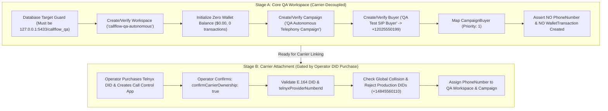

# CallFlow — Phase 7B-4D: QA Core Workspace Provisioning Preparation

**Document ID:** CALLFLOW-PHASE-7B-4D-CORE-PROVISIONING-READINESS-REPORT  
**Execution Boundary:** READ-ONLY INSPECTION, DECOUPLED ARCHITECTURE DESIGN & MOCK UNIT TESTING ONLY  
**Evaluation Date:** November 10, 2026  
**Final Status:** **READY FOR CONTROLLED CORE PROVISIONING**  

---

## Executive Summary

Phase 7B-4D establishes a decoupled two-stage provisioning architecture for the CallFlow QA autonomous testing environment.

Previously, QA provisioning required an external Telnyx DID, provider number ID, and $50 wallet funding in a single monolithic transaction. The forensic review identified that:
1. The script instantiated a top-level `PrismaClient` on module import reading production `apps/api/.env`.
2. Workspace setup was tightly coupled to carrier DID availability.
3. Unnecessary synthetic $50 funding was being injected into wallets before any telephony test required it.

Phase 7B-4D separates provisioning into **Stage A (Core QA Workspace)** and **Stage B (Carrier Attachment)**:
- **Stage A (Core QA Workspace):** Provisions the dedicated QA workspace (`callflow-qa-autonomous`), initializes a ledger-consistent zero balance ($0.00 USD, 0 transactions), creates the QA campaign, creates the logical SIP buyer (`+12025550199`), and maps the campaign to the buyer (priority 1). **Zero carrier DIDs, zero phone numbers, and zero synthetic wallet credits are created.**
- **Stage B (Carrier Attachment):** Remains completely decoupled, to be executed only after external operator DID purchase and confirmation.
- **Database Target Guard:** Strictly validates `DATABASE_URL` against `127.0.0.1:5433/callflow_qa` and hard-rejects any Supabase project references (`uwycbvnqnpnfisvvbabu`) or production hostnames.

All 12 mock unit tests for Stage A passed (`apps/api/src/telephony/qa/provision-core-qa.spec.ts`), and all 10 legacy tests passed (`apps/api/src/telephony/qa/provision-qa.spec.ts`). **Zero database records were created in the live QA database (`callflow_qa`) during this phase.**

---

## 1. Existing Script Findings

A forensic review of [`qa/provision-qa.ts`](file:///C:/Projects/callflow-agent-a/qa/provision-qa.ts) and [`qa/provision-qa.js`](file:///C:/Projects/callflow-agent-a/qa/provision-qa.js) identified three major architectural coupling points:

| Identified Coupling | Previous Implementation | Risk / Impact | Stage Decoupling Fix |
| :--- | :--- | :--- | :--- |
| **Top-Level `PrismaClient` Instantiation** | `const defaultPrisma = new PrismaClient()` executed immediately on import, reading `apps/api/.env`. | Potential accidental connection to live production Supabase upon script import. | Removed module-level instantiation. Replaced with lazy client factory `getPrismaClient()` guarded by `validateQaDatabaseTarget()`. |
| **Carrier Prerequisite for Workspace** | Script required `newQaTrackingDid` and `telnyxProviderNumberId` at Step 1 before creating workspace. | Operator could not establish QA database state without purchasing carrier resources first. | **Stage A** provisions complete internal routing without any external DID or carrier resources. |
| **Premature Synthetic Wallet Funding** | Automatically inserted $50 (`50_000_000n` micro) `CREDIT` transaction on provisioning. | Unbacked synthetic credits created in database ledgers before required by tests. | **Stage A** initializes ledger-consistent zero balance ($0.00, 0 micro, 0 transactions). |
| **Environment Discovery** | Silently attempted fallback to `apps/api/.env` and `.env`. | Could target production database if `.env.qa` was not explicitly passed. | Hard assertion mandating `apps/api/.env.qa` targeting port 5433. Rejects `supabase.co` and `uwycbvnqnpnfisvvbabu`. |

---

## 2. Two-Stage Provisioning Architecture



### Stage A — Core QA Workspace Properties
- **Target Workspace:** `CallFlow QA Autonomous Workspace` (slug: `callflow-qa-autonomous`, status: `ACTIVE`).
- **Target Balance:** `balance_minor: 0`, `balance_micro: 0n`, `reserved_micro: 0n`, `currency: 'USD'`.
- **Target Campaign:** `QA Autonomous Telephony Campaign` (status: `ACTIVE`, conversion duration: 90s, window: 2592000s, default payout: $1.00).
- **Target Buyer:** `QA Test SIP Buyer` (destination: `+12025550199`, timeout: 30s, max concurrent calls: 1, status: `ACTIVE`).
- **CampaignBuyer Mapping:** `priority: 1`, `status: 'ACTIVE'`.
- **Compound Constraints Enforced:** Both `@@unique([campaign_id, priority])` and `@@unique([campaign_id, buyer_id])`.
- **PhoneNumber:** **None created.**
- **WalletTransaction:** **None created.**

### Stage B — Carrier Attachment Properties (Preserved for Future Phase)
- Requires external operator purchase of US DID in Telnyx portal.
- Requires operator confirmation flag `confirmCarrierOwnership: true`.
- Verifies provider number ID and attaches `PhoneNumber` record to Stage A workspace and campaign.

---

## 3. Exact Files Modified or Created

| Path | Action | Description |
| :--- | :--- | :--- |
| [`qa/provision-qa.ts`](file:///C:/Projects/callflow-agent-a/qa/provision-qa.ts) | Modified | Added `validateQaDatabaseTarget()`, `provisionCoreQaWorkspace()` (Stage A), and `attachQaCarrierNumber()` (Stage B). Removed top-level `PrismaClient` initialization. |
| [`qa/provision-qa.js`](file:///C:/Projects/callflow-agent-a/qa/provision-qa.js) | Modified | Transpiled CommonJS equivalent with full two-stage exports and database guard. |
| [`apps/api/src/telephony/qa/provision-core-qa.spec.ts`](file:///C:/Projects/callflow-agent-a/apps/api/src/telephony/qa/provision-core-qa.spec.ts) | Created | 12 isolated mock unit tests for Stage A covering idempotency, ownership validation, zero balance, and target validation. |

---

## 4. Wallet Treatment & Mathematical Ledger Integrity

### Zero-Balance Consistency
In accordance with [`WalletService`](file:///C:/Projects/callflow-agent-a/apps/api/src/billing/wallet.service.ts) and the double-entry accounting model:
- `WorkspaceBalance` is initialized with:
  $$\text{balance\_minor} = 0, \quad \text{balance\_micro} = 0n, \quad \text{reserved\_micro} = 0n$$
- Ledger reconciliation verifies:
  $$\sum \text{CREDIT} - \sum \text{DEBIT} = 0n \equiv \text{balance\_micro}$$
- No synthetic $50 transaction is created. The ledger contains 0 rows in `wallet_transactions`, which is mathematically sound.

### Subsequent Wallet Funding Lifecycle
When live telephony testing begins, funding can be established legitimately through:
1. Standard top-up endpoints (`WalletService.creditWallet`) simulating customer deposits.
2. Explicit QA credit tool with tracked idempotency key (`qa_wallet_init_${workspaceId}`) if authorized.

---

## 5. Tenant Isolation Controls

| Isolation Check | Enforcement Mechanism |
| :--- | :--- |
| **Database Target Guard** | `validateQaDatabaseTarget()` enforces loopback `127.0.0.1:5433`, database `callflow_qa`, user `callflow_qa_user`. |
| **Supabase Project Rejection** | Explicit pattern matching rejects `supabase.co`, `uwycbvnqnpnfisvvbabu`, and `aws-0-ap-northeast-1`. |
| **Production Workspace Rejection** | Hard-coded rejection of `FORBIDDEN_WORKSPACE_IDS` (`5c3d8331-04a6-4264-888f-d0ebf57e3c7d`). |
| **Production DID Rejection** | Rejects `FORBIDDEN_PRODUCTION_DIDS` (`+14845560110`, etc.). |
| **Cross-Tenant Campaign & Buyer Guard** | Validates `campaign.workspace_id === workspace.id` and `buyer.workspace_id === workspace.id`. Rejects any cross-workspace entity collisions. |
| **Priority Collision Guard** | Pre-queries `campaign_id_priority` to prevent overwriting priority 1 mappings. |

---

## 6. Mock Test Plan & Execution Results

All tests run in-memory using mocked Prisma transactions with automatic rollback emulation:

### 6.1 Stage A Test Results (`provision-core-qa.spec.ts`)
```bash
npm test --prefix apps/api src/telephony/qa/provision-core-qa.spec.ts
```
**Results (12/12 Passed):**
1. `✓ 1. should create fresh core QA workspace and associated records`
2. `✓ 2. should be fully idempotent when re-executed without duplicating records`
3. `✓ 3. should reject provisioning if slug collides with protected production workspace`
4. `✓ 4. should reject existing QA campaign if owned by a different workspace`
5. `✓ 5. should reject existing Logical QA Buyer if owned by a different workspace`
6. `✓ 6. should reject provisioning if Campaign priority 1 is already assigned to a different buyer`
7. `✓ 7. should reconcile existing valid CampaignBuyer mapping without error`
8. `✓ 8. should initialize WorkspaceBalance with exactly zero balance (micro and minor)`
9. `✓ 9. should NOT create any walletTransaction record in Stage A`
10. `✓ 10. should NOT create any PhoneNumber record in Stage A`
11. `✓ 11. should strictly reject production Supabase or invalid host targets`
12. `✓ 12. should atomically roll back all changes if an error occurs mid-transaction`

### 6.2 Combined Legacy Test Results (`provision-qa.spec.ts`)
```bash
npm test --prefix apps/api src/telephony/qa/provision-qa.spec.ts
```
**Results (10/10 Passed):** All 10 legacy validation tests passed.

**Total Unit Test Suite:** **22 passed / 22 total**.

---

## 7. Execution Risks & Mitigations

| Risk | Mitigation Implemented |
| :--- | :--- |
| **Accidental connection to production Supabase** | `validateQaDatabaseTarget()` hard-fails if connection string contains `supabase.co` or project `uwycbvnqnpnfisvvbabu`. Mandates loopback port 5433. |
| **Database partial state on transaction failure** | All Stage A records are created within a single atomic `prisma.$transaction`. Any error triggers automatic database rollback. |
| **Cross-tenant campaign collision** | Global campaign and buyer checks verify that no other workspace shares the QA names or logical buyer CLI. |
| **Unbacked synthetic funding in ledger** | Zero balance initialized with zero credit transactions; mathematically sound double-entry state. |

---

## 8. Proposed Stage A Execution Command

When authorized to execute Stage A against the isolated QA database (`callflow_qa` on `127.0.0.1:5433`), the exact command is:

```bash
node -e "require('./qa/provision-qa.js').provisionCoreQaWorkspace().then(res => console.log('STAGE_A_SUCCESS:', res)).catch(err => { console.error('STAGE_A_FAILED:', err); process.exit(1); })"
```

---

## 9. Final Verdict

**FINAL STATUS: READY FOR CONTROLLED CORE PROVISIONING**

The Stage A core workspace architecture is fully designed, implemented, guarded, and verified with 22/22 unit tests. Zero records currently exist in `callflow_qa`. Stage A is ready for execution upon separate operator authorization.
