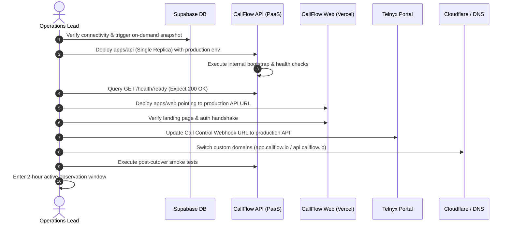

# CallFlow — Part 3.4.1: Production Deployment Runbook & Operational Cutover Guide

**Project:** CallFlow  
**Scope:** Controlled Production Cutover, Verification, and Post-Cutover Rollback  
**Git Branch:** `agent/reporting-backend-fix`  
**Execution Authorization:** **PLANNING ONLY — DO NOT EXECUTE WITHOUT EXPLICIT APPROVAL**

---

## 1. Pre-Deployment Readiness Checklist

Before initiating production cutover, the operator and lead engineer must verify all pre-flight conditions:

- [ ] **1.1 Codebase Integrity:**
  - Branch `agent/reporting-backend-fix` is clean, all tests passing.
  - Non-destructive production builds verified:
    - `apps/api`: `npm run build` exits `0`.
    - `apps/web`: `npm run build` exits `0`.
    - Prisma: `npx prisma generate` exits `0`.
- [ ] **1.2 Database Pre-Flight:**
  - Target Supabase database (`uwycbvnqnpnfisvvbabu`) confirmed at 43 tables, 8,311 baseline rows, 0 orphaned foreign keys.
  - Verified local database backup exists: `backups/calltracking_mvp_pre_import_2026-11-06T18-45-27-394Z.dump`.
  - Staging cutover verified: Part 3.2 and Part 3.3 passed with zero runtime errors.
- [ ] **1.3 Environment Variables & Secrets:**
  - `DATABASE_URL` configured with port `6543` and `?pgbouncer=true`.
  - `DIRECT_URL` configured with port `5432`.
  - Production `JWT_SECRET` and `SUPABASE_URL` staged in cloud secrets manager.
  - Production `TELNYX_API_KEY`, `TELNYX_PUBLIC_KEY`, and `TELNYX_CALL_CONTROL_APP_ID` staged.
  - Production `SMTP_*` email credentials staged.
  - `WEBHOOK_ENCRYPTION_KEY` (32 chars) staged.
- [ ] **1.4 Single-Replica Worker Constraint:**
  - Cloud deployment orchestrator (Render / Railway / ECS) configured with **`replicas: 1`** to prevent duplicate background worker execution.

---

## 2. Step-by-Step Deployment Sequence



### Step 2.1: Supabase Pre-Cutover Snapshot
1. Navigate to the Supabase Project Dashboard (`uwycbvnqnpnfisvvbabu`) ➔ Database ➔ Backups.
2. Confirm latest automated daily backup is complete.
3. If on Pro tier, verify Point-in-Time Recovery (PITR) is active and timestamp recorded.

### Step 2.2: Backend API Deployment (`apps/api`)
1. Deploy `apps/api` to selected container platform (e.g., Render / Railway / ECS).
2. Ensure container startup command is:
   ```bash
   node dist/main.js
   ```
3. Set environment variable: `PORT=3000` (or platform default).
4. Verify initial container logs:
   - `Nest application successfully started`
   - `CommercialFinalizationService: Starting Commercial Finalization worker loop (10m interval)...`
   - `ReservationRecoveryService: Starting Reservation Recovery worker loop...`

### Step 2.3: Backend Health Probe Verification
Before directing traffic, query the API health probes:
```bash
# 1. Liveness check
curl -f https://<api-host>/health/live
# Expected: {"status":"healthy"}

# 2. Readiness check (Database connectivity)
curl -f https://<api-host>/health/ready
# Expected: {"status":"healthy","services":{"database":{"status":"up"}}}
```
> [!CAUTION]
> If `GET /health/ready` returns anything other than `200 OK` with database `up`, **HALT DEPLOYMENT IMMEDIATELY**. Do not proceed to frontend deployment.

### Step 2.4: Frontend UI Deployment (`apps/web`)
1. Deploy `apps/web` to Vercel (or Amplify).
2. Configure environment variables:
   - `NEXT_PUBLIC_SUPABASE_URL=https://uwycbvnqnpnfisvvbabu.supabase.co`
   - `NEXT_PUBLIC_SUPABASE_ANON_KEY=<anon_key>`
   - `NEXT_PUBLIC_API_URL=https://<api-domain>`
   - `NEXT_PUBLIC_SITE_URL=https://<web-domain>`
3. Verify public landing page renders without React hydration errors.

### Step 2.5: Telephony Webhook Configuration
1. Log into the Telnyx Mission Control Portal.
2. Navigate to Call Control Applications ➔ Select Production CallFlow App.
3. Update Webhook URL:
   - From: `https://<staging-or-ngrok-domain>/webhooks/telnyx`
   - To: `https://api.callflow.io/webhooks/telnyx`
4. Confirm webhook API version is `v2`.

### Step 2.6: Production DNS Routing
1. Update DNS CNAME / A records in Cloudflare / Route 53:
   - `api.callflow.io` ➔ Point to API PaaS endpoint.
   - `app.callflow.io` ➔ Point to Vercel edge.
2. Verify TLS certificate issuance and HTTPS handshake on both domains.

---

## 3. Post-Deployment Verification & Smoke Tests

Execute the following automated verification suite against `https://api.callflow.io`:

### 3.1 Health & Database Status
```bash
curl -i https://api.callflow.io/health
```
- **Expected:** HTTP 200 OK, `database: { status: 'up' }`.

### 3.2 Authenticated Route Handshake
Using an authorized admin JWT token:
```bash
curl -i -H "Authorization: Bearer <TOKEN>" https://api.callflow.io/workspaces
```
- **Expected:** HTTP 200 OK, returns authorized workspace list.

### 3.3 Multi-Tenant Isolation Enforcement
Request a foreign workspace ID with User 1 credentials:
```bash
curl -i -H "Authorization: Bearer <TOKEN_USER_1>" https://api.callflow.io/workspaces/<FOREIGN_WORKSPACE_ID>
```
- **Expected:** **HTTP 403 Forbidden** strictly returned by `WorkspaceGuard`.

### 3.4 Inbound Webhook Test Call
1. Place a test inbound phone call to a provisioned CallFlow tracking number.
2. Verify call routing to configured destination number.
3. Verify webhook processing in logs:
   `LOG [TelnyxWebhookController] Received event: call.initiated`
   `LOG [TelnyxWebhookController] Received event: call.answered`
   `LOG [TelnyxWebhookController] Received event: call.hangup`
4. Verify call record created in database without balance corruption.

---

## 4. Observation Window Protocol

Upon traffic activation, maintain an active **2-hour operational observation window**:
1. **Background Worker Sweeps:**
   - At T+5m, T+10m, T+15m: Check logs for clean `ReservationRecoveryService` sweep.
   - At T+10m, T+20m: Check logs for clean `CommercialFinalizationService` sweep.
   - Verify zero unhandled promise rejections or database deadlocks.
2. **Database Connection Pool:**
   - Monitor Supabase active connections on port 6543.
   - Ensure prepared statement errors (`42P05`) remain at 0.
3. **Error Budget:**
   - 5xx error rate must remain `< 0.1%`.

---

## 5. Post-Cutover Rollback Plan

### 5.1 Rollback Trigger Conditions
Rollback must be triggered immediately if any of the following occur within the observation window:
1. **Telephony Black Hole:** Inbound phone calls fail to route or drop prematurely due to API errors.
2. **Database Pool Failure:** Supabase PgBouncer crashes or rejects connections with persistent connection refusal.
3. **Wallet Balance Corruption:** Inaccurate debits, negative wallet balances, or unhandled exceptions in `WalletService`.
4. **Tenant Data Leakage:** Any cross-tenant data exposure or RBAC failure.
5. **Persistent 5xx Spike:** API 5xx error rate exceeds `1.0%` for more than 5 consecutive minutes.

---

### 5.2 Critical Data Reconciliation Policy (Post-Cutover Writes)

> [!CRITICAL]
> **DO NOT BLINDLY REVERT DATABASE TO OLD BACKUP OR LOCAL HOST.**
> During the cutover window, real customer calls, reservations, billing events, and audit logs may have been written to Supabase.
> Simply pointing the API back to the local database or restoring an old backup will cause **permanent data loss** of all new calls and customer financial transactions.

#### Data Preservation & Extraction Procedure:
If a critical application failure requires rolling back the API, execute the following data preservation steps before cutting off traffic:

1. **Record Rollback Cutoff Timestamp ($T_{cutoff}$):**
   ```bash
   export ROLLBACK_CUTOFF_TIME=$(date -u +"%Y-%m-%dT%H:%M:%SZ")
   ```
2. **Stop Incoming Telephony Webhooks:**
   - Immediately switch the Telnyx Call Control Webhook URL to an emergency failover endpoint or IVR holding queue to pause new incoming calls.
3. **Extract New Transactional Records Created on Supabase:**
   Extract all rows created after cutover start time ($T_{cutover}$):
   ```sql
   -- Identify delta records created during the live window
   SELECT 'calls' AS table_name, count(*) FROM calls WHERE created_at >= '2026-11-07 00:00:00+00'
   UNION ALL
   SELECT 'call_events', count(*) FROM call_events WHERE created_at >= '2026-11-07 00:00:00+00'
   UNION ALL
   SELECT 'wallet_transactions', count(*) FROM wallet_transactions WHERE created_at >= '2026-11-07 00:00:00+00'
   UNION ALL
   SELECT 'call_reservations', count(*) FROM call_reservations WHERE created_at >= '2026-11-07 00:00:00+00';
   ```
4. **Dump Delta Records to File:**
   Export new records as JSON/SQL before any database teardown or schema alteration.

---

### 5.3 Application & Infrastructure Rollback Sequence

1. **Step 1 — Codebase Reversion:**
   - If the issue is an application bug introduced in the deployment:
     - In Render / Railway / Vercel, click **Redeploy Previous Version** (instant rollback of container image / build artifact).
     - Keep database pointing to Supabase.
2. **Step 2 — Database Connection Rollback (Only if Supabase Infrastructure Outage):**
   - If Supabase itself is unreachable and traffic must be temporarily routed back to an emergency local/standby PostgreSQL:
     - Update `apps/api` environment variable `DATABASE_URL` to the standby connection string.
     - Restart API.
     - Replay extracted delta records into the standby database once online.
3. **Step 3 — DNS / Traffic Reversion:**
   - Revert DNS CNAME records to prior stable infrastructure or failover maintenance page.
4. **Step 4 — Verification:**
   - Verify health probe `GET /health` returns `200 OK` on the reverted system.
   - Send incident notification to engineering lead.
