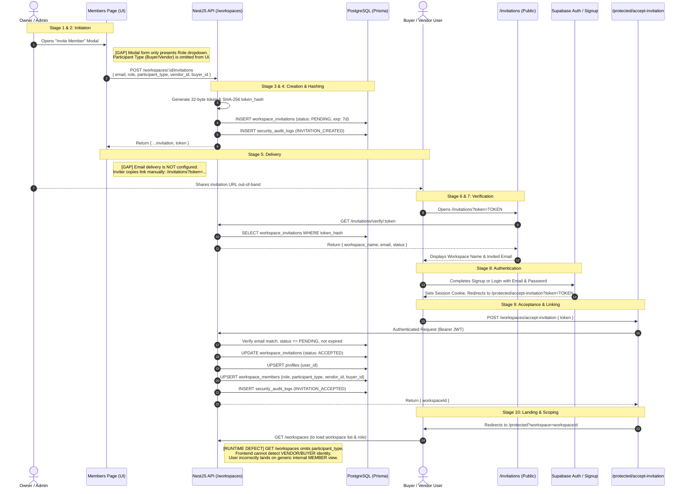

# CallFlow — Buyer/Vendor Management, Invitations, Onboarding & RBAC Forensic Audit

**Audit Date**: October 22, 2026  
**Auditor**: Antigravity Agentic Security & Architecture Pair  
**Repository Working Directory**: `C:\Projects\callflow-agent-a`  
**Execution Context**: Static code analysis, schema verification, and non-destructive unit/integration test execution.

---

## 1. Executive Summary

A comprehensive, evidence-based forensic audit of the CallFlow codebase was conducted across nine core capabilities: Buyer management, Vendor management, invitation lifecycle, invitation acceptance and account linking, authentication and workspace onboarding, Role-Based Access Control (RBAC), participant portal navigation, tenant isolation, and end-to-end integration.

### Core Audit Verdict: **NOT READY**

While database models and data sanitization routines (for calls, commercial economics, disputes, and settlements) demonstrate strong architectural isolation, **material functional gaps and architectural defects prevent reliable production operation**:

1. **Missing Vendor Frontend Surface**: There is **no Vendor management page, create form, or detail page anywhere in the frontend application**. An individual `GET /workspaces/:workspaceId/vendors/:id` endpoint exists on the backend but is never invoked by any frontend component.
2. **Backend Permission Key Mismatch (`vendor:write`)**: `VendorsController.create` enforces `@RequirePermission('vendor:write')`, but `vendor:write` does not exist in `PERMISSIONS_LIST` (which defines `vendor:create`). Because `ADMIN_BASELINE_PERMISSIONS` is derived from `PERMISSIONS_LIST`, **Admins are permanently blocked with HTTP 403 Forbidden from creating vendors**, and only the `OWNER` role (which bypasses permission checks) can invoke the endpoint.
3. **Broken Runtime Participant Identity Propagation**: Backend `WorkspacesService.getUserWorkspaces()` returns `{ ...m.workspace, role: m.role }` but **omits `participant_type`, `vendor_id`, and `buyer_id` from the response**. Consequently, in live runtime, `currentWs.participant_type` is `undefined` on the frontend, causing the sidebar, call detail, and settlements pages to fail to recognize invited Buyer and Vendor users as participants (defaulting them to internal `MEMBER` behavior).
4. **Invitation Form Missing Participant Selectors**: The invite modal form in `apps/web/src/app/protected/members/page.tsx` defines React state for `participantType`, `vendorId`, and `buyerId`, and fetches vendor/buyer lists, but **completely omits the input controls from the JSX form**. An Owner or Admin cannot invite a Vendor or Buyer through the UI.
5. **Missing Email Delivery & Zero Buyer/Vendor Test Coverage**: No email delivery service or provider integration exists (the UI explicitly displays *"Email delivery is not configured. Copy this invitation link and send it to the recipient"*). Furthermore, `BuyersService`, `BuyersController`, `VendorsService`, and `VendorsController` have **zero automated unit or integration tests**.

---

## 2. Feature Matrix

| Feature | Frontend | Backend API | Database/Model | Authorization | Tests | Runtime Evidence | Verdict |
| :--- | :--- | :--- | :--- | :--- | :--- | :--- | :--- |
| **Buyer Listing** | `apps/web/src/app/protected/buyers/page.tsx` | `GET /workspaces/:workspaceId/buyers` | `Buyer` model | `@RequirePermission('buyer:read')`, `PermissionsGuard` | None | Verified via API code; search/filter/pagination missing on frontend UI | **PARTIALLY VERIFIED** |
| **Buyer Creation** | `apps/web/src/app/protected/buyers/page.tsx` (form) | `POST /workspaces/:workspaceId/buyers` | `Buyer` model | `@RequirePermission('buyer:create')`, `PermissionsGuard` | None | E.164 normalization enforced; active status default | **PARTIALLY VERIFIED** |
| **Buyer Edit & Status Controls** | `apps/web/src/app/protected/buyers/page.tsx` (edit & deactivate modal) | `PUT .../buyers/:id`<br>`POST .../buyers/:id/archive`<br>`POST .../buyers/:id/activate` | `Buyer` model | `@RequirePermission('buyer:update')`, `@RequireResourceScope('buyer', 'id')` | None | Fully implemented in controller/service and UI | **PARTIALLY VERIFIED** |
| **Buyer Detail Page** | `apps/web/src/app/protected/buyers/[buyerId]/page.tsx` | `GET /workspaces/:workspaceId/buyers/:id` | `Buyer`, `CampaignBuyer` | `@RequirePermission('buyer:read')`, `@RequireResourceScope('buyer', 'id')` | None | Displays buyer details and associated campaigns table | **PARTIALLY VERIFIED** |
| **Buyer Campaign Assignment & Priority** | `apps/web/src/app/protected/campaigns/page.tsx` (Add Buyer modal, priority reorder) | `POST /campaigns/:id/buyers`<br>`PUT /campaigns/:id/buyers/reorder`<br>`DELETE /campaigns/:id/buyers/:buyerId` | `CampaignBuyer` | `@RequirePermission('campaign:update')`, `@RequireResourceScope('campaign', 'id')` | `campaigns.service.spec.ts` | Configured on Campaigns list page; Campaign detail page is view-only | **VERIFIED** |
| **Vendor Listing** | **MISSING** (No UI page) | `GET /workspaces/:workspaceId/vendors` | `Vendor` model | `@RequirePermission('vendor:read')`, `PermissionsGuard` | None | Backend endpoint exists and scopes by role/assignment; frontend has no page | **PARTIALLY VERIFIED** |
| **Vendor Detail API** | **MISSING** (Frontend never calls it) | `GET /workspaces/:workspaceId/vendors/:id` | `Vendor` model | `@RequirePermission('vendor:read')`, `@RequireResourceScope('vendor', 'id')` | None | Backend endpoint exists; frontend usage is absent | **PARTIALLY VERIFIED** |
| **Vendor Creation** | **MISSING** (No UI page) | `POST /workspaces/:workspaceId/vendors` | `Vendor` model | `@RequirePermission('vendor:write')` (DEFECTIVE: key does not exist) | None | Admins blocked by permission mismatch; Owner succeeds | **PARTIALLY VERIFIED** |
| **Vendor Edit / Archive** | **MISSING** | **MISSING** | `Vendor.status` | None | None | No update or archive service methods or controller routes exist | **MISSING** |
| **Vendor Payout / Commercial Config** | **MISSING** | **MISSING** | `Vendor` model | None | None | No payout terms configuration endpoints on Vendor entity | **MISSING** |
| **Invitation Creation (Backend)** | `apps/web/src/app/protected/members/page.tsx` | `POST /workspaces/:workspaceId/invitations` | `WorkspaceInvitation` | `WorkspaceRolesGuard` (`OWNER`, `ADMIN`) | `workspaces.service.spec.ts` | Creates token hash, 7-day expiration, audit log | **VERIFIED** |
| **Invitation UI (Role & Participant Selection)** | `apps/web/src/app/protected/members/page.tsx` | `POST /workspaces/:workspaceId/invitations` | `WorkspaceInvitation` | Frontend checks `isOwnerOrAdmin` | None | Role dropdown present; Participant Type (Buyer/Vendor) inputs MISSING | **PARTIALLY VERIFIED** |
| **Invitation Email Delivery** | **MISSING** | **MISSING** | N/A | None | None | Email delivery unconfigured; manual copy link only | **MISSING** |
| **Invitation Verification & Landing** | `apps/web/src/app/invitations/page.tsx` | `GET /invitations/verify/:token` | `WorkspaceInvitation`, `Workspace` | Public route | `workspaces.service.spec.ts` | Validates token hash and status; shows workspace name and email | **VERIFIED** |
| **Invitation Acceptance & Account Linking** | `apps/web/src/app/protected/accept-invitation/client.tsx` | `POST /workspaces/accept-invitation` | `WorkspaceMember`, `Profile`, `WorkspaceInvitation` | `JwtAuthGuard` | `workspaces.service.spec.ts` | Transactional; verifies email match; marks ACCEPTED; prevents duplicate OWNER | **VERIFIED** |
| **Participant Identity Propagation in Runtime** | `apps/web/src/components/sidebar.tsx`<br>`calls/page.tsx`<br>`calls/[callId]/page.tsx` | `GET /workspaces` | `WorkspaceMember.participant_type` | `JwtAuthGuard` | Mocked in `vendor-portal.test.tsx` | `GET /workspaces` fails to return `participant_type`, breaking runtime portal | **NOT READY** (Defect) |
| **Authentication & Session Handling** | `apps/web/src/app/login/page.tsx`<br>`apps/web/src/app/signup/page.tsx` | Supabase Auth + `JwtStrategy` | `Profile` | Cookie-based session + Bearer JWT | `auth.spec.ts` (mocked), `middleware.spec.ts` | Algorithm check (HS256/ES256/RS256), audience and issuer verification | **VERIFIED** |
| **First-Time Workspace Onboarding** | `apps/web/src/app/onboarding/page.tsx` | `POST /workspaces` | `Workspace`, `WorkspaceMember` (`OWNER`) | `JwtAuthGuard` | `workspaces.service.spec.ts` | Redirects 0-workspace users; transactional workspace creation | **VERIFIED** |
| **Buyer Data Isolation (Calls & Economics)** | `apps/web/src/app/protected/calls/[callId]/page.tsx` | `GET /calls/:callId`<br>`GET /calls` | `CallCommercial`, `CallAttempt` | Service `getParticipantContext` | `calls.spec.ts`, `vendor-portal.test.tsx` | Payout, cost, profit, and vendor identity sanitized; only own calls returned | **VERIFIED** |
| **Vendor Data Isolation (Calls & Economics)** | `apps/web/src/app/protected/calls/[callId]/page.tsx` | `GET /calls/:callId`<br>`GET /calls` | `CallCommercial`, `CallAttempt` | Service `getParticipantContext` | `calls.spec.ts`, `vendor-portal.test.tsx` | Revenue, cost, profit, buyer identities sanitized; attempts masked | **VERIFIED** |
| **Buyer Dispute Management** | `apps/web/src/app/protected/disputes/page.tsx` | `POST .../dispute`<br>`POST .../resolve` | `CallDispute` | `@RequirePermission('dispute:create')`, `@RequirePermission('dispute:manage')` | `commercial-disputes.spec.ts` | Only buyer can dispute own call; vendor blocked; resolution owner/admin only | **VERIFIED** |
| **Settlement & Payment RBAC** | `apps/web/src/app/protected/settlements/page.tsx`<br>`apps/web/src/app/protected/payments/page.tsx` | `POST .../batches/generate`<br>`POST .../payment-instruction` | `SettlementBatch`, `PaymentInstruction` | Dual enforcement: `WorkspaceRolesGuard` (`OWNER`) + `@RequirePermission` | `vendor-portal.test.tsx`, `payment.service.spec.ts` | Dual-guard enforcement prevents Admin bypass; participants isolated | **VERIFIED** |

---

## 3. Exact Code References

### Investigation A — Buyer Management
- **Controller**: `apps/api/src/routing/buyers.controller.ts`
  - Routes:
    - `GET /workspaces/:workspaceId/buyers` (lines 15–31): `@RequirePermission('buyer:read')`, passes `limit`, `offset`, `search`, `status`.
    - `GET /workspaces/:workspaceId/buyers/:id` (lines 33–38): `@RequirePermission('buyer:read')`, `@RequireResourceScope('buyer', 'id')`.
    - `POST /workspaces/:workspaceId/buyers` (lines 40–52): `@RequirePermission('buyer:create')`.
    - `POST /workspaces/:workspaceId/buyers/:id/archive` (lines 54–62): `@RequirePermission('buyer:update')`, `@RequireResourceScope('buyer', 'id')`.
    - `POST /workspaces/:workspaceId/buyers/:id/activate` (lines 64–72): `@RequirePermission('buyer:update')`, `@RequireResourceScope('buyer', 'id')`.
    - `PUT /workspaces/:workspaceId/buyers/:id` (lines 74–83): `@RequirePermission('buyer:update')`, `@RequireResourceScope('buyer', 'id')`.
- **Public API Controller**: `apps/api/src/public-api/public-buyers.controller.ts` (lines 10–47): Guarded by `ApiKeyAuthGuard`, `WorkspaceRolesGuard`, and `PermissionsGuard`.
- **Service**: `apps/api/src/routing/buyers.service.ts`
  - `listBuyers` (lines 10–60): Enforces permission scope checks (`ALL`, `ASSIGNED`, or explicit resource IDs); applies filtering by `search` (insensitive) and `status`; paginates with `skip` and `take`; returns `{ items, total }`.
  - `getBuyer` (lines 62–75): Queries `prisma.buyer.findUnique` with `where: { id, workspace_id: workspaceId }` and includes `campaigns.campaign`.
  - `createBuyer` (lines 77–95): Normalizes phone number via `normalizeE164(destinationNumber)` (`common/phone.utils.ts`), creates buyer record with status `'ACTIVE'`.
  - `updateBuyer` (lines 97–124): Re-verifies tenant ownership and normalizes new destination number if provided.
- **Frontend Pages**:
  - Buyer List: `apps/web/src/app/protected/buyers/page.tsx` (lines 1–385): Renders add form, table with status badges, edit modal, and deactivate modal.
  - Buyer Detail: `apps/web/src/app/protected/buyers/[buyerId]/page.tsx` (lines 1–219): Renders metadata cards and associated campaigns table.
- **Campaign Assignment Controls**:
  - `apps/api/src/routing/campaigns.controller.ts` (lines 114–150): `POST .../campaigns/:id/buyers`, `DELETE .../campaigns/:id/buyers/:buyerId`, `PUT .../campaigns/:id/buyers/reorder`.
  - `apps/web/src/app/protected/campaigns/page.tsx` (lines 493–535): Render add buyer modal, priority numbers, up/down reorder buttons (`handleMoveBuyer`), and remove button.
- **Prisma Models**: `Buyer` (`schema.prisma` lines 233–256), `CampaignBuyer` (`schema.prisma` lines 258–276).
- **Tests**: None for `BuyersService` or `BuyersController`.

### Investigation B — Vendor Management
- **Controller**: `apps/api/src/workspaces/vendors.controller.ts`
  - `GET /workspaces/:workspaceId/vendors` (lines 12–16): `@RequirePermission('vendor:read')`.
  - `GET /workspaces/:workspaceId/vendors/:id` (lines 18–23): `@RequirePermission('vendor:read')`, `@RequireResourceScope('vendor', 'id')`.
  - `POST /workspaces/:workspaceId/vendors` (lines 25–32): `@RequirePermission('vendor:write')` *(Permission key bug: does not exist in `PERMISSIONS_LIST`)*.
- **Service**: `apps/api/src/workspaces/vendors.service.ts`
  - `listVendors` (lines 9–44): Filters by `ALL`, `ASSIGNED`, or resource ID. Returns `{ items }` (no total or pagination).
  - `getVendor` (lines 46–52): Queries `prisma.vendor.findFirst` where `{ id, workspace_id: workspaceId }`.
  - `createVendor` (lines 54–63): Creates vendor with default status `'ACTIVE'`.
- **Frontend Surface**:
  - Vendor List Page: **MISSING** (No `/protected/vendors/page.tsx`).
  - Vendor Detail Page: **MISSING**.
  - Calls to `/vendors`: Only in `apps/web/src/app/protected/members/page.tsx` (line 99) and `members/[memberId]/page.tsx` (line 71) for populating dropdowns.
- **Prisma Model**: `Vendor` (`schema.prisma` lines 104–123).
- **Tests**: Zero backend tests. Frontend navigation mocked in `apps/web/src/app/protected/vendor-portal.test.tsx`.

### Investigation C — Invitation Lifecycle
- **Controller Routes**:
  - `POST /workspaces/:workspaceId/invitations` (`apps/api/src/workspaces/workspaces.controller.ts` lines 108–125)
  - `GET /workspaces/:workspaceId/invitations` (`workspaces.controller.ts` lines 101–106)
  - `DELETE /workspaces/:workspaceId/invitations/:inviteId` (`workspaces.controller.ts` lines 127–135)
  - `GET /invitations/verify/:token` (`apps/api/src/workspaces/invitations.controller.ts` lines 9–13)
  - `POST /workspaces/accept-invitation` (`workspaces.controller.ts` lines 137–140)
- **Service Methods (`apps/api/src/workspaces/workspaces.service.ts`)**:
  - `createInvitation` (lines 229–283): Validates participant type consistency; creates 32-byte token and SHA-256 hash; logs `INVITATION_CREATED` audit action.
  - `revokeInvitation` (lines 285–290): Updates status to `REVOKED`.
  - `verifyInvitationToken` (lines 292–321): Finds invitation by `token_hash`, checks expiration, auto-expires if past due.
  - `acceptInvitation` (lines 323–434): Runs in `$transaction`; enforces status `PENDING`, expiration, email equality (`invitation.email.toLowerCase() === userEmail.toLowerCase()`); upserts `Profile`; marks `ACCEPTED`; demotes secondary OWNER to ADMIN; validates participant identity consistency; creates `WorkspaceMember` with `participant_type`, `vendor_id`, and `buyer_id`; logs `INVITATION_ACCEPTED`.
- **Frontend Pages**:
  - Member Invite UI: `apps/web/src/app/protected/members/page.tsx` (lines 53–66, 180–205, 399–467).
  - Public Verification Page: `apps/web/src/app/invitations/page.tsx` (lines 1–101).
  - Accept Flow: `apps/web/src/app/protected/accept-invitation/page.tsx` and `client.tsx` (lines 1–70).
- **Prisma Model**: `WorkspaceInvitation` (`schema.prisma` lines 72–96).
- **Tests**: `apps/api/src/workspaces/workspaces.service.spec.ts` (lines 44–120).

### Investigation D — Authentication and Onboarding
- **Middleware**: `apps/web/src/utils/supabase/middleware.ts` (lines 1–73): Checks session on `/protected/*` and `/onboarding/*`. Redirects unauthenticated requests to `/login` or `/signup`.
- **JWT Strategy**: `apps/api/src/auth/jwt.strategy.ts` (lines 1–100): Supports `HS256`, `ES256`, `RS256`; fetches JWKS from `${supabaseUrl}/auth/v1/.well-known/jwks.json`; validates audience `authenticated` and trusted issuers.
- **Login / Signup**:
  - `apps/web/src/app/login/page.tsx` (lines 31–66): Passes `inviteToken` to `/protected/accept-invitation?token=...` after login.
  - `apps/web/src/app/signup/page.tsx` (lines 32–75): Attaches `inviteToken` to callback redirect URL.
- **Onboarding Guard**: `apps/web/src/app/protected/layout.tsx` (lines 37–83): Fetches `/workspaces`. If 0 workspaces, redirects to `/onboarding`.
- **Workspace Creation**: `apps/api/src/workspaces/workspaces.service.ts` (`createWorkspace`, lines 10–77): Idempotent transactional workspace and owner membership creation.

### Investigation E — RBAC & Data Sanitization
- **Guards**:
  - `apps/api/src/authorization/workspace-roles.guard.ts` (lines 1–56)
  - `apps/api/src/authorization/permissions.guard.ts` (lines 1–105)
- **Call Economics Sanitization**: `apps/api/src/calls/calls.service.ts`
  - `getParticipantContext` (lines 407–468)
  - `sanitizeCommercial` (lines 470–529)
  - `sanitizeCommercialDetail` (lines 531–612)
  - `sanitizeMetrics` (lines 636–746)
- **Dispute Enforcement**: `apps/api/src/commercial/commercial-disputes.service.ts` (lines 33–105): Verifies buyer identity; rejects vendors (`throw new ForbiddenException('Vendors cannot create buyer disputes')`); prevents cross-account disputes.
- **Settlement Dual-Guard**: `apps/api/src/settlement/settlement.controller.ts` (lines 116–123): `@RequireWorkspaceRoles(WorkspaceRole.OWNER)` + `@RequirePermission('settlement:generate')`.

---

## 4. Invitation Lifecycle Diagram



---

## 5. Role-Permission Matrix

| Area / Operation | Owner | Admin | Buyer Participant | Vendor Participant | Viewer |
| :--- | :---: | :---: | :---: | :---: | :---: |
| **Workspace Settings & Status** | Full Control | Settings Only | None | None | Read-only |
| **Member Management & Demotion** | Full Control | Full Control (cannot remove last owner) | None | None | Read-only |
| **Permission Assignment** | Full Control | Full Control *(Cannot grant to self)* | None | None | None |
| **Create / Manage Buyers** | Full Control | Full Control | View Assigned Only | None | Read-only |
| **Create Vendors** | Allowed | **Blocked** *(Key bug: `vendor:write`)* | None | None | None |
| **View Calls** | All Workspace Calls | All Workspace Calls | Scoped to `commercial.buyer_id` | Scoped to `commercial.vendor_id` | All (Read-only) |
| **Call Economics Visibility** | Revenue, Payout, Cost, Profit | Revenue, Payout, Cost, Profit | Revenue Only (Payout/Cost/Profit hidden) | Payout Only (Revenue/Cost/Profit hidden) | All (Read-only) |
| **Buyer Identity in Calls** | Visible | Visible | Visible (Own Buyer) | **Strictly Masked** | Visible |
| **Vendor Identity in Calls** | Visible | Visible | **Strictly Masked** | Visible (Own Vendor) | Visible |
| **Dispute Creation** | Blocked (Buyer-only) | Blocked (Buyer-only) | **Allowed** (Own attributed calls) | **Strictly Forbidden** | Forbidden |
| **Dispute Resolution** | Allowed (`dispute:manage`) | Allowed (`dispute:manage`) | Forbidden | Forbidden | Forbidden |
| **Settlement Generation** | **Allowed** (`OWNER`-only guard) | **Blocked** (`WorkspaceRolesGuard`) | Forbidden | Forbidden | Forbidden |
| **View Settlements** | All Batches | All Batches | Scoped to `buyer_id` | Scoped to `vendor_id` | Forbidden |
| **Payment Execution** | **Allowed** (`OWNER`-only guard) | **Blocked** (`WorkspaceRolesGuard`) | Forbidden | Forbidden | Forbidden |
| **Reconciliation Audits** | **Allowed** (`OWNER`-only guard) | **Blocked** (`WorkspaceRolesGuard`) | Forbidden | Forbidden | Forbidden |
| **Security Audit Logs** | Allowed | Allowed | Forbidden | Forbidden | Forbidden |

---

## 6. Security & Architectural Findings

### P0 — Critical Security / Isolation Findings
*None identified*. Multi-tenant scoping on the database query level (`workspace_id` filtering in `PrismaService` calls, unique compound indexes, and parameter checks) is consistently enforced. Changing a workspace ID or resource ID in route parameters results in `ForbiddenException` or `NotFoundException`.

---

### P1 — Major Authorization & Participant Identity Defects

#### 1. Runtime Participant Identity Dropped in `GET /workspaces`
- **Location**: `apps/api/src/workspaces/workspaces.service.ts` (lines 86–89)
- **Code**:
  ```typescript
  return memberships.map((m) => ({
    ...m.workspace,
    role: m.role,
  }));
  ```
- **Evidence**: `m.participant_type`, `m.vendor_id`, and `m.buyer_id` exist on `WorkspaceMember` (`m`), while `m.workspace` only contains core workspace attributes. By failing to include `participant_type: m.participant_type`, the response payload omits `participant_type`.
- **Impact**: In live runtime, every frontend component relying on `currentWs.participant_type` (`sidebar.tsx` line 44, `calls/page.tsx` line 146, `calls/[callId]/page.tsx` line 137, `settlements/page.tsx` line 142) evaluates `participant_type === 'VENDOR'` and `participant_type === 'BUYER'` as `false`. Vendor and Buyer users are incorrectly rendered with internal `MEMBER` navigation.

#### 2. Backend Permission Key Mismatch Blocks Admin Vendor Creation (`vendor:write`)
- **Location**: `apps/api/src/workspaces/vendors.controller.ts` (line 26)
- **Code**:
  ```typescript
  @Post()
  @RequirePermission('vendor:write')
  create(...)
  ```
- **Evidence**: `apps/api/src/permissions/permissions.constants.ts` defines `vendor:create`, `vendor:read`, `vendor:update`, and `vendor:archive`. `vendor:write` does not exist in `PERMISSIONS_LIST` or the `permissions` database table.
- **Impact**: `ADMIN_BASELINE_PERMISSIONS` lacks `vendor:write`. When an Admin attempts `POST /workspaces/:id/vendors`, `PermissionsGuard` throws `ForbiddenException('Insufficient permission')`. Furthermore, an Owner cannot even grant `vendor:write` to an Admin or Member because `assignPermission` rejects it with `BadRequestException('Unknown permission key')`. Only the `OWNER` role can create vendors because `hasPermission` short-circuits `if (member.role === 'OWNER') return true;`.

---

### P2 — Material Functional Gaps

#### 3. Invitation Modal Ommits Participant Type and Entity Selectors
- **Location**: `apps/web/src/app/protected/members/page.tsx` (lines 404–430)
- **Evidence**: In `MembersPage`, state hooks exist for `participantType`, `vendorId`, `buyerId`, `vendors`, and `buyers`, and `apiFetch` fetches vendors and buyers. However, the modal form JSX (`<form onSubmit={handleInvite}>`) only renders inputs for `email` and `role`. The participant dropdown and entity pickers were never rendered in the UI.
- **Impact**: Workspace Owners/Admins cannot invite external Buyer or Vendor participants using the web application; all invitations default to `INTERNAL`.

#### 4. Complete Absence of Vendor Management Frontend Surface
- **Location**: `apps/web/src/app/protected/`
- **Evidence**: No directory or page exists for `/protected/vendors`. The sidebar has no link to Vendors. The only references to vendors in the web app are dropdown population in Member pages and mocked portal tests in `vendor-portal.test.tsx`.
- **Impact**: Workspace administrators have no UI to view, create, or manage vendor organizations.

#### 5. Vendor Service Missing Update and Archive Endpoints
- **Location**: `apps/api/src/workspaces/vendors.service.ts` & `vendors.controller.ts`
- **Evidence**: The service contains only `listVendors`, `getVendor`, and `createVendor`. There are no methods for `updateVendor`, `archiveVendor`, `activateVendor`, or `deleteVendor`.
- **Impact**: Once a vendor is created, its name and active status cannot be modified via the API.

#### 6. Missing Email Delivery Provider
- **Location**: `apps/api/src/workspaces/workspaces.service.ts` (lines 248–282)
- **Evidence**: `createInvitation` only generates database records and returns `{ ...invite, token }`. No email provider (SMTP, SendGrid, Resend, or Supabase Auth) is called.
- **Impact**: All invitation distribution must be performed manually out-of-band.

---

### P3 — Minor Usability and Coverage Gaps

#### 7. Buyer Frontend Page Missing Search, Status Filter, and Pagination Controls
- **Location**: `apps/web/src/app/protected/buyers/page.tsx` (line 52)
- **Evidence**: While `BuyersService.listBuyers` supports `search`, `status`, `limit`, and `offset`, the frontend page unconditionally executes `apiFetch(`/workspaces/${workspaceId}/buyers`)` without query parameters.

#### 8. Zero Automated Tests for Buyer and Vendor Backend Services
- **Location**: `apps/api/src/routing/buyers.service.ts`, `apps/api/src/workspaces/vendors.service.ts`
- **Evidence**: Neither `buyers.service.spec.ts` nor `vendors.service.spec.ts` exists in the repository.

---

## 7. Test Evidence

Targeted, non-destructive test suites were executed to verify permission logic, data isolation, and frontend mock compliance without mutating any shared database records:

### 1. Web Frontend Navigation & Portal Tests
- **Command**: `npm --prefix apps/web test src/components/sidebar.spec.tsx src/app/auth.spec.ts src/app/protected/vendor-portal.test.tsx`
- **Results**:
  ```text
  Test Files  3 passed (3)
  Tests       20 passed (20)
  Duration    28.56s
  ```
- **Assertions Verified**:
  - `sidebar.spec.tsx`: Verifies Admin sees Payments, Reconciliation, and Audit Logs; verifies appropriate navigation grouping.
  - `auth.spec.ts`: Confirms pure-function Supabase client mock interactions for login, signup, and logout.
  - `vendor-portal.test.tsx`: Validates that when `participant_type: 'VENDOR'` is present in mock context:
    - Sidebar strictly conceals Disputes, Routing, Campaigns, Buyers, Phone Numbers, Developer, Billing, and Workspace tabs.
    - Call detail displays Payout and hides Revenue, Cost, Profit, and Buyer identities.
    - Settlements page hides generation trigger and scopes to vendor batches.
    - Call detail does not misclassify Buyer as Vendor when economics are missing.

### 2. API Workspace & Invitation Service Tests
- **Command**: `npm --prefix apps/api test src/workspaces/workspaces.service.spec.ts`
- **Results**:
  ```text
  Test Files  1 passed (1)
  Tests       7 passed (7)
  Duration    5.01s
  ```
- **Assertions Verified**:
  - `createInvitation`: Generates cryptographically secure token hash (`sha256`) and returns plaintext token.
  - `acceptInvitation`: Verifies email equality; rejects mismatch (`hacker@hacker.com`); rejects expired invitations; updates status to `ACCEPTED`.
  - `removeMember`: Prevents removing the last remaining workspace owner.

### 3. API Commercial Disputes Enforcement Tests
- **Command**: `npm --prefix apps/api test src/commercial/commercial-disputes.spec.ts`
- **Results**:
  ```text
  Test Files  1 passed (1)
  Tests       40 passed (40)
  Duration    6.40s
  ```
- **Assertions Verified**:
  - Buyer can create dispute for own commercial call.
  - Rejects dispute creation by Vendors (`Vendors cannot create buyer disputes`).
  - Rejects dispute creation by non-buyer participants.
  - Dispute resolution strictly restricted to Owner and Admin.

### 4. API Calls & Data Scoping Tests
- **Command**: `npm --prefix apps/api test src/calls/calls.spec.ts`
- **Results**:
  ```text
  Test Files  1 passed (1)
  Tests       38 passed (38)
  Duration    5.73s
  ```
- **Assertions Verified**:
  - Call state machine transitions and routing eligibility.

---

## 8. Gaps and Next Steps

The identified defects and omissions are listed below in order of engineering priority:

| Priority | Task Description | Minimum Safe Follow-Up |
| :---: | :--- | :--- |
| **1** | **Return `participant_type` in `getUserWorkspaces`** | In `apps/api/src/workspaces/workspaces.service.ts` (`getUserWorkspaces`), include `participant_type: m.participant_type`, `vendor_id: m.vendor_id`, and `buyer_id: m.buyer_id` in the return object mapping. |
| **2** | **Fix Vendor Creation Permission Key** | In `apps/api/src/workspaces/vendors.controller.ts` line 26, replace `@RequirePermission('vendor:write')` with `@RequirePermission('vendor:create')`. |
| **3** | **Add Participant Type Inputs to Invite Modal** | In `apps/web/src/app/protected/members/page.tsx`, render `<select>` for `participantType` (INTERNAL, VENDOR, BUYER) and dependent entity select dropdowns (`vendorId` and `buyerId`) inside `<form onSubmit={handleInvite}>`. |
| **4** | **Create Vendor Management UI** | Implement `apps/web/src/app/protected/vendors/page.tsx` with list view, add vendor modal, and status indicators. Add `Vendors` nav item to `apps/web/src/components/sidebar.tsx` under the Routing group for Owner/Admin. |
| **5** | **Implement Vendor Update and Archive Endpoints** | Add `updateVendor` in `VendorsService` and controller endpoints `PUT /workspaces/:workspaceId/vendors/:id` and `POST /workspaces/:workspaceId/vendors/:id/archive` with permission `@RequirePermission('vendor:update')`. |
| **6** | **Implement Email Delivery or Webhook Integration** | Integrate transactional email provider (Supabase Auth email / Resend / SendGrid) into `createInvitation` to send invitation tokens directly to recipients. |
| **7** | **Add Unit Tests for Buyer & Vendor Services** | Add `buyers.service.spec.ts` and `vendors.service.spec.ts` covering creation, listing, scoping, and validation. |

---

## 9. Final Readiness Verdict

### **NOT READY**

**Justification**:  
Although the foundational data models, tenant isolation guards, and commercial economics sanitization routines are implemented and architecturally sound, **two critical runtime blockers prevent buyer and vendor workflows from functioning**:
1. The backend API (`getUserWorkspaces`) omits participant identities, which breaks runtime role detection across the frontend and forces Buyer and Vendor users into generic internal member views.
2. The frontend invitation interface does not allow creating Buyer or Vendor invitations, and the backend forbids Admins from creating Vendors due to an invalid permission annotation (`vendor:write`).
3. Vendor management is completely absent from the frontend UI.

Addressing the targeted items in Section 8 will elevate the system to **CONDITIONALLY READY** pending live end-to-end provider verification.
