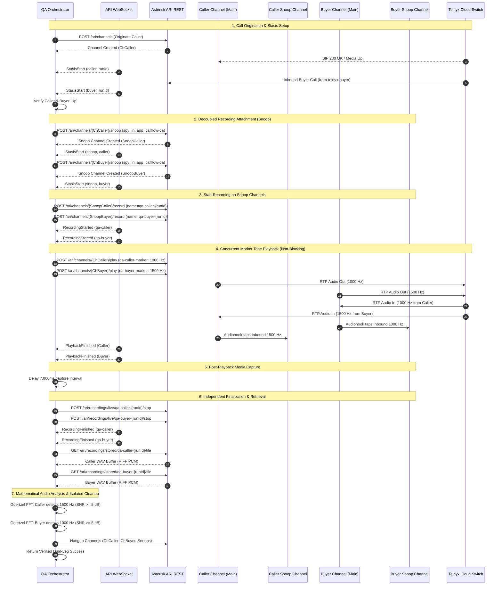

# CallFlow Phase 7B-10T: Recording Architecture Review & Decision
**Timestamp:** 2026-11-12T01:25:35Z  
**Phase:** 7B-10T (Buyer Native ARI Recording Lifecycle Repair & Dual-Leg Recording Reliability)  
**Deliverable:** Deliverable C (Stage C — Recording Architecture Review & Decision)

---

## 1. Executive Summary

Phase 7B-10S revealed that calling `recordChannel` directly on an active Asterisk Stasis channel monopolizes that channel's Stasis control thread inside `__ast_play_and_record`. This blocks any concurrent `playMedia` invocations on that same channel, causing race conditions, silence timeouts, and premature finalization of recordings.

This document evaluates four architectural options to decouple media playback from media capture, establishes an evaluation matrix against five mandatory criteria, and specifies the chosen architecture along with a formal state machine and sequence diagram.

---

## 2. Architecture Options Under Consideration

### Option 1: Direct Channel Recording with Playback-First Sequencing
- **Description:** Keep direct channel recording (`POST /ari/channels/{channelId}/record`), but sequence operations strictly: issue `playMedia` first, await playback completion, and only then start `recordChannel` (or vice versa).
- **Limitations:** Does not allow simultaneous full-duplex transmission and reception. Precludes testing continuous media flow while markers are actively playing.

### Option 2: Decoupled Channel Recording via Asterisk Snoop Channels (Chosen)
- **Description:** For each leg (caller and buyer), create a dedicated Snoop channel (`POST /ari/channels/{channelId}/snoop`) configured with `spy: in` (or `spy: both`) and `whisper: none`. The Snoop channel attaches an Asterisk `audiohook` to tap media non-intrusively.
- **Recording Mechanism:** The recording is initiated on the Snoop channel (`POST /ari/channels/{snoopChannelId}/record`).
- **Playback Mechanism:** The marker tones are injected directly into the main channel (`POST /ari/channels/{mainChannelId}/play`).
- **Key Advantage:** Main channel's Stasis control queue is never blocked by recording. Marker playback and media capture run concurrently without contention.

### Option 3: Asterisk Bridge-Level Recording
- **Description:** Place both caller and buyer channels into a local Asterisk bridge (`POST /ari/bridges`) and record the bridge (`POST /ari/bridges/{bridgeId}/record`).
- **Fatal Flaw:** In CallFlow's architecture, calls are bridged in the **Telnyx Cloud Switch** (via Telnyx Call Control `bridge` command). Asterisk only sees two independent SIP legs. A local Asterisk bridge would bypass the Telnyx cloud switch, distorting the QA test boundary and mixing both legs into a single combined file, destroying separate caller and buyer proof.

### Option 4: Staggered Cross-Leg Playback Injection
- **Description:** Maintain direct recording on leg A while leg B plays, then switch roles.
- **Limitations:** Complex orchestration, highly susceptible to timing jitter and network latency, double the required call duration (risking the 30-second watchdog limit).

---

## 3. Evaluation Against the 5 Mandatory Criteria

| Evaluation Criterion | Option 1: Sequential Direct | Option 2: Snoop Channels | Option 3: Bridge Recording | Option 4: Staggered Play |
| :--- | :---: | :---: | :---: | :---: |
| **1. Eliminates Mutex Contention between Record and Play** | ⚠️ Partial (Serializes, doesn't eliminate) | ✅ **Full (Completely decoupled threads)** | ⚠️ Partial | ⚠️ Partial |
| **2. Preserves Independent Caller & Buyer Recordings** | ✅ Yes | ✅ **Yes (Dedicated per-leg snoop files)** | ❌ No (Single mixed bridge file) | ✅ Yes |
| **3. Provides True Bidirectional Verification** | ⚠️ Compromised (Time-shifted) | ✅ **Full (Simultaneous full-duplex)** | ❌ No (Cannot isolate directional SNR) | ⚠️ Time-shifted |
| **4. Avoids Premature Termination on Silence** | ⚠️ Risky if bridge silent initially | ✅ **High (Audiohook continuously feeds frames)** | ⚠️ Unknown | ⚠️ Risky |
| **5. Operates Reliably under Docker NAT on Windows** | ✅ Yes | ✅ **Yes (Local Asterisk memory hook)** | ⚠️ Yes | ✅ Yes |

---

## 4. Architectural Decision: Option 2 (Decoupled Snoop Channels) with Direct Fallback

### Technical Rationale
1. **Zero Control Queue Blocking:** By attaching an Asterisk Snoop channel (`Snoop/PJSIP/...`), Asterisk attaches a passive `ast_audiohook` to the RTP media stream. The main channel's Stasis command queue remains 100% responsive, executing `playMedia` immediately without queuing behind recording.
2. **True Full-Duplex Capture:** While the main channel transmits the local marker tone out to the carrier, the Snoop channel continuously captures incoming carrier RTP without interruption.
3. **Strict Separation of Leg Lifecycles:** Caller and buyer legs each have an independent main channel ID, snoop channel ID, recording session, and state machine. A timeout or failure on one leg cannot deadlock or abort the other leg.

---

## 5. Dual-Leg Independent Recording State Machine

Each leg (`caller` and `buyer`) is tracked by an independent recording session state machine:

```
[ UNINITIALIZED ]
       │
       ▼  (Originate / Inbound Stasis entry)
[ STASIS_UP ]
       │
       ▼  (POST /ari/channels/{id}/snoop OR direct record)
[ ATTACHING ]
       │
       ▼  (ARI StasisStart for Snoop / RecordingStarted)
[ RECORDING_ACTIVE ] ◄────────┐
       │                      │ Simultaneous
       ▼  (POST playMedia)    │ Full-Duplex
[ PLAYBACK_ACTIVE ]           │
       │                      │
       ▼  (PlaybackFinished)  │
[ PLAYBACK_COMPLETED ] ───────┘
       │
       ▼  (Capture Interval Timer: 7,000ms)
[ CAPTURING ]
       │
       ▼  (Stop Recording Request)
[ STOP_REQUESTED ]
       │
       ▼  (RecordingFinished Event + REST Download)
[ FINALIZED ]
       │
       ▼  (Goertzel Tone + SNR + Duration Analysis)
[ VALIDATED ]
```

### State Transitions & Error Resilience
- If playback fails or times out on one leg, that leg transitions to `PLAYBACK_ERROR`, but the recording capture continues uninterrupted.
- If a channel terminates unexpectedly, Asterisk fires `RecordingFinished`, allowing the orchestrator to harvest whatever valid audio was recorded prior to hangup.
- Stop and cleanup operations are strictly idempotent and per-leg isolated.

---

## 6. Detailed Sequence Diagram for Dual-Leg Recording


